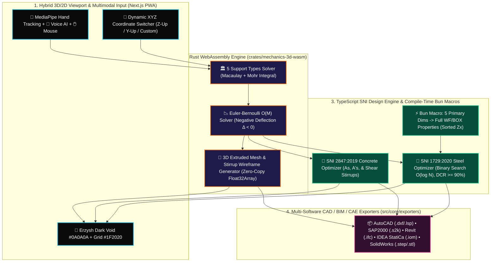

<div align="center">

<!-- FUTURISTIC SVG HERO HEADER -->


# 🏗️ Interactive 3D Beam Deflection & Structural Design Simulator

**Platform Rekayasa Struktur 3D/2D Interaktif untuk Simulasi Defleksi Balok & Optimasi Desain Penampang (Beton Bertulang SNI 2847:2019 & Baja Profil IWF/BOX SNI 1729:2020) dengan Multi-Format CAD/BIM/CAE Exporter**

_Dikembangkan oleh **Rizqi Lasheva Purnama Putra** — Dikendalikan secara real-time melalui gerakan tangan (MediaPipe Motion Capture), kursor, dan perintah suara AI di atas arsitektur **Next.js + Bun v1.4.4 + Rust WebAssembly (`wasm32-unknown-unknown`)** dengan dukungan **Adaptive PWA**._

<br />

<!-- ROW 1: LIVE DEPLOYMENT, RELEASE VERSION, &amp; AUTHOR -->
<p align="center">
<a href="https://erzysh-ibds.vercel.app">

</a>
<a href="https://github.com/Rilaptra/erzysh-IBDS/releases">

</a>
<a href="https://erzysh-ibds.vercel.app">

</a>
</p>

<!-- ROW 2: CORE TECH STACK -->
<p align="center">


</p>

<!-- ROW 3: CIVIL ENGINEERING &amp; CAD INTEROPERABILITY -->
<p align="center">


</p>

</div>

## 🌟 Ikhtisar Proyek (Overview)

> [!IMPORTANT]
> **Interactive 3D Beam Deflection & Structural Design Simulator (`IBDS/`)** adalah aplikasi rekayasa struktur masa depan berbasis web dan **Progressive Web App (PWA)** yang dirancang untuk mata kuliah **Aplikasi Komputer Teknik Sipil**. Aplikasi ini memadukan kecepatan komputasi **Rust WebAssembly (`wasm32-unknown-unknown`)** untuk menyimulasikan **lengkungan balok 3D tanpa distorsi penampang** dan **diagram gaya dalam 2D** pada **60–120 FPS**, dengan ketelitian algoritma optimasi penampang **Beton Bertulang (SNI 2847:2019)** serta **Baja Profil IWF & BOX (SNI 1729:2020)** di atas **Bun v1.4.4 Native Stack**.

> [!TIP]
> 🌐 **Akses Aplikasi & Portofolio:**
>
> - **Live Deployment (Vercel):** [https://erzysh-ibds.vercel.app](https://erzysh-ibds.vercel.app) _(Aktif & Siap Diakses)_

## ✨ 8 Kapabilitas Rekayasa Utama

### `01` · Panggung Visual Hybrid: Balok 3D Ekstrusi + Tumpuan & Grafik 2D (`#0A0A0A` Theme)

Dirancang di atas kanvas gelap presisi tinggi (**Erzysh Dark Void `#0A0A0A`** dengan grid ortogonal `#1F2020` dan pendaran _radial glow_ Teal/Cyan):

- **Visualisasi Balok Baja 3D (IWF & BOX):** Menarik (_extrude_) geometri penampang IWF (lengkap dengan lengkungan _fillet_ $r$) atau BOX dari ujung A ke ujung B mengikuti garis elastis lendutan **tanpa distorsi bentuk penampang (_no cross-section distortion_)**, diwarnai dengan gradasi kontur bergaya **SAP2000**.
- **Visualisasi Balok Beton Bertulang 3D (2 Sub-Mode Interaktif):**
  1. **Mode Solid + Potongan Ujung (_Solid + End Cross-Section_):** Menampilkan balok beton persegi panjang 3D yang melengkung mengikuti lendutan, dengan gambar detail potongan tulangan pokok dan sengkang pada permukaan ujung A dan B.
  2. **Mode Wireframe Kerangka Tulangan (_X-Ray Rebar & Stirrup Cage_):** Menampilkan selubung beton secara transparan (`opacity: 0.18`) untuk memperlihatkan susunan batang tulangan memanjang 3D serta barisan cincin sengkang tertutup di sepanjang bentang sesuai jarak spasi $s$ hasil optimasi.
- **Simbol Tumpuan 2D & HUD Defleksi:** Simbol tumpuan **Jepit, Sendi, dan Rol** dirender dalam vektor **2D** tajam (`#94A3B8` stroke, `#334155` fill), dilengkapi **Colorbar Legend** vertikal di **sisi kanan layar** dan kartu **Lendutan Maksimum ($\Delta\_{\max} < 0$)** di **kiri bawah layar**.

### `02` · Dukungan 5 Kategori Tumpuan (8 Variasi Orientasi), Lendutan Negatif ($\Delta < 0$), & Sumbu Dinamis $X\text{-}Y\text{-}Z$

- **5 Kategori Tumpuan Lengkap:** Mendukung tumpuan statis tertentu maupun statis tak tentu melalui metode singularitas Macaulay dan integral kompatibilitas Mohr di Rust WASM:
  1. **Kantilever** (`Jepit–Bebas` & `Bebas–Jepit`)
  2. **Sendi–Rol** (`Sendi–Rol` & `Rol–Sendi`)
  3. **Jepit–Jepit** (`Fixed–Fixed`)
  4. **Jepit–Rol** (`Jepit–Rol` & `Rol–Jepit`)
  5. **Jepit–Sendi** (`Jepit–Sendi` & `Sendi–Jepit`)
- **Konvensi Lendutan Negatif ($\Delta < 0$):** Sesuai kaidah kalkulus mekanika struktur, sumbu vertikal positif mengarah ke atas sehingga **lendutan akibat beban gravitasi ke bawah selalu bernilai negatif ($\Delta < 0$, misal `-14,20 mm`)**.
- **Koordinat Sumbu $X\text{-}Y\text{-}Z$ Dinamis (`Z-Up` / `Y-Up` / `Custom XYZ`):** Sumbu vertikal atas–bawah dapat diganti secara _real-time_ dari **$Y$ (`Y-Up` — standar WebGL/SolidWorks)** menjadi **$Z$ (`Z-Up` — standar SAP2000/Revit/AutoCAD)** lengkap dengan _3D Axis Gizmo_.

### `03` · Dual-Mode Pembebanan (Mode A: Gaya Eksternal vs Mode B: Gaya Dalam Langsung)

- **Mode A — Gaya Eksternal Interaktif _(Desktop)_:** Input panjang bentang ($L$), beban terpusat ($P$), beban merata ($q$), momen eksternal, serta kalkulasi otomatis berat sendiri (_self-weight_ dari $\gamma_{\text{material}} \cdot A$).
- **Mode B — Gaya Dalam Langsung _(Desktop & Android PWA)_:** Input langsung hasil analisis struktur terfaktor ($P_u, M_{ux}, M_{uy}, T_u, V_u, L$) tanpa harus memodelkan beban eksternal dari awal.

### `04` · Tiga Mode Visualisasi Diagram Gaya Dalam 2D (`SFD · NFD · BMD · TFD`)

Pengguna bebas memilih cara menampilkan diagram Gaya Geser (**SFD**), Gaya Aksial (**NFD**), Momen Lentur (**BMD**), dan Momen Torsi (**TFD**):

1. **Mode 1 — Bertumpuk Sejajar di As Balok (_In-Place Beam Axis Overlay_):** Digambar langsung menempel pada sumbu balok dengan _toggle_ aktif/nonaktif per diagram.
2. **Mode 2 — Sejajar Menurun secara Vertikal (_Stacked Vertical Charts_):** Disusun berurutan dari atas ke bawah tepat sejajar panjang bentang balok $L$.
3. **Mode 3 — Jendela Mengambang Khusus (_Dedicated Floating Window_):** Ditampilkan di dalam _Floating Window_ tersendiri yang dapat digeser bebas.

### `05` · Optimasi Penampang Beton (SNI 2847:2019) & Baja IWF/BOX (SNI 1729:2020)

| Modul Material                           | Fokus Optimasi & Standar Acuan                                                                                                                                                                                                                                                                                                                                      | Kompleksitas & Keunggulan Arsitektur                                                                                                                                                                                    |
| :--------------------------------------- | :------------------------------------------------------------------------------------------------------------------------------------------------------------------------------------------------------------------------------------------------------------------------------------------------------------------------------------------------------------------ | :---------------------------------------------------------------------------------------------------------------------------------------------------------------------------------------------------------------------- |
| 🧱 **Beton Bertulang (`SNI 2847:2019`)** | • Fokus murni menghitung **jumlah & diameter tulangan tarik ($A_s$) serta tekan ($A'\_s$) yang efisien** (Blok Whitney, cek $A_{s,\min}$, $\epsilon_t \ge 0,005$, & spasi bersih antar tulangan).<br>• Menghitung **diameter & jarak spasi sengkang geser ($s$)** berdasarkan gaya geser $V_u$ dan kuat geser beton standar $V_c = 0,17 \lambda \sqrt{f'_c} b_w d$. | Evaluasi langsung $O(D \cdot R)$ terhadap katalog tulangan BJTP 24/30 & BJTS 40/50/60 serta mutu beton $f'_c$ / $K\text{-xxx}$.                                                                                         |
| 🔩 **Profil Baja (`SNI 1729:2020`)**     | • Evaluasi 89 profil **IWF** & 23 profil **BOX (PSR)** pada mutu **BJ 34 s/d BJ 55**.<br>• Cek kelangsingan (Tabel B4.1b), Tekuk Torsi-Lateral / LTB (Bab F), interaksi biaxial (Pasal H1), dan torsi (Pasal H3) dengan target efisiensi **$0,90 \le M_u / \phi M_n \le 1,00$** serta filter $H_{\max} / W_{\max}$.                                                 | Katalog JSON hanya menyimpan **5 dimensi primer ($H, B, t_w, t_f, r$)**; seluruh properti ($A, I, S, Z, h_o, J, C_w, r_{ts}$) dihitung saat _build-time_ oleh **Bun Macro** & dicari via **Binary Search $O(\log N)$**. |

### `06` · Ekspor Multi-Format ke Software CAD, BIM, & CAE Industri

Profil dan balok yang dihasilkan dapat langsung diekspor mengikuti orientasi sumbu ($X, Y, Z$) aktif ke berbagai ekosistem _software_:

- **AutoCAD / Civil 3D / BricsCAD:** `.dxf` (2D Section dengan _bulge fillet_ eksak & 3D Mesh pada layer terpisah) serta `.lsp` (AutoLISP Script).
- **SAP2000 & ETABS:** `.s2k` (Model teks lengkap dengan Material, Frame Section, Joint Restraints 5 jenis tumpuan, & Frame Loads).
- **Autodesk Revit & Tekla Structures:** `.ifc` (Standar BIM `IFC4` — `IfcBeam`, `IfcIShapeProfileDef`, `IfcRectangleHollowProfileDef`, `IfcReinforcingBar`) & `.txt` (Revit Family Type Catalog).
- **IDEA StatiCa:** `.iom.xml` (IDEA Open Model XML beserta gaya dalam ekstrem), `.dxf` (Cross-Section), & `.ifc`.
- **SolidWorks / Inventor / Fusion 360 / ANSYS:** `.step` / `.stp` (`ISO 10303-21 AP214` B-Rep Solid) & `.stl` (3D Mesh termasuk bentuk balok terdefleksi).

### `07` · Sistem Interaksi Multimodal (Gestur Tangan, Mouse, & Suara AI)

- **Motion Capture Kursor Tangan (MediaPipe Hands):** Menggantikan mouse dengan 5 simbol kursor dinamis — ✋ `◎` (_Pointer_), 🤏 `⌖` (_Pinch Klik_), ✊ `▼` (_Tekan Beban Real-Time_), ☝️ `▸` (_Pointing Presisi_), dan ✌️ `▣` (_Geser Floating Window_).
- **Kontrol Suara Diskrit & AI Engineering Consultant:** Perintah suara bahasa natural yang diterjemahkan ke _Command Registry_ serta panel diskusi teknis bersama AI mengenai rasionalitas hasil optimasi SNI.

### `08` · Adaptive PWA Split & GA4 Custom Epoch Visitor Counter

- **Desktop Workstation vs Android Field Companion:** Mode Desktop memuat fitur penuh (3D Canvas, Mode A & B, 6 Floating Windows, Hand Tracking), sedangkan Mode Android PWA otomatis memisahkan bundle berat (_code-splitting_) menjadi kalkulator lapangan **Mode B + Optimasi SNI + AI Chat** yang ringan dan hemat baterai.
- **GA4 Visitor Flex Badge:** Menampilkan jumlah kunjungan sejak tanggal peluncuran yang dikonfigurasi (`HARDCODED_START_DATE`) menggunakan tanda tangan JWT `crypto.subtle` dan cache `Bun.hash` tanpa SDK berat.

## 🏛️ Arsitektur Sistem (Hybrid Rust WASM Opsi B + Bun v1.4.4)



## 📂 Struktur Repositori & Indeks Dokumentasi (`mdfiles/`)

Seluruh spesifikasi rekayasa di dalam folder [./mdfiles/](https://www.google.com/search?q=./mdfiles/) disusun secara modular dan diorkestrasi oleh skrip CLI [scripts/ai/step-context-bundler.ts](https://www.google.com/search?q=./scripts/ai/step-context-bundler.ts):

| File Spesifikasi di `mdfiles/`                                                                                                                             | Domain & Cakupan Bahasan                                                                                                                                                            |
| :--------------------------------------------------------------------------------------------------------------------------------------------------------- | :---------------------------------------------------------------------------------------------------------------------------------------------------------------------------------- |
| 📄 [bun\_v1\_4\_4\_architecture\_and\_context.md](https://www.google.com/search?q=./mdfiles/bun_v1_4_4_architecture_and_context.md)                        | Arsitektur Hybrid **Next.js + Bun v1.4.4 + Rust WASM (Opsi B)**, 20 Pilar Kualitas, _Branded Units_, _Strict Comment Policy_, & GA4 Counter.                                        |
| 📄 [final\_project\_file\_structure\_and\_preparation.md](https://www.google.com/search?q=./mdfiles/final_project_file_structure_and_preparation.md)       | Pohon struktur file produksi final (`IBDS/`), kontrak fungsi per modul, _environment variables_, dan automasi Git Hooks / AI Commit & Auto-Release.                                 |
| 📄 [step\_by\_step\_build\_roadmap.md](https://www.google.com/search?q=./mdfiles/step_by_step_build_roadmap.md)                                            | Pembagian **7 Tahap Pembangunan (Step 1–7)** beserta cara kerja generator otomatis `.tmp-step-context/step-0X/PROMPT.md`.                                                           |
| 📄 [structural\_mechanics\_and\_deflection\_solver\_spec.md](https://www.google.com/search?q=./mdfiles/structural_mechanics_and_deflection_solver_spec.md) | Rumus 5 jenis tumpuan (8 variasi), fungsi Macaulay & Integral Mohr, solver Euler-Bernoulli (**lendutan negatif $\Delta < 0$**), sumbu dinamis $X\text{-}Y\text{-}Z$, & ekstrusi 3D. |
| 📄 [steel\_wf\_box\_section\_geometry\_spec.md](https://www.google.com/search?q=./mdfiles/steel_wf_box_section_geometry_spec.md)                           | Rumus matematika resmi perhitungan properti penampang **IWF & BOX** ($A, W, I_x, I_y, r_x, r_y, S_x, S_y, Z_x, Z_y, h_o, J, C_w, r_{ts}, C$) dari dimensi primer.                   |
| 📄 [sni\_1729\_steel\_design\_specification.md](https://www.google.com/search?q=./mdfiles/sni_1729_steel_design_specification.md)                          | Spesifikasi LRFD **SNI 1729:2020** (Tabel B4.1b, LTB Bab F, Biaxial H1, Torsi H3) serta tabel dimensi primer 89 profil IWF & 23 profil BOX.                                         |
| 📄 [sni\_2847\_concrete\_design\_specification.md](https://www.google.com/search?q=./mdfiles/sni_2847_concrete_design_specification.md)                    | Spesifikasi **SNI 2847:2019** untuk optimasi jumlah & diameter tulangan lentur ($A_s, A'_s$) metode Whitney serta diameter & spasi sengkang geser ($V_c, V_s$).                     |
| 📄 [ui\_ux\_visual\_layout\_and\_interaction\_spec.md](https://www.google.com/search?q=./mdfiles/ui_ux_visual_layout_and_interaction_spec.md)              | Spesifikasi visual kanvas `#0A0A0A`, balok 3D (Baja & 2 Mode Beton), simbol tumpuan 2D, 3 mode diagram 2D, _Colorbar Legend_, & 6 _Floating Windows_.                               |
| 📄 [cad\_bim\_cae\_export\_specification.md](https://www.google.com/search?q=./mdfiles/cad_bim_cae_export_specification.md)                                | Spesifikasi generator file ekspor ke **AutoCAD (`.dxf`/`.lsp`)**, **SAP2000 (`.s2k`)**, **Revit (`.ifc`)**, **IDEA StatiCa (`.iom.xml`)**, dan **SolidWorks (`.step`/`.stl`)**.     |

<details>
<summary><b>🔽 Klik untuk melihat Pohon Direktori Repositori <code>IBDS/</code></b></summary>
<br />

```text
IBDS/
├── .github/workflows/                  # CI Quality Gate & Automated AI GitHub Release
├── .githooks/                          # Native Bun pre-commit (bun fmt & bun check -b)
├── crates/
│   └── mechanics-3d-wasm/              # 🦀 Rust WASM: 5 Tumpuan, Euler-Bernoulli, & 3D Extruded Mesh
├── mdfiles/                            # 📚 9 Dokumen Spesifikasi Inti & Arsip Iterasi (iterate/)
├── prototype/                          # 🧪 Prototipe Multimodal Aktif (hand-tracking & voice-command)
├── scripts/
│   ├── ai/
│   │   ├── step-context-bundler.ts     # 🎯 CLI Pembuat Folder Temp & PROMPT.md per Step [1-7]
│   │   ├── ai-commit-helper.ts         # 🤖 Generator Conventional Commit + Auto Semantic Release Tag
│   │   └── ai-pr-summary.ts
│   ├── wasm/
│   │   └── build-mechanics-wasm.ts     # ⚙️ Builder Rust -> src/wasm/ via Bun.$
│   ├── ci/
│   └── data/
├── src/
│   ├── config/                         # Gate PWA Desktop/Android, Faktor Φ SNI, & Epoch GA4
│   ├── types/                          # Branded Units (kN, kNm, MPa, mm) & Koordinat Z-Up/Y-Up
│   ├── data/                           # Katalog JSON 5 Dimensi Primer IWF, BOX, & Tulangan Beton
│   ├── wasm/                           # Output Binding WebAssembly Zero-Copy
│   ├── macros/                         # Bun Compile-Time Pre-Sorting O(log N)
│   ├── core/
│   │   ├── mechanics/                  # Bridge TS <-> Rust WASM
│   │   ├── concrete/                   # Engine Optimasi Beton SNI 2847:2019
│   │   ├── steel/                      # Engine Optimasi Baja SNI 1729:2020
│   │   └── exporters/                  # Generator .dxf, .lsp, .s2k, .ifc, .iom.xml, .step, .stl
│   ├── state/
│   ├── hooks/
│   ├── components/                     # 3D Beam Viewport, 2D Overlays, Floating Windows, & HUD
│   └── app/                            # Next.js App Router, PWA Manifest, & Bun API Routes
├── tests/                              # Unit Tests & Benchmark Validasi SAP2000
└── README.md
```

</details>

## 🚀 Cara Menjalankan Repositori di Lokal (Quick Start)

### 1. Prasyarat Sistem (_Prerequisites_)

Pastikan perangkat kamu telah terinstal:

- [**Bun**](https://bun.sh) **v1.4.4+** (`bun --version`)
- [**Rust & Cargo**](https://rustup.rs) + target WebAssembly (`rustup target add wasm32-unknown-unknown`) + `wasm-bindgen-cli`

### 2. Kloning & Persiapan Konteks Pembangunan Bertahap (Step 1 – 7)

Jika kamu sedang membangun modul demi modul menggunakan bantuan AI, jalankan **Step Context Bundler CLI** untuk menghasilkan folder konteks `.tmp-step-context/step-0X/` beserta file `PROMPT.md`:

```bash
# 1. Clone repositori
git clone https://github.com/erzysh/IBDS.git
cd IBDS

# 2. Jalankan CLI interaktif pemilih Step [1-7] & pembuat PROMPT.md otomatis
bun run scripts/ai/step-context-bundler.ts
```

### 3. Menjalankan Server Pengembangan Lokal (Setelah Step 1–5 Terinstal)

```bash
# 1. Instal seluruh dependencies dengan Bun v1.4.4
bun install

# 2. Aktifkan native Git Hooks (.githooks/pre-commit)
bun run hooks:install

# 3. Kompilasi modul Rust 3D Mechanics ke WebAssembly & validasi katalog SNI
bun run wasm:build
bun run data:validate

# 4. Jalankan server pengembangan Next.js dengan runtime Bun & Turbopack
bun run dev
```

Buka **`http://localhost:3000`** di browser Desktop untuk mengakses **Full 3D Workstation Mode** (atau melalui perangkat Android untuk mengakses **Android Field Companion PWA**).

### 4. Perintah Utilitas, Pengujian, & AI Commit / Auto-Release

| Perintah CLI                                                            | Fungsi Eksekusi                                                                                                            |
| :---------------------------------------------------------------------- | :------------------------------------------------------------------------------------------------------------------------- |
| `bun run step:bundle` _(atau `bun scripts/ai/step-context-bundler.ts`)_ | Membuka menu interaktif `[1-7]` untuk menyalin `mdfiles` terkait & membuat `PROMPT.md` di `.tmp-step-context/`.            |
| `bun run wasm:build`                                                    | Mengompilasi `crates/mechanics-3d-wasm` ke `src/wasm/` secara otomatis.                                                    |
| `bun run typecheck` (`bun check -b`)                                    | Menjalankan pengecekan tipe TypeScript native berkecepatan tinggi.                                                         |
| `bun run format` (`bun fmt`)                                            | Memformat seluruh kode `.ts`, `.tsx`, `.css`, `.json`, dan `.md` secara instan.                                            |
| `bun test --parallel --check`                                           | Menjalankan seluruh pengujian unit SNI 2847, SNI 1729, dan benchmark SAP2000 secara paralel.                               |
| `bun run commit:ai`                                                     | Membaca `git diff --staged`, menyusun _Conventional Commit_ via AI, dan mendukung _auto-bump_ tag rilis GitHub (`vX.Y.Z`). |

## 👤 Identitas Pengembang (Author)

| **Rizqi Lasheva Purnama Putra (`Erzy.sh`)**                                     |
| :------------------------------------------------------------------------------ |
| 🎓 **Program Studi Teknik Sipil — Mata Kuliah Aplikasi Komputer**               |
| 💻 GitHub: [@erzysh](https://www.google.com/search?q=https://github.com/erzysh) |

<div align="center">
<br />


</div>
