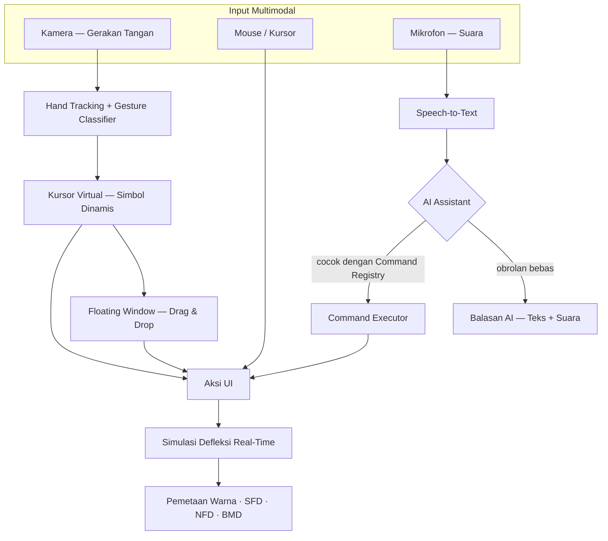

# 🏗️ Interactive Beam Deflection Simulator

**Simulasi defleksi balok akibat beban eksternal & berat sendiri — dikendalikan lewat gerakan tangan, mouse, dan suara secara _real-time_.**

---

## 📖 Gambaran Umum

> [!IMPORTANT]
> **Interactive Beam Deflection Simulator** adalah sebuah aplikasi yang dapat menyimulasikan **defleksi balok** akibat **beban eksternal** maupun **berat sendiri** (_self-weight_) secara _**real-time**_ — dengan animasi yang **_smooth_ dan ringan** — dan seluruhnya dapat dikendalikan melalui **gerakan tangan (_motion capture_)**, **mouse/kursor**, maupun **perintah suara** yang diterjemahkan oleh **AI assistant**.

> [!NOTE]
> 📌 Dokumen ini bersifat _**living document**_ — rencana akan **terus berkembang seiring berjalannya waktu** dan akan diperbarui kembali di kemudian hari.

---

## ✨ Fitur Utama

### `1` · Pemetaan Warna Defleksi

Menghitung dan menggambarkan tingkat defleksi melalui **_pemetaan warna_ yang intuitif** — layaknya _software_ struktur profesional seperti **SAP2000**.

### `2` · Optimasi Iteratif Penampang

**Optimasi iteratif** untuk **merekomendasikan dimensi penampang yang efisien** — dievaluasi dan disempurnakan bertahap hingga ditemukan desain paling efisien.

### `3` · Visualisasi Diagram Gaya Dalam

Visualisasi **SFD · NFD · BMD** yang **interaktif dan komprehensif**:

| Diagram | Kepanjangan              | Deskripsi                                    |
| :-----: | :----------------------- | :------------------------------------------- |
| **SFD** | _Shear Force Diagram_    | Diagram gaya lintang sepanjang bentang balok |
| **NFD** | _Normal Force Diagram_   | Diagram gaya normal (aksial) sepanjang balok |
| **BMD** | _Bending Moment Diagram_ | Diagram momen tekuk sepanjang bentang balok  |

### `4` · Interaksi Multimodal

Kendalikan seluruh aplikasi lewat **tiga modalitas input** — gestur tangan, mouse/kursor, dan suara — yang dapat saling menggantikan. _(Detail lengkap di seksi berikutnya.)_

---

## 🖐️ Sistem Interaksi Multimodal

### 🤚 A · Kontrol Gestur Tangan — _Motion Capture_

Kamera menangkap gerakan tangan secara langsung (_hand tracking_ di dalam _browser_), lalu **tangan menggantikan kursor** pada seluruh halaman — tanpa perlu menyentuh mouse.

Kunci desainnya: **kursor virtual bersifat dinamis** — setiap gestur yang terdeteksi akan **mengubah bentuk simbol kursor** secara otomatis, sehingga pengguna selalu tahu "mode apa" yang sedang aktif.

**Pemetaan Gestur → Simbol Kursor → Fungsi** _(usulan awal — masih dapat berubah):_

|            Gestur            | Nama         |     Simbol Kursor      | Fungsi                                                            |
| :--------------------------: | :----------- | :--------------------: | :---------------------------------------------------------------- |
|      ✋ Telapak terbuka      | _Open Palm_  |     ◎ cincin halus     | Mode pointer — kursor virtual aktif, _hover_ & navigasi           |
| 🤏 Cubit (jempol + telunjuk) | _Pinch_      |      ⌖ _reticle_       | **Klik** — pilih elemen, tekan tombol, mulai _drag_               |
|           ✊ Kepal           | _Fist_       | ▼ panah gaya berdenyut | **Gaya eksternal _real-time_** — beban "dipegang" di ujung tangan |
|       ☝️ Telunjuk saja       | _Point_      |     ▸ panah kecil      | Mode presisi — _pointing_ halus, _snap_ ke node/penampang         |
|         ✌️ Dua jari          | _Two-Finger_ |   ▣ bingkai jendela    | Grab & pindahkan **floating window**                              |

> [!TIP]
> 🎯 **Gaya eksternal _real-time_ dengan tangan:** saat gestur ✊ aktif, vektor gaya mengikuti posisi tangan di atas balok — **lendutan, pemetaan warna, dan seluruh diagram merespons secara langsung** seiring tangan bergerak. Simbol kursor berubah menjadi panah gaya sebagai umpan balik visual.

### 🪟 B · Floating Window

Panel-panel mengambang di atas kanvas simulasi yang **bisa dipindah-pindah bebas** — dengan **dua cara**:

- 🖱️ via **mouse/kursor** (_drag & drop_ klasik), atau
- 🤚 via **gestur tangan** (cubit-tahan-geser, simbol ▣ aktif).

Contoh _floating window_: **Window Gestur**, **Window Beban Real-Time**, **Window Diagram Gaya Dalam**, **Window Optimasi**.

### 🎙️ C · Kontrol Suara — _Voice Command_

> [!WARNING]
> ⚠️ **Batasan desain yang disengaja:** kontrol suara **hanya untuk _toggle_ / kontrol diskrit** (nyalakan–matikan, buka–tutup, ganti mode) — **bukan** untuk mengatur parameter kontinu seperti nilai beban atau panjang bentang secara presisi. Parameter kontinu tetap lewat gestur/mouse.

Alur: 🎤 ucapan → _speech-to-text_ → **AI menerjemahkan bahasa natural** → dicocokkan ke **Command Registry** yang sudah disediakan → aksi dieksekusi.

| Contoh Ucapan                                            | Command                 | Aksi                            |
| :------------------------------------------------------- | :---------------------- | :------------------------------ |
| _"Tolong nyalakan window real time untuk gestur tangan"_ | `toggle.window.gesture` | Floating window gestur → **ON** |
| _"Matikan kontrol suaranya"_                             | `toggle.voice`          | Voice control → **OFF**         |
| _"Tampilkan diagram momen tekuk"_                        | `toggle.diagram.bmd`    | Panel BMD tampil/sembunyi       |
| _"Masuk ke mode optimasi"_                               | `toggle.mode.optimize`  | Optimasi iteratif aktif         |
| _"Hilangkan beban real-time-nya"_                        | `toggle.window.load`    | Floating window beban → **OFF** |

### 🤖 D · AI Conversational Assistant

AI memiliki **peran ganda**:

1. **🧭 Intent Router** — menerjemahkan ucapan bebas (bahasa natural, tidak harus kata-kata kaku) ke _command_ yang tersedia di registry; jika tidak ada yang cocok, AI tetap merespons secara wajar.
2. **💬 Rekan Percakapan** — saat diajak ngobrol (bukan perintah), **AI bisa menjawab dan membalas secara natural** — misalnya menjelaskan fitur, atau sekadar merespons.

Balasan AI disajikan dalam bentuk **teks** ( gelembung chat) dan/atau **suara** (_text-to-speech_).

### 📊 Matriks Modalitas

| Kemampuan                     |  🤚 Gestur Tangan   |     🖱️ Mouse     |   🎤 Suara + AI   |
| :---------------------------- | :-----------------: | :--------------: | :---------------: |
| Menggantikan kursor           |     ✅ langsung     |    ✅ standar    |         —         |
| Klik / pilih elemen           |   ✅ gestur pinch   |   ✅ klik kiri   |         —         |
| **Gaya eksternal real-time**  | ✅ simbol khusus ✊ | ✅ klik & tahan  |         —         |
| Memindah floating window      |         ✅          |        ✅        |         —         |
| Toggle ON/OFF cepat           |  ✅ via tombol UI   |        ✅        | ✅ bahasa natural |
| Percakapan dua arah dengan AI |          —          | 💬 chat opsional |        ✅         |

### ⌨️ Command Registry

| Command                                | Fungsi                                 | Sumber Pemicu |
| :------------------------------------- | :------------------------------------- | :------------ |
| `toggle.window.gesture`                | Floating window gestur ON/OFF          | 🎤 · 🖱️       |
| `toggle.window.load`                   | Floating window beban real-time ON/OFF | 🎤 · 🖱️ · 🤚  |
| `toggle.diagram.sfd` / `.nfd` / `.bmd` | Diagram gaya dalam tampil/sembunyi     | 🎤 · 🖱️       |
| `toggle.mode.optimize`                 | Mode optimasi iteratif aktif/nonaktif  | 🎤 · 🖱️       |
| `toggle.cursor.hand`                   | Kursor virtual (tangan) ON/OFF         | 🎤 · 🖱️       |
| `toggle.capture.hand`                  | Motion capture (kamera) ON/OFF         | 🎤 · 🖱️       |

---

## ⚙️ Arsitektur Alur

> [!NOTE]
> **Fallback yang tetap dijaga:** bila kamera tidak tersedia/ditolak → kontrol otomatis kembali ke mouse; bila mikrofon tidak diizinkan → voice control nonaktif, aplikasi tetap berfungsi penuh.

---

## 📋 Ringkasan Cepat

| Aspek                   | Detail                                                                   |
| :---------------------- | :----------------------------------------------------------------------- |
| **Jenis Aplikasi**      | Simulator defleksi balok interaktif                                      |
| **Sumber Beban**        | Beban eksternal & berat sendiri (_self-weight_)                          |
| **Mode Simulasi**       | _Real-time_ · animasi _smooth_ & ringan                                  |
| **Visual Defleksi**     | Pemetaan warna intuitif (gaya _SAP2000_)                                 |
| **Fitur Optimasi**      | Iteratif → rekomendasi dimensi penampang efisien                         |
| **Diagram Gaya Dalam**  | SFD · NFD · BMD — interaktif & komprehensif                              |
| **Modalitas Interaksi** | 🤚 Gerakan tangan (_motion capture_) · 🖱️ Mouse/Kursor · 🎤 Suara via AI |
| **AI Assistant**        | _Intent router_ ke command registry + rekan percakapan (teks & suara)    |

---

## 🧭 Catatan Pengembangan

**Changelog:**

|  Versi   | Perubahan                                                                                                                                           |
| :------: | :-------------------------------------------------------------------------------------------------------------------------------------------------- |
| **v0.1** | Rencana inti — simulator defleksi, pemetaan warna, optimasi iteratif, SFD/NFD/BMD                                                                   |
| **v0.2** | ➕ Motion capture & kontrol gestur tangan (kursor virtual + simbol dinamis) · floating window · kontrol suara (batasan: toggle saja) · AI assistant |

**Saran teknologi (tidak mengikat):**

- 🤚 _Hand tracking_ → **MediaPipe Hands** (berjalan lokal di _browser_, tanpa kirim video ke server)
- 🎤 _Speech_ → **Web Speech API** (STT & TTS bawaan _browser_)
- 🤖 NLU + percakapan → **LLM** dengan _function calling_ ke command registry

---

_Real-Time · Multimodal · Evolving_

