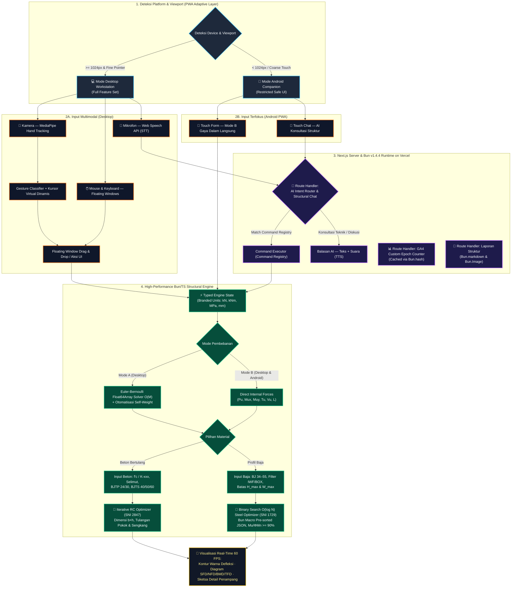

# 🏗️ Interactive Beam Deflection & Structural Design Simulator

**Platform Rekayasa Struktur Interaktif untuk Simulasi Defleksi Balok & Optimasi Desain Penampang (Beton Bertulang SNI 2847 & Baja Profil IWF/BOX SNI 1729)**

_Dikendalikan secara real-time melalui gerakan tangan (Motion Capture), kursor, dan perintah suara berbasis AI di atas arsitektur super ringan **Next.js + Bun v1.4.4 Native APIs** dengan dukungan **Adaptive PWA** (Desktop Full Workstation & Android Field Companion)._

 

<!-- ROW 1: STATUS, TECH STACK & PLATFORM -->

  
  
  

<!-- ROW 2: ENGINEERING & INTERACTION CAPABILITIES -->

  
  
  
  

<!-- QUICK NAVIGATION -->

  <a href="#-gambaran-umum"><b>📖 Gambaran Umum</b></a> •
  <a href="#-fitur-utama"><b>✨ Fitur Utama</b></a> •
  <a href="#-spesifikasi-teknis-input--output-perhitungan-struktur"><b>📐 Spesifikasi Teknis</b></a> •
  <a href="#️-sistem-interaksi-multimodal"><b>🖐️ Interaksi Multimodal</b></a> •
  <a href="#️-arsitektur-alur-sistem--platform-split"><b>⚙️ Arsitektur</b></a> •
  <a href="#-kesesuaian-dengan-panduan-tugas-besar"><b>🎓 Standar Tugas Besar</b></a> •
  <a href="#-catatan-pengembangan--roadmap-iterasi"><b>🧭 Roadmap</b></a>

---

## 📖 Gambaran Umum

> [!IMPORTANT]
> **Interactive Beam Deflection & Structural Design Simulator** adalah aplikasi rekayasa struktur interaktif berbasis web dan **Progressive Web App (PWA)** yang menyimulasikan **defleksi balok**, **diagram gaya dalam**, serta **optimasi desain penampang Balok Beton Bertulang dan Balok Profil Baja (IWF & BOX)** dengan animasi yang **_smooth_ dan ringan**. Aplikasi ini mendukung **dua mode input pembebanan** — melalui **beban eksternal & berat sendiri (_self-weight_)** secara _real-time_ maupun **input langsung gaya dalam hasil analisis struktur ($P_u, M\_{ux}, M\_{uy}, T_u$)** — serta dapat dikendalikan sepenuhnya melalui **gerakan tangan (_motion capture_)**, **mouse/kursor**, dan **perintah suara** yang diterjemahkan oleh **AI Assistant** pada mode Desktop.

> [!NOTE]
> 📌 **Status Dokumen:** _**Living Document**_ (**Iterasi v0.4**) — spesifikasi terus berkembang seiring iterasi pengembangan. Rancangan ini disusun mengikuti kaidah rekayasa perangkat lunak teknik sipil berbasis AI (mulai dari analisis kebutuhan, spesifikasi input-output terukur, kepatuhan standar SNI, hingga rencana verifikasi dan dokumentasi GitHub). Spesifikasi arsitektur mendalam terkait **Bun v1.4.4 Native APIs**, struktur direktori, standar kode TypeScript, PWA Desktop vs Android, dan telemetri pengunjung didokumentasikan secara terpisah di dalam [`mdfiles/bun_v1_4_4_architecture_and_context.md`](../bun_v1_4_4_architecture_and_context.md).

---

## ✨ Fitur Utama

### `01` · Pemilihan Material & Mode Input Pembebanan Ganda

Memberikan fleksibilitas penuh bagi praktisi maupun mahasiswa pada tahap permodelan awal balok:

- **Pilihan Material Struktural:**
  - 🧱 **Balok Beton Bertulang (_Reinforced Concrete_)** — perhitungan dimensi dan konfigurasi tulangan berdasarkan standar beton struktural (**SNI 2847**).
  - 🔩 **Balok Profil Baja (_Structural Steel_)** — pemilihan dan optimasi profil **IWF (_Wide Flange_)** maupun **BOX (_Hollow Structural Section_)** berdasarkan metode LRFD (**SNI 1729**).
- **Pilihan Mode Input Pembebanan:**
  - **Mode A — Gaya Eksternal (_External Load Mode_):** Input panjang bentang ($L$), kondisi tumpuan, beban terpusat ($P$), beban merata ($q$), momen eksternal, serta kalkulasi otomatis berat sendiri (_self-weight_). Mendukung manipulasi beban _real-time_ menggunakan kursor maupun gestur tangan _(Khusus Mode Desktop)_.
  - **Mode B — Gaya Dalam Langsung (_Direct Internal Forces Mode_):** Input langsung hasil analisis struktur terfaktor tanpa harus memodelkan beban eksternal dari awal _(Tersedia di Desktop & Android PWA)_, meliputi:
    - **Axial Load ($P_u$)** — gaya aksial terfaktor ($\text{kN}$)
    - **Momen Sumbu Kuat ($M\_{ux}$)** — momen lentur terfaktor arah sumbu mayor X ($\text{kNm}$)
    - **Momen Sumbu Lemah ($M\_{uy}$)** — momen lentur terfaktor arah sumbu minor Y ($\text{kNm}$)
    - **Torsi ($T_u$)** — momen puntir/torsi terfaktor ($\text{kNm}$)
    - **Gaya Geser ($V_u$)** & **Panjang Bentang ($L$)** — untuk evaluasi geser, tekuk torsi lateral (_LTB_), dan kontrol lendutan ($\text{m}$)

### `02` · Desain & Optimasi Iteratif Penampang Berkecepatan Tinggi ($O(\log N)$)

Algoritma **optimasi iteratif** berbasis _pre-sorted lookup tables_ (di-_bundle_ saat _compile-time_ menggunakan **Bun Macros**) yang mengevaluasi kandidat dimensi, penulangan, atau profil standar secara instan untuk menghasilkan rekomendasi desain paling aman dan ekonomis:

- **Optimasi Balok Beton Bertulang:** Merekomendasikan dimensi penampang ($b \times h$), konfigurasi & diameter tulangan tarik/tekan, serta tulangan geser/torsi (sengkang).
- **Optimasi Balok Profil Baja (IWF & BOX):** Merekomendasikan profil baja standar menggunakan _binary search_ $O(\log N)$ terhadap modulus plastis $Z_x$ yang memenuhi batas geometri maksimum ($H_{\max}$ dan $W_{\max}$) serta merekomendasikan mutu baja paling ekonomis dengan target efisiensi kapasitas **$M_u / \phi M_n \ge 90\%$** (namun tetap $\le 100\%$).

### `03` · Pemetaan Warna Defleksi (_SAP2000-Style Color Contour_)

Menghitung kurva lendutan (_deflection_) sepanjang bentang balok menggunakan `Float64Array` berkecepatan $O(M)$ dan memvisualisasikannya melalui **_pemetaan warna_ (_color contour_) yang intuitif** — layaknya perangkat lunak analisis struktur profesional seperti **SAP2000** — lengkap dengan verifikasi batas lendutan izin ($\Delta_{\max} \le L/\text{batas}$).

### `04` · Visualisasi Diagram Gaya Dalam Komprehensif

Visualisasi **SFD · NFD · BMD · TFD** yang interaktif, presisi, dan responsif terhadap perubahan beban:

| Diagram | Kepanjangan              | Deskripsi Teknis                                                     |
| :-----: | :----------------------- | :------------------------------------------------------------------- |
| **SFD** | _Shear Force Diagram_    | Diagram gaya lintang/geser ($V_u$) sepanjang bentang balok           |
| **NFD** | _Normal Force Diagram_   | Diagram gaya normal/aksial ($P_u$) sepanjang bentang balok           |
| **BMD** | _Bending Moment Diagram_ | Diagram momen lentur biaxial ($M_{ux}$ & $M_{uy}$) sepanjang bentang |
| **TFD** | _Torsion Force Diagram_  | Diagram momen puntir/torsi ($T_u$) sepanjang bentang balok           |

### `05` · Sistem Interaksi Multimodal

Kendalikan ruang kerja simulasi pada mode Desktop lewat **tiga modalitas input** — gestur tangan (_motion capture_), mouse/kursor, dan perintah suara via AI — yang dapat saling menggantikan secara mulus tanpa jeda.

### `06` · Arsitektur PWA Adaptif (Desktop Workstation vs Android Field Companion)

Mendukung instalasi **Progressive Web App (PWA)** dengan pemisahan kapabilitas antarmuka secara cerdas untuk menjaga ergonomi dan performa pada berbagai ukuran layar:

| Fitur & Kapabilitas                                            | 💻 Desktop (Web & Installed PWA) |       📱 Android (Installed PWA Lite Mode)       |
| :------------------------------------------------------------- | :------------------------------: | :----------------------------------------------: |
| **Mode B: Input Gaya Dalam ($P_u, M\_{ux}, M\_{uy}, T_u, L$)** |             ✅ Penuh             |          ✅ Penuh (Fokus Utama Mobile)           |
| **Optimasi Penampang Beton (SNI 2847) & Baja (SNI 1729)**      |             ✅ Penuh             |                     ✅ Penuh                     |
| **Visualisasi Potongan Penampang & Diagram Statis**            |             ✅ Penuh             |        ✅ Responsif Vertikal (_Tab View_)        |
| **AI Engineering Assistant (Diskusi Hasil Desain)**            |         ✅ Teks & Suara          |               ✅ Chat Teks Ringkas               |
| **Mode A: Simulasi Beban Eksternal Interaktif (_Drag Load_)**  |      ✅ _Real-time_ 60 FPS       | 🔒 Dinonaktifkan (Cegah _mis-touch_ layar kecil) |
| **Multi-Floating Draggable Windows**                           |      ✅ Bebas _Drag & Drop_      |     🔒 Diganti _Bottom Sheet_ / _Single Tab_     |
| **Kamera Hand Tracking (_Motion Capture_ Kursor)**             |        ✅ MediaPipe Hands        |  🔒 Dinonaktifkan (Hemat baterai & _viewport_)   |

### `07` · Google Analytics (GA4) & Custom Epoch Visitor Badge ("Flex Counter")

Dilengkapi telemetri **Google Analytics 4 (GA4)** serta _widget_ penghitung jumlah kunjungan (_visitor/session counter_) sejak tanggal peluncuran kustom yang dikonfigurasi pada sistem (`ANALYTICS_START_DATE`), disajikan secara _real-time_ (dengan _server-side caching_ ringan di Bun Runtime Vercel) sebagai indikator traksi aplikasi.

---

## 📐 Spesifikasi Teknis Input & Output Perhitungan Struktur

Bagian ini merinci parameter input dan keluaran (_output_) teknis untuk masing-masing mode pembebanan dan jenis material balok.

### 🔄 1. Parameter Input Pembebanan & Geometri Bentang

| Mode Input                                            | Parameter yang Diinput Pengguna                                                                                                                                                                                                                                                                                           | Keterangan & Alur Kalkulasi                                                                                                                            |
| :---------------------------------------------------- | :------------------------------------------------------------------------------------------------------------------------------------------------------------------------------------------------------------------------------------------------------------------------------------------------------------------------ | :----------------------------------------------------------------------------------------------------------------------------------------------------- |
| **Mode A: Gaya Eksternal** _(Khusus Desktop)_         | • Panjang bentang ($L$) & jenis tumpuan • Beban terpusat ($P$) & posisi beban • Beban merata ($q$) & momen eksternal • Berat sendiri (_self-weight_ otomatis dari $\gamma_{\text{material}}$)                                                                                                                    | Menghitung reaksi tumpuan, diagram gaya dalam, lendutan _real-time_, lalu meneruskan nilai ekstrem ($P_u, V_u, M_u, T_u$) ke modul desain penampang.   |
| **Mode B: Gaya Dalam Langsung** _(Desktop & Android)_ | • **Axial Load ($P_u$)** — $\text{kN}$ • **Momen Lentur Mayor ($M\_{ux}$)** — $\text{kNm}$ • **Momen Lentur Minor ($M\_{uy}$)** — $\text{kNm}$ • **Torsi ($T_u$)** — $\text{kNm}$ • **Gaya Geser ($V_u$)** — $\text{kN}$ _(opsional/otomatis dari gradien momen)_ • **Panjang Bentang ($L$)** — $\text{m}$ | Langsung mengevaluasi kapasitas penampang terhadap kombinasi aksial-lentur biaxial-torsi serta menghitung estimasi kurvatur/lendutan pada bentang $L$. |

---

### 🧱 2. Modul Balok Beton Bertulang (_Reinforced Concrete Beam_ — SNI 2847)

| Kategori                       | Parameter                             | Pilihan / Format Input & Output                                                                                                                                                                                                                                                                                     |
| :----------------------------- | :------------------------------------ | :------------------------------------------------------------------------------------------------------------------------------------------------------------------------------------------------------------------------------------------------------------------------------------------------------------------ |
| **Input Material & Penampang** | **Mutu Beton**                        | Pilihan input dalam **$f'\_c$ ($\text{MPa}$)** _(mis. $20, 25, 30, 35\text{ MPa}$)_ atau **Mutu $K\text{-xxx}$** _(mis. $K\text{-}225, K\text{-}250, K\text{-}300, K\text{-}350, K\text{-}400$ dengan konversi otomatis $f'_c \approx 0{,}083 \times K$)_.                                                          |
|                                | **Selimut Beton (_Concrete Cover_)**  | Tebal bersih selimut beton $d_c$ / $c_c$ ($\text{mm}$) — mis. $25\text{ mm}, 40\text{ mm}$, atau $50\text{ mm}$ sesuai kondisi eksposur lingkungan.                                                                                                                                                                 |
|                                | **Mutu Baja Tulangan**                | • **Tulangan Polos (BJTP):** **BJTP 24** ($f_y = 240\text{ MPa}$) atau **BJTP 30** ($f_y = 295\text{–}300\text{ MPa}$) • **Tulangan Sirip/Ulir (BJTS):** **BJTS 40** ($f_y = 390\text{–}400\text{ MPa}$), **BJTS 50** ($f_y = 490\text{–}500\text{ MPa}$), atau **BJTS 60** ($f_y = 590\text{–}600\text{ MPa}$). |
|                                | **Dimensi Awal _(Opsional)_**         | Lebar ($b$) dan tinggi ($h$) awal untuk mode _Design Check_, atau dikosongkan untuk mode _Full Auto-Optimization_.                                                                                                                                                                                                  |
| **Output Optimasi Desain**     | **Rekomendasi Dimensi Penampang**     | Lebar balok ($b$) dan tinggi total ($h$) hasil optimasi rasio ekonomis ($h/b \approx 1{,}5\text{–}2{,}0$) yang memenuhi syarat lendutan dan spasi bersih tulangan.                                                                                                                                                  |
|                                | **Tulangan Tarik & Tekan**            | Jumlah dan **diameter tulangan longitudinal tarik** ($A_s$, mis. `4 D19`) serta **tulangan tekan** ($A'_s$, mis. `2 D16`) beserta verifikasi rasio tulangan ($\rho_{\min} \le \rho \le \rho_{\max}$).                                                                                                               |
|                                | **Tulangan Geser (Sengkang) & Torsi** | **Diameter dan jarak sengkang** (mis. `Ø10 - 150 mm` di tumpuan & `Ø10 - 200 mm` di lapangan) serta kebutuhan tulangan memanjang tambahan akibat torsi ($A_l$) bila $T_u > T_{th}$.                                                                                                                                 |
|                                | **Ringkasan Rasio Kapasitas**         | Nilai kapasitas terfaktor ($\phi M_n, \phi V_n, \phi T_n$), rasio utilisasi ($M_u / \phi M_n$), dan visualisasi sketsa potongan melintang penampang beton.                                                                                                                                                          |

---

### 🔩 3. Modul Balok Profil Baja (_Structural Steel Beam_ — SNI 1729)

| Kategori                                | Parameter                              | Pilihan / Format Input & Output                                                                                                                                                                                                                                                                                                                       |
| :-------------------------------------- | :------------------------------------- | :---------------------------------------------------------------------------------------------------------------------------------------------------------------------------------------------------------------------------------------------------------------------------------------------------------------------------------------------------- |
| **Input Material**                      | **Mutu Baja Struktural**               | Pilihan standar: **BJ 34** ($f_y = 210\text{ MPa}, f_u = 340\text{ MPa}$), **BJ 37** ($f_y = 240\text{ MPa}, f_u = 370\text{ MPa}$), **BJ 41** ($f_y = 250\text{ MPa}, f_u = 410\text{ MPa}$), **BJ 50** ($f_y = 290\text{ MPa}, f_u = 500\text{ MPa}$), atau **BJ 55** ($f_y = 410\text{ MPa}, f_u = 550\text{ MPa}$).                               |
| **Input Filter & Batasan (_Optional_)** | **Filter Tipe Profil**                 | Pilihan ruang pencarian: **Hanya IWF**, **Hanya BOX (Hollow)**, atau **Semua Profil (IWF + BOX)** _(otomatis membandingkan efisiensi IWF vs BOX terutama saat kombinasi $M_{uy}$ dan Torsi $T_u$ dominan)_.                                                                                                                                           |
|                                         | **Batasan Dimensi Maksimum**           | Input opsional **Tinggi Penampang Maksimum ($H\_{\max}$)** dan **Lebar Penampang Maksimum ($W\_{\max}$ / $B\_{\max}$)** dalam $\text{mm}$ (mis. akibat batas ruang plafon/ME).                                                                                                                                                                        |
| **Output Optimasi Desain**              | **Rekomendasi Profil Penampang**       | Daftar peringkat profil terbaik (mis. `IWF 300x150x6.5x9` atau `BOX 250x250x9`) yang lolos kelangsingan penampang (_compact/non-compact_), tekuk torsi lateral (_LTB_), interaksi aksial-lentur biaxial ($P_u\text{-}M_{ux}\text{-}M_{uy}$), torsi ($T_u$), dan batas dimensi ($H \le H_{\max}, W \le W_{\max}$).                                     |
|                                         | **Rekomendasi Mutu & Profil Ekonomis** | Fitur _Smart Grade & Section Optimizer_: mengevaluasi lintas mutu (**BJ 34 s/d BJ 55**) untuk merekomendasikan kombinasi profil + mutu baja paling ringan/ekonomis dengan **rasio utilisasi optimal $M_u / \phi M_n \ge 90\%$** (mendekati kapasitas penuh tanpa melewati batas 100%, yakni rentang _sweet spot_ $0{,}90 \le \text{DCR} \le 1{,}00$). |

---

## 🖐️ Sistem Interaksi Multimodal

> [!TIP]
> **Pemisahan Ergonomi Platform:** Fitur gestur tangan, _floating window_ bebas, dan kontrol suara penuh berjalan di **Mode Desktop Workstation**, sementara **Mode Android PWA** difokuskan pada input sentuh Mode B & AI Chat Teks yang aman untuk layar kecil.

### 🤚 A · Kontrol Gestur Tangan — _Motion Capture_

Kamera menangkap gerakan tangan secara langsung (_client-side hand tracking_ menggunakan **MediaPipe Hands**), lalu **tangan menggantikan kursor** pada seluruh halaman tanpa perlu menyentuh mouse. Setiap gestur yang terdeteksi akan **mengubah bentuk simbol kursor virtual** secara otomatis sebagai umpan balik visual instan:

|            Gestur            | Nama Gestur  |      Simbol Kursor       | Fungsi Interaksi                                                           |
| :--------------------------: | :----------- | :----------------------: | :------------------------------------------------------------------------- |
|      ✋ Telapak terbuka      | _Open Palm_  |     `◎` Cincin Halus     | Mode pointer — kursor virtual aktif, _hover_ & navigasi                    |
| 🤏 Cubit (jempol + telunjuk) | _Pinch_      |       `⌖` Reticle        | **Klik** — pilih elemen, tekan tombol, pilih material/profil, mulai _drag_ |
|           ✊ Kepal           | _Fist_       | `▼` Panah Gaya Berdenyut | **Gaya eksternal _real-time_** — beban "dipegang" di ujung tangan (Mode A) |
|       ☝️ Telunjuk saja       | _Point_      |    `▸` Panah Presisi     | Mode presisi — _pointing_ halus, _snap_ ke node/penampang                  |
|         ✌️ Dua jari          | _Two-Finger_ |   `▣` Bingkai Jendela    | Grab & pindahkan **floating window**                                       |

### 🔳 B · Floating Window (Desktop) & Bottom Sheet (Android PWA)

Pada **Mode Desktop**, panel-panel mengambang di atas kanvas simulasi dapat dipindah-pindah bebas melalui **mouse/kursor** (_drag & drop_) maupun **gestur tangan** (dua jari `▣`). Pada **Mode Android PWA**, panel otomatis bertransformasi menjadi _Bottom Sheet_ / _Single Tab View_ vertikal agar bebas dari tumpukan jendela di layar sempit.

1. **Window Konfigurasi Material & Beban** — pilih Beton Bertulang vs Baja (IWF/BOX), serta pilih Mode Gaya Eksternal vs Mode Gaya Dalam ($P_u, M_{ux}, M_{uy}, T_u, L$).
2. **Window Beban Real-Time** _(Khusus Desktop Mode A)_ — kontrol interaktif beban terpusat, merata, dan respons instan.
3. **Window Parameter & Batasan Desain** — atur mutu beton ($f'_c / K$), selimut, mutu tulangan (BJTP/BJTS), atau mutu baja (BJ 34–55), filter IWF/BOX, dan batas $H_{\max} / W_{\max}$.
4. **Window Hasil Optimasi & Penampang** — tampilkan sketsa detail tulangan beton ($n\text{-D xx}$, sengkang) atau rekomendasi profil & mutu baja ekonomis ($M_u/\phi M_n \ge 90\%$).
5. **Window Diagram Gaya Dalam** — tampilkan SFD, NFD, BMD, dan TFD secara interaktif.
6. **Window Gestur & Kamera** _(Khusus Desktop)_ — pratinjau _hand tracking_ dan indikator gestur aktif.

### 🎙️ C · Kontrol Suara — _Voice Command_

> [!WARNING]
> **Batasan Desain Disengaja:** Kontrol suara **hanya ditujukan untuk _toggle_ / kontrol diskrit** (menyalakan/mematikan window, mengganti material Beton/Baja, mengganti mode input beban, atau memfilter IWF/BOX) — **bukan** untuk memasukkan angka atau mengatur parameter kontinu seperti nilai $M_{ux}$ atau panjang bentang secara presisi.

Alur Eksekusi: `🎤 Ucapan Pengguna` ➔ `Speech-to-Text (Web Speech API)` ➔ `AI Intent Translation` ➔ `Command Registry Matching` ➔ `Aksi UI`.

| Contoh Ucapan Natural                                    | Command Registry        | Aksi Sistem                                                |
| :------------------------------------------------------- | :---------------------- | :--------------------------------------------------------- |
| _"Ganti material balok ke beton bertulang"_              | `set.material.rc`       | Mode material ➔ **Beton Bertulang**                        |
| _"Ubah ke balok baja profil IWF saja"_                   | `set.steel.filter.iwf`  | Material **Baja** + filter profil ➔ **IWF Only**           |
| _"Pakai input gaya dalam langsung"_                      | `set.loadmode.internal` | Mode input ➔ **Gaya Dalam ($P_u, M\_{ux}, M\_{uy}, T_u$)** |
| _"Tampilkan diagram momen tekuk"_                        | `toggle.diagram.bmd`    | Panel BMD tampil/sembunyi                                  |
| _"Jalankan optimasi penampang ekonomis"_                 | `toggle.mode.optimize`  | Optimasi iteratif & cek $M_u/\phi M_n \ge 90\%$ aktif      |
| _"Tolong nyalakan window real time untuk gestur tangan"_ | `toggle.window.gesture` | Floating window gestur ➔ **ON**                            |
| _"Hilangkan beban real-time-nya"_                        | `toggle.window.load`    | Floating window beban ➔ **OFF**                            |
| _"Matikan kontrol suaranya"_                             | `toggle.voice`          | Voice control ➔ **OFF**                                    |

### 🤖 D · AI Conversational Assistant

1. **🧭 Intent Router:** Menerjemahkan instruksi bahasa natural ke _command_ yang tersedia di dalam _Command Registry_.
2. **💬 Rekan Diskusi Rekayasa Struktur:** Menjelaskan rasionalitas teknis di balik hasil optimasi — misalnya mengapa profil **BOX** lebih direkomendasikan dibanding **IWF** ketika kombinasi **Torsi ($T_u$)** dan **$M\_{uy}$** besar, atau mengapa mutu **BJ 41** menghasilkan rasio $M_u/\phi M_n \ge 90\%$ yang lebih ekonomis dibanding **BJ 55** pada bentang tertentu.

### 📊 E · Matriks Modalitas & Command Registry

<b>🔽 Klik untuk melihat Tabel Matriks Modalitas & Daftar Lengkap Command Registry</b>

 

#### Matriks Modalitas Interaksi

| Kemampuan                                                     |  🤚 Gestur Tangan _(Desktop)_   |    🖱️ Mouse / Keyboard / Touch     |          🎤 Suara + AI          |
| :------------------------------------------------------------ | :-----------------------------: | :--------------------------------: | :-----------------------------: |
| Menggantikan kursor & klik elemen                             | ✅ _palm_ (`◎`) & _pinch_ (`⌖`) |             ✅ Standar             |                —                |
| **Gaya eksternal real-time (Mode A)**                         |    ✅ Simbol khusus ✊ (`▼`)    |    ✅ Klik & tahan _(Desktop)_     |                —                |
| Input nilai $P_u, M_{ux}, M_{uy}, T_u, L, H_{\max}, W_{\max}$ |     ✅ _Slider_ / _Stepper_     |    ✅ Ketik langsung / _Slider_    |                —                |
| Pilih material (Beton / Baja IWF / BOX) & mutu                |               ✅                |                 ✅                 |        ✅ _Toggle_ cepat        |
| Memindah floating window _(Desktop)_                          |       ✅ Gestur ✌️ (`▣`)        |          ✅ _Drag & Drop_          |                —                |
| Toggle ON/OFF cepat                                           |        ✅ Via tombol UI         |                 ✅                 |        ✅ Bahasa natural        |
| Diskusi hasil optimasi & rekomendasi mutu                     |                —                | 💬 Chat teks _(Desktop & Android)_ | ✅ Percakapan suara _(Desktop)_ |

#### Daftar Command Registry

| Command ID                                        | Fungsi Eksekusi                                                         | Sumber Pemicu |
| :------------------------------------------------ | :---------------------------------------------------------------------- | :-----------: |
| `set.material.rc` / `set.material.steel`          | Pilih material Balok Beton Bertulang atau Balok Baja                    | 🎤 · 🖱️ · 🤚  |
| `set.loadmode.external` / `set.loadmode.internal` | Pilih input Gaya Eksternal atau Gaya Dalam ($P_u, M_{ux}, M_{uy}, T_u$) | 🎤 · 🖱️ · 🤚  |
| `set.steel.filter.iwf` / `.box` / `.all`          | Filter profil baja: hanya IWF, hanya BOX, atau keduanya                 |    🎤 · 🖱️    |
| `toggle.window.gesture`                           | Floating window gestur ON/OFF                                           |    🎤 · 🖱️    |
| `toggle.window.load`                              | Floating window input beban/gaya dalam ON/OFF                           | 🎤 · 🖱️ · 🤚  |
| `toggle.diagram.sfd` / `.nfd` / `.bmd` / `.tfd`   | Diagram gaya dalam tampil/sembunyi                                      |    🎤 · 🖱️    |
| `toggle.mode.optimize`                            | Mode optimasi iteratif penampang & mutu ekonomis aktif/nonaktif         |    🎤 · 🖱️    |
| `toggle.cursor.hand` / `toggle.capture.hand`      | Kursor virtual (tangan) & motion capture kamera ON/OFF                  |    🎤 · 🖱️    |
| `toggle.voice`                                    | Kontrol suara (_voice command_) ON/OFF                                  |    🎤 · 🖱️    |

---

## ⚙️ Arsitektur Alur Sistem & Platform Split

> [!NOTE]
> **Mekanisme _Graceful Fallback_:** Apabila akses kamera ditolak/tidak tersedia ➔ interaksi otomatis kembali ke mouse; apabila mikrofon dinonaktifkan ➔ _voice control_ dimatikan tanpa mengganggu UI; apabila diakses dari perangkat Android layar kecil ➔ antarmuka otomatis beralih ke _Mode Android Companion_.

---

## 🎓 Kesesuaian dengan Panduan Tugas Besar

Pengembangan proyek ini dirancang secara terukur menggunakan pendekatan manajemen ruang lingkup bertahap (_staged scope management_) guna menjamin keandalan kalkulasi teknik sipil sekaligus inovasi interaksi modern:

### 1. Pemisahan Ruang Lingkup (_MVP vs Fitur Eksploratif_)

|                   Tahap                    | Fokus Pengembangan                                                | Komponen Fitur & Deliverable Teknis                                                                                                                                                                                                                                                                                                                                                                                                                                                    |
| :----------------------------------------: | :---------------------------------------------------------------- | :------------------------------------------------------------------------------------------------------------------------------------------------------------------------------------------------------------------------------------------------------------------------------------------------------------------------------------------------------------------------------------------------------------------------------------------------------------------------------------- |
|      **Tahap 1 (MVP / Fitur Wajib)**       | **Engine Analisis Struktur, Desain Beton/Baja & Visualisasi Web** | • Pemilihan Material (Beton Bertulang vs Baja IWF/BOX) • Dual Input Pembebanan (Gaya Eksternal vs Gaya Dalam $P_u, M_{ux}, M_{uy}, T_u, L$) • Kalkulasi & Optimasi Beton ($f'_c/K$, BJTP/BJTS $\rightarrow$ dimensi, tulangan pokok & sengkang) • Kalkulasi & Optimasi Baja (BJ 34–55, filter IWF/BOX, batas $H_{\max}/W_{\max}$, rasio ekonomis $M_u/\phi M_n \ge 90\%$) • Visualisasi pemetaan warna defleksi & diagram SFD/NFD/BMD/TFD dengan kontrol Mouse/UI standar. |
|      **Tahap 2 (Fitur Eksploratif)**       | **Interaksi Multimodal & AI Assistant**                           | • _Hand Tracking_ & kursor virtual dinamis via MediaPipe Hands • _Multi-Floating Draggable Windows_ • _Voice Command_ (_toggle_ cepat) via Web Speech API • _AI Conversational Assistant_ sebagai _intent router_ dan asisten diskusi hasil desain.                                                                                                                                                                                                                           |
| **Tahap 3 (Optimasi Platform & Produksi)** | **Bun v1.4.4 Native Stack, Adaptive PWA & Analitik**              | • Optimasi _compile-time_ dengan Bun Macros & `Float64Array` solver • Pemisahan adaptif PWA Desktop Workstation vs Android Field Mode • Integrasi GA4 Custom Epoch Visitor Counter (_server-side cached_ via `Bun.hash`).                                                                                                                                                                                                                                                        |

### 2. Standar Acuan & Metodologi Rekayasa

- **Mekanika Bahan & Analisis Struktur:** Persamaan diferensial garis elastis Euler-Bernoulli dengan metode integrasi numerik berbasis `Float64Array` berkecepatan $O(M)$.
- **Beton Bertulang (SNI 2847):** Faktor reduksi kekuatan ($\phi$), blok tegangan tekan ekuivalen Whitney, analisis lentur tulangan tunggal/rangkap, kombinasi geser ($V_c + V_s$), dan torsi penampang persegi.
- **Struktur Baja (SNI 1729 — LRFD):** Klasifikasi kelangsingan penampang (_compact/non-compact/slender_), kapasitas lentur & _Lateral-Torsional Buckling_ (LTB), persamaan interaksi aksial-lentur biaxial (H1-1a/b), serta torsi penampang terbuka (IWF) vs tertutup (BOX) berbasis _dataset_ JSON tabel profil standar SNI/JIS yang di-_inline_ saat _build-time_ melalui **Bun Macros**.

### 3. Rencana Pengujian, Validasi & Luaran Akhir

- **Verifikasi Perhitungan Manual & Software Pembanding:** Menguji akurasi output aplikasi (momen, lendutan, luas tulangan $A_s$, dan rasio kapasitas profil baja $M_u/\phi M_n$) terhadap lembar hitungan manual (_spreadsheet_) dan pemodelan **SAP2000**.
- **Pengujian Batas (_Edge-Case Testing_):** Memastikan sistem menampilkan peringatan terukur saat parameter tidak valid (mis. batas $H_{\max}$ terlalu kecil sehingga tidak ada profil yang memenuhi, atau gaya dalam melampaui kapasitas maksimum tabel).
- **Luaran Akhir (_Deliverables_):**
  1. **GitHub Repository** terstruktur (kode sumber modular, _database_ profil IWF/BOX, dokumentasi arsitektur `mdfiles/`, riwayat _commit_ terstandar, dan `README.md`).
  2. **Laporan Pengembangan** (identifikasi masalah, spesifikasi kebutuhan fungsional/nonfungsional, _flowchart_ algoritma optimasi, dan tabel verifikasi pengujian).
  3. **Buku Panduan (_User Manual_)** penggunaan mode input gaya eksternal/dalam, optimasi beton/baja, mode PWA Desktop/Android, dan kontrol multimodal.

---

## 📋 Ringkasan Spesifikasi Sistem

| Aspek Sistem                  | Spesifikasi Detail                                                                                                                                                      |
| :---------------------------- | :---------------------------------------------------------------------------------------------------------------------------------------------------------------------- |
| **Kategori Aplikasi**         | Simulator Defleksi Balok & _Optimizer_ Desain Penampang (Beton Bertulang & Baja) Berbasis Web & PWA                                                                     |
| **Runtime & Arsitektur**      | **Next.js (App Router) + Bun v1.4.4 Native APIs** di Vercel (Bun Macros, `Bun.hash`, `Bun.markdown`, `Bun.Image`)                                                       |
| **Pilihan Material**          | **Beton Bertulang** ($f'_c$ / $K\text{-xxx}$, BJTP 24/30, BJTS 40/50/60) & **Baja** (IWF & BOX, BJ 34/37/41/50/55)                                                      |
| **Mode Input Beban**          | **1) Mode A — Gaya Eksternal** + berat sendiri (_real-time_ di Desktop) · **2) Mode B — Gaya Dalam Langsung** ($P_u, M_{ux}, M_{uy}, T_u, V_u, L$ di Desktop & Android) |
| **Output Balok Beton**        | Rekomendasi dimensi ($b \times h$), diameter & jumlah tulangan tarik/tekan, serta tulangan geser/torsi (sengkang)                                                       |
| **Output Balok Baja**         | Rekomendasi profil _binary search_ $O(\log N)$ (filter IWF/BOX, batas $H_{\max}$ & $W_{\max}$) & mutu ekonomis ($M_u/\phi M_n \ge 90\%$)                                |
| **Visual Defleksi & Diagram** | Pemetaan warna intuitif (gaya _SAP2000_) + Diagram **SFD · NFD · BMD · TFD**                                                                                            |
| **Modalitas Interaksi**       | 🤚 Gerakan tangan (_motion capture_) · 🖱️ Mouse/Keyboard/Touch · 🎤 Suara via AI                                                                                        |
| **AI Assistant**              | _Intent router_ ke Command Registry + rekan diskusi rekayasa struktur (teks & suara)                                                                                    |
| **Dukungan Platform (PWA)**   | **Desktop Workstation** (fitur penuh) & **Android Field Companion** (Mode B, Optimasi & AI Chat Teks)                                                                   |
| **Telemetri & Analitik**      | **GA4 Custom Epoch Visitor Counter** (_Flex Counter_ dengan _hardcoded start date_)                                                                                     |

---

## 🧭 Catatan Pengembangan & Roadmap Iterasi

|             Versi             | Fokus Iterasi                                                        | Detail Perubahan & Pencapaian Arsitektur                                                                                                                                                                                                                                                                                                                                                                                                                                                                                                   |
| :---------------------------: | :------------------------------------------------------------------- | :----------------------------------------------------------------------------------------------------------------------------------------------------------------------------------------------------------------------------------------------------------------------------------------------------------------------------------------------------------------------------------------------------------------------------------------------------------------------------------------------------------------------------------------- |
|            `v0.1`             | **Rencana Inti**                                                     | Simulator defleksi dasar, pemetaan warna, optimasi iteratif awal, visualisasi SFD/NFD/BMD.                                                                                                                                                                                                                                                                                                                                                                                                                                                 |
|            `v0.2`             | **Multimodal & AI**                                                  | ➕ Motion capture & kontrol gestur tangan (kursor virtual + simbol dinamis) · _floating window_ · kontrol suara (batasan: _toggle_ diskrit) · AI Assistant + _Command Registry_.                                                                                                                                                                                                                                                                                                                                                           |
|            `v0.3`             | **Dual-Material, Dual-Load & Standar Tugas Besar**                   | ➕ Pilihan material **Beton Bertulang** vs **Profil Baja (IWF & BOX)** · Dual mode input (**Gaya Eksternal** vs **Gaya Dalam $P_u, M\_{ux}, M\_{uy}, T_u, L$**) · Spesifikasi parameter beton SNI 2847 ($f'_c/K$, selimut, BJTP/BJTS, output tulangan tarik/tekan/sengkang & dimensi) · Spesifikasi parameter baja SNI 1729 (BJ 34–55, filter IWF/BOX, batas $H_{\max}/W_{\max}$, optimasi profil & mutu ekonomis $M_u/\phi M_n \ge 90\%$) · Penyelarasan tahapan pengembangan (MVP vs Eksploratif) & validasi sesuai panduan Tugas Besar. |
| 🌟 **`v0.4`** _(Saat Ini)_ | **Bun v1.4.4 Native Stack, PWA Desktop/Android Split & GA4 Counter** | ➕ Standardisasi _tech stack_ super ringan: **Next.js (App Router) + Bun v1.4.4 Runtime di Vercel** (`bun fmt`, `bun check`, Bun Macros, `Bun.hash`, `Bun.markdown`, `Bun.Image`, `Bun.zstdCompressSync`). ➕ **PWA Adaptive Split:** Mode penuh di Desktop vs Mode terbatas & bebas _error_ di Android PWA. ➕ **Google Analytics (GA4) Custom Start-Date Visitor Counter** dengan _hardcoded epoch date_. ➕ Pembuatan dokumentasi arsitektur teknis di `mdfiles/bun_v1_4_4_architecture_and_context.md`.                       |
|   `v0.5` _(Berikutnya)_    | **Database & Riwayat Proyek**                                        | ⏳ Integrasi persistensi database menggunakan **Bun Native SQL (`Bun.SQL` / `bun:sqlite`)** yang di Bun v1.4.4 menghemat 48% CPU per _query_ dan mendukung `query.cancel()` untuk menyimpan riwayat desain balok.                                                                                                                                                                                                                                                                                                                          |
|    `v0.6` _(Lanjutan)_     | **Ekspor Laporan & Validasi Otomatis**                               | ⏳ Ekspor lembar perhitungan struktur otomatis via `Bun.markdown` dan _thumbnail_ kurva lendutan via `Bun.Image`, serta _automated E2E testing_ menggunakan `Bun.WebView` & `bun test --check`.                                                                                                                                                                                                                                                                                                                                            |

---

**⚡ Built with Next.js + Bun v1.4.4 Native APIs · 🧱 SNI 2847 & 🔩 SNI 1729 Compliant · 🖐️ Multimodal AI-Powered Engineering**

_Real-Time Deflection · Dual-Material Optimizer · Desktop Workstation & Android Adaptive PWA_

