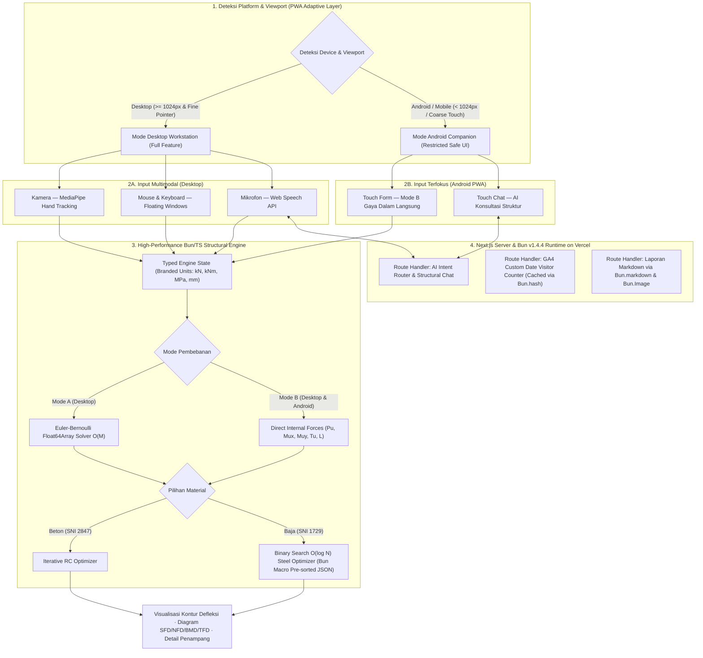

# 🏗️ Interactive Beam Deflection & Structural Design Simulator

**Simulasi defleksi balok & optimasi desain penampang (Beton Bertulang & Profil Baja IWF/BOX) akibat beban eksternal maupun gaya dalam — dibangun di atas arsitektur super ringan Next.js + Bun v1.4.4 Native APIs dengan dukungan PWA adaptif (Desktop Full Workstation & Android Field Mode).**

---

## 📖 Gambaran Umum

> [!IMPORTANT]
> **Interactive Beam Deflection & Structural Design Simulator** adalah aplikasi rekayasa struktur interaktif berbasis web dan **Progressive Web App (PWA)** yang menyimulasikan **defleksi balok**, **diagram gaya dalam**, serta **optimasi desain penampang Balok Beton Bertulang dan Balok Profil Baja (IWF & BOX)**. Aplikasi ini mendukung **dua mode input pembebanan** — melalui **beban eksternal & berat sendiri (_self-weight_)** secara _real-time_ maupun **input langsung gaya dalam hasil analisis struktur ($P_u, M\_{ux}, M\_{uy}, T_u$)** — serta dikendalikan melalui **gerakan tangan (_motion capture_)**, **mouse/kursor**, dan **perintah suara** yang diterjemahkan oleh **AI assistant** pada mode Desktop.

> [!NOTE]
> 📌 Dokumen ini bersifat _**living document**_ (Saat ini: **Iterasi v0.4**). Spesifikasi arsitektur mendalam terkait **Bun v1.4.4 Native APIs**, struktur _folder_, standar kode TypeScript, PWA Desktop vs Android, dan analitik pengunjung disimpan secara terpisah dan terstruktur di dalam `mdfiles/bun_v1_4_4_architecture_and_context.md`.

---

## ✨ Fitur Utama

### `1` · Pemilihan Material & Mode Input Pembebanan Ganda

Fleksibilitas penuh pada tahap awal permodelan balok:

- **Pilihan Material Balok:**
  - 🧱 **Balok Beton Bertulang (_Reinforced Concrete_)** — desain dimensi dan penulangan berdasarkan standar beton struktural (SNI 2847).
  - 🔩 **Balok Profil Baja (_Structural Steel_)** — pemilihan dan optimasi profil **IWF (_Wide Flange_)** maupun **BOX (_Hollow Structural Section_)** berdasarkan SNI 1729.
- **Pilihan Mode Input Pembebanan:**
  - **Mode A — Gaya Eksternal (_External Load Mode_):** Input panjang bentang ($L$), kondisi tumpuan, beban titik ($P$), beban merata ($q$), momen eksternal, serta perhitungan otomatis berat sendiri (_self-weight_). Mendukung interaksi beban _real-time_ menggunakan kursor maupun gestur tangan _(Khusus Mode Desktop)_.
  - **Mode B — Gaya Dalam Langsung (_Direct Internal Forces Mode_):** Input langsung hasil perhitungan gaya dalam terfaktor dari analisis struktur tanpa harus memodelkan beban eksternal dari awal _(Tersedia di Desktop & Android PWA)_, meliputi:
    - **Axial Load ($P_u$)** — gaya aksial terfaktor ($\text{kN}$)
    - **Momen Sumbu Kuat ($M\_{ux}$)** — momen lentur terfaktor arah sumbu X ($\text{kNm}$)
    - **Momen Sumbu Lemah ($M\_{uy}$)** — momen lentur terfaktor arah sumbu Y ($\text{kNm}$)
    - **Torsi ($T_u$)** — momen puntir/torsi terfaktor ($\text{kNm}$)
    - **Gaya Geser ($V_u$)** & **Panjang Bentang ($L$)** — untuk evaluasi geser, tekuk torsi lateral (_LTB_), dan kontrol lendutan ($\text{m}$)

### `2` · Desain & Optimasi Iteratif Penampang Berkecepatan Tinggi ($O(\log N)$)

Algoritma **optimasi iteratif** berbasis _pre-sorted lookup tables_ (di-bundle saat _compile-time_ menggunakan **Bun Macros**) yang mengevaluasi kandidat dimensi, penulangan, atau profil standar secara instan:

- **Optimasi Balok Beton Bertulang:** Merekomendasikan dimensi penampang ($b \times h$), konfigurasi & diameter tulangan tarik/tekan, serta tulangan geser/torsi (sengkang).
- **Optimasi Balok Profil Baja (IWF & BOX):** Merekomendasikan profil baja standar menggunakan _binary search_ $O(\log N)$ terhadap modulus plastis $Z_x$ yang memenuhi batas geometri maksimum ($H_{\max}$ dan $W_{\max}$) serta merekomendasikan mutu baja paling ekonomis dengan target efisiensi kapasitas **$M_u / \phi M_n \ge 90\%$** (namun tetap $\le 100\%$).

### `3` · Pemetaan Warna Defleksi

Menghitung kurva lendutan (_deflection_) sepanjang bentang balok menggunakan `Float64Array` berkecepatan $O(M)$ dan menggambarkannya melalui **_pemetaan warna_ (_color contour_) yang intuitif** — layaknya _software_ analisis struktur profesional seperti **SAP2000** — lengkap dengan pengecekan batas lendutan izin ($\Delta_{\max} \le L/\text{batas}$).

### `4` · Visualisasi Diagram Gaya Dalam

Visualisasi **SFD · NFD · BMD · TFD** yang **interaktif dan komprehensif**:

| Diagram | Kepanjangan              | Deskripsi                                                          |
| :-----: | :----------------------- | :----------------------------------------------------------------- |
| **SFD** | _Shear Force Diagram_    | Diagram gaya lintang/geser ($V_u$) sepanjang bentang balok         |
| **NFD** | _Normal Force Diagram_   | Diagram gaya normal (aksial $P_u$) sepanjang balok                 |
| **BMD** | _Bending Moment Diagram_ | Diagram momen lentur ($M_{ux}$ & $M_{uy}$) sepanjang bentang balok |
| **TFD** | _Torsion Force Diagram_  | Diagram momen puntir/torsi ($T_u$) sepanjang bentang balok         |

### `5` · Arsitektur PWA Adaptif (Desktop Workstation vs Android Field Companion)

Aplikasi memiliki dukungan instalasi **Progressive Web App (PWA)** penuh dengan pembagian kapabilitas antarmuka secara tegas untuk mencegah _error_ tampilan maupun penurunan performa pada layar kecil:

| Fitur & Kapabilitas                                            | 💻 Desktop (Web & Installed PWA) |       📱 Android (Installed PWA Lite Mode)       |
| :------------------------------------------------------------- | :------------------------------: | :----------------------------------------------: |
| **Mode B: Input Gaya Dalam ($P_u, M\_{ux}, M\_{uy}, T_u, L$)** |             ✅ Penuh             |          ✅ Penuh (Fokus Utama Mobile)           |
| **Optimasi Penampang Beton (SNI 2847) & Baja (SNI 1729)**      |             ✅ Penuh             |                     ✅ Penuh                     |
| **Visualisasi Potongan Penampang & Diagram Statis**            |             ✅ Penuh             |        ✅ Responsif Vertikal (_Tab View_)        |
| **AI Engineering Assistant (Diskusi Hasil Desain)**            |         ✅ Teks & Suara          |               ✅ Chat Teks Ringkas               |
| **Mode A: Simulasi Beban Eksternal Interaktif (_Drag Load_)**  |      ✅ _Real-time_ 60 FPS       | 🔒 Dinonaktifkan (Cegah _mis-touch_ layar kecil) |
| **Multi-Floating Draggable Windows**                           |      ✅ Bebas _Drag & Drop_      |     🔒 Diganti _Bottom Sheet_ / _Single Tab_     |
| **Kamera Hand Tracking (_Motion Capture_ Kursor)**             |        ✅ MediaPipe Hands        |  🔒 Dinonaktifkan (Hemat baterai & _viewport_)   |

### `6` · Google Analytics (GA4) & Custom Epoch Visitor Badge ("Flex Counter")

Dilengkapi telemetri **Google Analytics 4 (GA4)** serta _widget_ penghitung jumlah kunjungan (_visitor/session counter_) sejak tanggal peluncuran kustom yang di-_hardcode_ langsung di konfigurasi sistem (`ANALYTICS_START_DATE`), disajikan secara _real-time_ (dengan _server-side caching_ ringan di Bun Runtime Vercel) sebagai _trust & traction badge_ pada aplikasi.

---

## 📐 Spesifikasi Teknis Input & Output Perhitungan Struktur

### 🔄 1. Parameter Input Pembebanan & Geometri Bentang

| Mode Input                                            | Parameter yang Diinput Pengguna                                                                                                                                                                                                                                                  | Keterangan / Satuan                                                                                                                                    |
| :---------------------------------------------------- | :------------------------------------------------------------------------------------------------------------------------------------------------------------------------------------------------------------------------------------------------------------------------------- | :----------------------------------------------------------------------------------------------------------------------------------------------------- |
| **Mode A: Gaya Eksternal** _(Khusus Desktop)_         | • Panjang bentang ($L$) & jenis tumpuan • Beban terpusat ($P$) & posisi beban • Beban merata ($q$) • Berat sendiri (_self-weight_ otomatis dari $\gamma_{\text{material}}$)                                                                                             | Menghitung reaksi tumpuan, diagram gaya dalam, lendutan _real-time_, lalu meneruskan nilai ekstrem ($P_u, V_u, M_u, T_u$) ke modul desain penampang.   |
| **Mode B: Gaya Dalam Langsung** _(Desktop & Android)_ | • **Axial Load ($P_u$)** — $\text{kN}$ • **Momen Lentur Mayor ($M\_{ux}$)** — $\text{kNm}$ • **Momen Lentur Minor ($M\_{uy}$)** — $\text{kNm}$ • **Torsi ($T_u$)** — $\text{kNm}$ • **Gaya Geser ($V_u$)** — $\text{kN}$ • **Panjang Bentang ($L$)** — $\text{m}$ | Langsung mengevaluasi kapasitas penampang terhadap kombinasi aksial-lentur biaxial-torsi serta menghitung estimasi kurvatur/lendutan pada bentang $L$. |

---

### 🧱 2. Modul Balok Beton Bertulang (_Reinforced Concrete Beam_)

Mengacu pada prinsip desain kekuatan batas (_Ultimate Strength Design_ / SNI 2847):

| Kategori                       | Parameter                             | Pilihan / Format Input & Output                                                                                                                                                                                                                                                                                     |
| :----------------------------- | :------------------------------------ | :------------------------------------------------------------------------------------------------------------------------------------------------------------------------------------------------------------------------------------------------------------------------------------------------------------------ |
| **Input Material & Penampang** | **Mutu Beton**                        | Pilihan input dalam **$f'\_c$ ($\text{MPa}$)** _(mis. $20, 25, 30, 35\text{ MPa}$)_ atau **Mutu $K\text{-xxx}$** _(mis. $K\text{-}225, K\text{-}250, K\text{-}300, K\text{-}350, K\text{-}400$ dengan konversi otomatis $f'\_c = 0{,}083 \times K$)_.                                                               |
|                                | **Selimut Beton (_Concrete Cover_)**  | Tebal bersih selimut beton $d_c$ / $c_c$ ($\text{mm}$) — mis. $25\text{ mm}, 40\text{ mm}$, atau $50\text{ mm}$ sesuai kondisi eksposur.                                                                                                                                                                            |
|                                | **Mutu Baja Tulangan**                | • **Tulangan Polos (BJTP):** **BJTP 24** ($f_y = 240\text{ MPa}$) atau **BJTP 30** ($f_y = 295\text{–}300\text{ MPa}$) • **Tulangan Sirip/Ulir (BJTS):** **BJTS 40** ($f_y = 390\text{–}400\text{ MPa}$), **BJTS 50** ($f_y = 490\text{–}500\text{ MPa}$), atau **BJTS 60** ($f_y = 590\text{–}600\text{ MPa}$). |
|                                | **Dimensi Awal _(Opsional)_**         | Lebar ($b$) dan tinggi ($h$) awal jika ingin mode _check_, atau dikosongkan untuk mode _full auto-optimization_.                                                                                                                                                                                                    |
| **Output Optimasi Desain**     | **Rekomendasi Dimensi Penampang**     | Lebar balok ($b$) dan tinggi total ($h$) hasil optimasi rasio ekonomis ($h/b \approx 1{,}5\text{–}2{,}0$) yang memenuhi syarat lendutan dan spasi tulangan.                                                                                                                                                         |
|                                | **Tulangan Tarik & Tekan**            | Jumlah dan **diameter tulangan longitudinal tarik** ($A_s$, mis. `4 D19`) serta **tulangan tekan** ($A'_s$, mis. `2 D16`) beserta pengecekan rasio tulangan ($\rho_{\min} \le \rho \le \rho_{\max}$).                                                                                                               |
|                                | **Tulangan Geser (Sengkang) & Torsi** | **Diameter dan jarak sengkang** (mis. `Ø10 - 150 mm` di tumpuan & `Ø10 - 200 mm` di lapangan) serta kebutuhan tulangan memanjang tambahan akibat torsi ($A_l$) bila $T_u > T_{th}$.                                                                                                                                 |
|                                | **Ringkasan Rasio Kapasitas**         | Nilai kapasitas terfaktor ($\phi M_n, \phi V_n, \phi T_n$), rasio utilisasi ($M_u / \phi M_n$), dan visualisasi sketsa potongan melintang penampang beton.                                                                                                                                                          |

---

### 🔩 3. Modul Balok Profil Baja (_Structural Steel Beam — IWF & BOX_)

Mengacu pada metode LRFD (_Load and Resistance Factor Design_ / SNI 1729) dengan _database_ tabel profil baja standar (IWF dan Hollow/Box):

| Kategori                                | Parameter                              | Pilihan / Format Input & Output                                                                                                                                                                                                                                                                                         |
| :-------------------------------------- | :------------------------------------- | :---------------------------------------------------------------------------------------------------------------------------------------------------------------------------------------------------------------------------------------------------------------------------------------------------------------------- |
| **Input Material**                      | **Mutu Baja Struktural**               | Pilihan standar: **BJ 34** ($f_y = 210\text{ MPa}, f_u = 340\text{ MPa}$), **BJ 37** ($f_y = 240\text{ MPa}, f_u = 370\text{ MPa}$), **BJ 41** ($f_y = 250\text{ MPa}, f_u = 410\text{ MPa}$), **BJ 50** ($f_y = 290\text{ MPa}, f_u = 500\text{ MPa}$), atau **BJ 55** ($f_y = 410\text{ MPa}, f_u = 550\text{ MPa}$). |
| **Input Filter & Batasan (_Optional_)** | **Filter Tipe Profil**                 | Pilihan ruang pencarian: **Hanya IWF**, **Hanya BOX (Hollow)**, atau **Semua Profil (IWF + BOX)** _(otomatis membandingkan efisiensi IWF vs BOX terutama saat ada beban $M\_{uy}$ dan Torsi $T_u$ besar)_.                                                                                                              |
|                                         | **Batasan Dimensi Maksimum**           | Input opsional **Tinggi Penampang Maksimum ($H\_{\max}$)** dan **Lebar Penampang Maksimum ($W\_{\max}$ / $B\_{\max}$)** dalam $\text{mm}$ (mis. akibat batas ruang plafon atau arsitektural).                                                                                                                           |
| **Output Optimasi Desain**              | **Rekomendasi Profil Penampang**       | Daftar peringkat profil terbaik (mis. `IWF 300x150x6.5x9` atau `BOX 250x250x9`) yang lolos kelangsingan penampang (_compact/non-compact_), tekuk torsi lateral (_LTB_), interaksi aksial-lentur biaxial ($P_u\text{-}M_{ux}\text{-}M_{uy}$), torsi ($T_u$), dan batas dimensi ($H \le H_{\max}, W \le W_{\max}$).       |
|                                         | **Rekomendasi Mutu & Profil Ekonomis** | Fitur _Smart Grade & Section Optimizer_: mengevaluasi lintas mutu (**BJ 34 s/d BJ 55**) untuk merekomendasikan kombinasi profil + mutu baja paling ringan/ekonomis dengan **rasio utilisasi optimal $M_u / \phi M_n \ge 90\%$** ($0{,}90 \le \text{DCR} \le 1{,}00$).                                                   |

---

## ⚙️ Arsitektur Alur Sistem & Platform Split

---

## 🧭 Catatan Pengembangan & Roadmap Iterasi

|              Versi              | Fokus Iterasi                                                        | Detail Perubahan                                                                                                                                                                                                                                                                                                                                                                                                                                                                                                     |
| :-----------------------------: | :------------------------------------------------------------------- | :------------------------------------------------------------------------------------------------------------------------------------------------------------------------------------------------------------------------------------------------------------------------------------------------------------------------------------------------------------------------------------------------------------------------------------------------------------------------------------------------------------------- |
|            **v0.1**             | Rencana Inti                                                         | Simulator defleksi, pemetaan warna, optimasi iteratif, SFD/NFD/BMD.                                                                                                                                                                                                                                                                                                                                                                                                                                                  |
|            **v0.2**             | Multimodal & AI                                                      | ➕ Motion capture & kontrol gestur tangan (kursor virtual + simbol dinamis) · floating window · kontrol suara (batasan: toggle saja) · AI assistant.                                                                                                                                                                                                                                                                                                                                                                 |
|            **v0.3**             | Dual-Material & Dual-Load                                            | ➕ Pilihan material **Beton Bertulang** vs **Profil Baja (IWF & BOX)** · Dual mode input (**Gaya Eksternal** vs **Gaya Dalam $P_u, M\_{ux}, M\_{uy}, T_u, L$**) · Spesifikasi parameter SNI 2847 & SNI 1729.                                                                                                                                                                                                                                                                                                         |
|      **v0.4** _(Saat Ini)_      | **Bun v1.4.4 Native Stack, PWA Desktop/Android Split & GA4 Counter** | ➕ Standardisasi _tech stack_ super ringan: **Next.js (App Router) + Bun v1.4.4 Runtime di Vercel** (`bun fmt`, `bun check`, Bun Macros, `Bun.hash`, `Bun.markdown`, `Bun.Image`, `Bun.zstdCompressSync`). ➕ **PWA Adaptive Split:** Mode penuh di Desktop vs Mode terbatas & bebas _error_ di Android PWA. ➕ **Google Analytics (GA4) Custom Start-Date Visitor Counter** dengan _hardcoded epoch date_. ➕ Pembuatan dokumentasi arsitektur teknis di `mdfiles/bun_v1_4_4_architecture_and_context.md`. |
| **v0.5** _(Iterasi Berikutnya)_ | **Database & Riwayat Proyek**                                        | ⏳ Integrasi persistensi database menggunakan **Bun Native SQL (`Bun.SQL` / `bun:sqlite`)** yang di Bun v1.4.4 hemat 48% CPU per _query_ dan mendukung `query.cancel()` untuk menyimpan riwayat desain balok.                                                                                                                                                                                                                                                                                                        |
|  **v0.6** _(Iterasi Lanjutan)_  | **Ekspor Laporan & Validasi Otomatis**                               | ⏳ Ekspor lembar perhitungan struktur otomatis via `Bun.markdown` dan _thumbnail_ kurva lendutan via `Bun.Image`, serta _automated E2E testing_ menggunakan `Bun.WebView` & `bun test --check`.                                                                                                                                                                                                                                                                                                                      |

---

_Real-Time · Dual-Material (RC & Steel) · Bun v1.4.4 Native · Desktop & Android Adaptive PWA_

