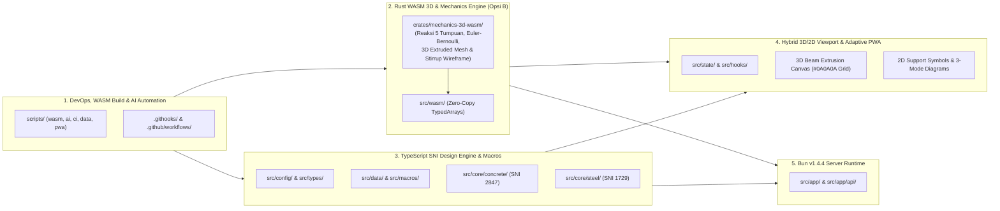
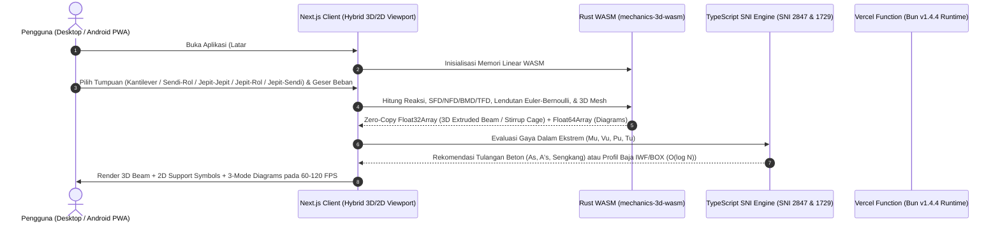
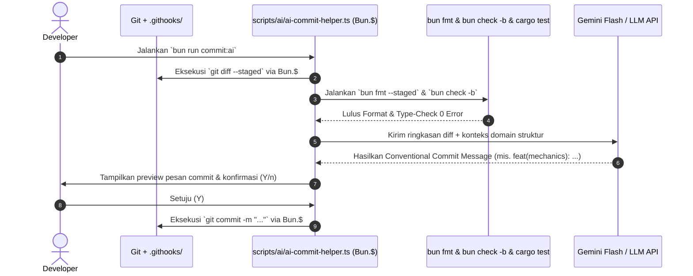

# ⚡ Technical Architecture & Context: Next.js + Bun v1.4.4 + Rust WASM (Hybrid Option B)

> **Dokumen Konteks Teknis (`mdfiles/bun_v1_4_4_architecture_and_context.md`)**
> Dokumen ini menjadi acuan tunggal (_Single Source of Truth_) bagi pengembang maupun _AI Coding Agent_ dalam membangun **Interactive Beam Deflection & Structural Design Simulator**. Seluruh keputusan arsitektur di bawah ini dirancang untuk memenuhi **20 Pilar Kualitas Rekayasa**: _Modular, Maintainable, Professional, Flexible, Sustainable, Reliable, Secure, Adaptive, Robust, Effective, Efficient, High-performance, User-friendly, Future-proof, Elegant, Intelligent, Trusted, Premium, Consistent, and Resilient_.
>
> 📌 **Referensi Struktur File Final & Mekanika 3D:** Daftar lengkap seluruh _folder_, _file_ produksi final, persiapan _environment_, serta kontrak fungsi per _file_ terdapat di `mdfiles/final_project_file_structure_and_preparation.md`, sementara spesifikasi rumus 5 jenis tumpuan, solver Euler-Bernoulli Rust WASM, dan visualisasi 3D/2D terdapat di `mdfiles/structural_mechanics_and_deflection_solver_spec.md`.

## 🔬 1. Hasil Riset Ekosistem Bun v1.4.4 + Rust WebAssembly (Hybrid Opsi B)

Sejak **Bun v1.4.0** (ditulis ulang dengan **Rust** untuk memangkas penggunaan CPU _idle_ hingga $5\times$ dan memori Next.js sebesar $28\%$) hingga rilis **Bun v1.4.4**, Bun telah bertransformasi menjadi _all-in-one runtime, package manager, type-checker, formatter, shell scripting engine,_ dan _native standard library_ yang menghilangkan kebutuhan akan puluhan _dependency_ npm pihak ketiga yang berat.

Untuk mendukung **visualisasi balok 3D ekstrusi secara _real-time_ (60–120 FPS)** tanpa jeda _Garbage Collector_ saat beban digeser dengan gestur tangan, arsitektur ini menggabungkan **Bun v1.4.4 + TypeScript** dengan **Rust WebAssembly (`wasm32-unknown-unknown`) melalui Pendekatan Hybrid Opsi B**:

- **Rust WASM (`crates/mechanics-3d-wasm/`):** Menjalankan komputasi mekanika struktur berfrekuensi tinggi (reaksi 5 jenis tumpuan, diagram gaya dalam SFD/NFD/BMD/TFD, integrasi kurva lendutan Euler-Bernoulli, serta pembuatan _3D Extruded Mesh_ profil IWF/BOX/Beton dan _3D Rebar Cage Wireframe_) dengan _Zero-Copy Memory Buffer_ langsung ke WebGL.
- **TypeScript + Bun Macros (`src/core/concrete/` & `src/core/steel/`):** Menjalankan algoritma evaluasi dan optimasi desain **SNI 2847:2019** (Beton) serta **SNI 1729:2020** (Baja IWF & BOX) agar aturan pasal-pasal SNI tetap mudah dipelihara, diinspeksi, dan divalidasi dengan `bun check -b`.

### 📊 Matriks Fitur Baru Bun v1.4.4 & Rust WASM yang Kita Maksimalkan

| Fitur / API Native                                 |      Versi / Target      | Keunggulan Teknis & Benchmark                                                                                                                                                                                                   | Implementasi Langsung pada Aplikasi Simulator Balok Kita                                                                                                                                          | Menggantikan Dependency Berat                               |
| :------------------------------------------------- | :----------------------: | :------------------------------------------------------------------------------------------------------------------------------------------------------------------------------------------------------------------------------ | :------------------------------------------------------------------------------------------------------------------------------------------------------------------------------------------------ | :---------------------------------------------------------- |
| **Rust WASM (`crates/mechanics-3d-wasm`)**         | `wasm32-unknown-unknown` | Eksekusi kode mesin mendekati _native_ dengan _Zero Garbage Collection Pause_ dan _linear memory buffer_ yang dapat dibaca langsung oleh WebGL (`Float32Array`).                                                                | Menghitung reaksi 5 jenis tumpuan, kurva lendutan Euler-Bernoulli $O(M)$, serta _vertex buffer_ 3D ekstrusi balok & _wireframe_ sengkang beton pada 60–120 FPS.                                   | Engine fisika/CAD JS yang lambat dan memicu _GC frame drop_ |
| **`bun fmt`**                                      |        **v1.4.4**        | _Built-in code formatter_ kompatibel Prettier (**$286\times$ lebih cepat dari Prettier**, RAM hanya $48\text{ MB}$ vs $459\text{ MB}$). Mencakup _auto-sort_ Tailwind CSS, `package.json`, dan _imports_ serta flag `--staged`. | Menjaga konsistensi seluruh kode `.ts`, `.tsx`, `.css`, `.json`, dan `.md` secara instan lewat _pre-commit hook_ `bun fmt --staged`.                                                              | `prettier`, `prettier-plugin-tailwindcss`, `lint-staged`    |
| **`bun check` & `bun check -b`**                   |   **v1.4.3 & v1.4.4**    | _Built-in TypeScript type checker_ berbasis _native_ (lulus $100\%$ uji konformansi TS 7.0.2, **$15\times$ lebih cepat** dengan flag `-b`).                                                                                     | Memvalidasi _advanced type-safety_ (satuan _branded types_ $\text{kN}, \text{kNm}, \text{MPa}, \text{mm}$) dan kontrak jembatan WASM dalam hitungan milidetik.                                    | `tsc` CLI standar yang lambat saat CI/CD                    |
| **`Bun.$` (Bun Native Shell) & `Bun.Glob`**        |    **v1.1 – v1.4.4**     | Eksekusi perintah _cross-platform shell_ (Windows, Linux, macOS) langsung di TypeScript dengan proteksi _command injection_ otomatis.                                                                                           | Mengorkestrasi kompilasi Rust WASM (`scripts/wasm/build-mechanics-wasm.ts`), membaca `git diff --staged` untuk **AI Commit Co-Helper**, dan verifikasi CI/CD.                                     | `husky`, `commitizen`, `zx`, `cross-env`, `glob`, `rimraf`  |
| **Bun Macros (`with { type: "macro" }`)**          |    **v1.0 – v1.4.4**     | Menjalankan fungsi TypeScript saat _bundle/compile-time_ dan menyuntikkan hasilnya langsung ke _bundle_ sebagai AST statis (_zero runtime cost_).                                                                               | Menghitung seluruh properti penampang IWF & BOX ($A, W, I_x, I_y, S_x, S_y, Z_x, Z_y, h_o, J, C_w, r_{ts}$) dari 5 dimensi primer di JSON dan mengurutkannya berdasarkan $Z_x$ saat _build time_. | Skrip _pre-build_ eksternal & tabel JSON raksasa            |
| **`Bun.SQL` & `bun:sqlite`**                       |    **v1.0 – v1.4.4**     | Di **v1.4.4**, penggunaan CPU `Bun.SQL` turun **$48\%$ per query**, hadir fitur `query.cancel()`, `COPY` streams, dan _column name transforms_.                                                                                 | Disiapkan untuk **Iterasi v0.5 (Database)**: menyimpan riwayat proyek simulasi pengguna dan _cache_ analitik tanpa ORM berat.                                                                     | `prisma`, `pg`, `mysql2`, `better-sqlite3`                  |
| **`Bun.markdown`**                                 |   **v1.4.0 & v1.3.12**   | Parser dan _renderer_ Markdown native ditulis dalam Rust (**$138\times$ lebih cepat** daripada `marked.parse()`).                                                                                                               | Merender penjelasan rumus SNI dari _AI Structural Assistant_ dan menghasilkan laporan perhitungan struktur (_calculation sheet_) secara instan.                                                   | `marked`, `remark`, `rehype`                                |
| **`Bun.Image`**                                    |   **v1.3.14 & v1.4.x**   | Pemrosesan gambar native (decode, resize, rotate, WebP/AVIF/PNG encode, dan pembuatan `.placeholder()` _thumbhash_).                                                                                                            | Menghasilkan seluruh ukuran ikon PWA (`192x192`, `512x512`, _maskable_) via `scripts/pwa/generate-pwa-icons.ts` dan _OpenGraph preview_ penampang balok.                                          | `sharp`, `jimp`, `pwa-asset-generator`                      |
| **`Bun.hash()` & `Bun.CryptoHasher`**              |    **v1.0 – v1.4.4**     | _Non-cryptographic hash_ super cepat (Wyhash, CRC32, CityHash) & _cryptographic hash_ (SHA-256, BLAKE2b).                                                                                                                       | Membuat _cache key_ deterministik $O(1)$ untuk hasil _solver_ kombinasi beban dan _caching response_ Google Analytics.                                                                            | `crypto-js`, `object-hash`, `xxhashjs`                      |
| **`Bun.zstdCompressSync()` & `Bun.deflateSync()`** |    **v1.1 – v1.4.4**     | Kompresi Zstandard, Gzip, dan Deflate native berkecepatan tinggi + native `CompressionStream`.                                                                                                                                  | Mengompresi _state_ konfigurasi balok menjadi _shareable URL string_ yang pendek dan padat tanpa _database_ pada tahap awal (MVP).                                                                | `pako`, `fflate`, `lz-string`                               |
| **`Bun.color()`**                                  |    **v1.1 – v1.4.4**     | Parsing, normalisasi, dan konversi format warna (`hex`, `rgb`, `hsl`, `css`) secara native.                                                                                                                                     | Menghasilkan gradasi warna _contour_ defleksi balok bergaya **SAP2000** secara presisi dan konsisten.                                                                                             | `chroma-js`, `tinycolor2`, `colord`                         |
| **`Bun.deepEquals()` & `Bun.peek()`**              |    **v1.0 – v1.4.4**     | Perbandingan objek bersarang secara mendalam di level native dan pembacaan nilai _resolved Promise_ tanpa ticks `await` tambahan.                                                                                               | Mencegah _re-render_ yang tidak perlu pada kanvas 3D defleksi $60\text{ FPS}$ saat parameter beban belum berubah.                                                                                 | `lodash.isequal`, `fast-deep-equal`                         |
| **`bun:test` & `Bun.WebView`**                     |    **v1.0 – v1.4.4**     | Test runner paralel (`bun test --parallel --check`) yang dapat memuat modul `.wasm` secara langsung.                                                                                                                            | Menguji keakuratan solver mekanika Rust WASM serta rumus SNI 2847 & SNI 1729 terhadap hitungan manual/SAP2000 secara otomatis.                                                                    | `jest`, `vitest`, `playwright`                              |

## 🗺️ 2. Ringkasan Domain Arsitektur: Hybrid Rust WASM (Opsi B) + Bun v1.4.4

Untuk mencapai performa **60–120 FPS tanpa jeda _Garbage Collector_** pada **Simulator Balok 3D** sekaligus menjaga kemudahan pemeliharaan rumus desain **SNI 2847 (Beton)** dan **SNI 1729 (Baja)**, proyek ini menerapkan **Arsitektur Hybrid Opsi B**:



## 🔄 3. Diagram Urutan Runtime & Automasi AI Co-Helper

### A. Alur Runtime Aplikasi (Hybrid 3D Rust WASM + TS SNI Optimizer + GA4 Flex Counter)



### B. Alur Automasi DevOps, Pre-Commit Hook, & AI Commit Message Co-Helper (`scripts/`)



## 🛡️ 4. Standar Rekayasa Kode, Type-Safety, & Optimasi Algoritma (Big O)

### A. Aturan Komentar Ketat (_Strict Comment Policy_)

1. **Dilarang keras menulis komentar yang tidak berguna (_No useless comments_).** Jangan pernah menulis komentar yang hanya mengulang nama fungsi atau variabel.
2. **Hanya tulis komentar jika benar-benar krusial** untuk menjelaskan logika matematika/rekayasa yang kompleks (misalnya: batas faktor $\beta_1$ SNI 2847 Pasal 22.2.2.4.3, persamaan tekuk torsi lateral SNI 1729 Bab F, atau integral kompatibilitas Mohr pada tumpuan statis tak tentu).
3. **Seluruh komentar di kode TypeScript maupun Rust WAJIB menggunakan Bahasa Inggris yang sederhana, lugas, dan mudah dipahami.**

### B. Advanced TypeScript Type-Safety (Divalidasi via `bun check -b`)

Untuk mencegah kesalahan konversi satuan teknik sipil (seperti mencampur $\text{kNm}$ dengan $\text{Nmm}$ pada rumus tegangan lentur), kita menggunakan **Branded Types** dan **Discriminated Unions**:

```typescript
// src/types/branded-units.ts
declare const UnitBrand: unique symbol;
export type Branded<T, B extends string> = T & { readonly [UnitBrand]: B };

export type Kilonewton = Branded<number, "kN">;
export type KilonewtonMeter = Branded<number, "kNm">;
export type Megapascal = Branded<number, "MPa">;
export type Millimeter = Branded<number, "mm">;
export type Meter = Branded<number, "m">;
export type UtilizationRatio = Branded<number, "DCR">;

export const toNmm = (moment: KilonewtonMeter): number => moment * 1_000_000;
```

### C. Optimasi Big O: Pemanfaatan Bun Macros (5 Dimensi Primer) & Rust WASM Zero-Copy

1. **Pre-Komputasi Properti Penampang & Pencarian Profil Baja Ekonomis dalam $O(\log N)$ dengan Bun Macros:**
   File JSON `src/data/steel-iwf-catalog.json` hanya menyimpan **5 parameter dimensi primer** ($H, B, t_w, t_f, r$). Pada saat _build time_, **Bun Macro** menghitung seluruh properti penampang ($A, W, I_x, I_y, S_x, S_y, Z_x, Z_y, r_x, r_y, h_o, J, C_w, r_{ts}$) menggunakan rumus resmi di `mdfiles/dokumentasi_rumus_profil_baja_wf.md` lalu mengurutkannya berdasarkan modulus plastis $Z_x$:

```typescript
import { computeIwfSectionProperties } from "../core/steel/iwf-geometric-properties";
// src/macros/precompute-steel-catalog.macro.ts
import rawIwfDimensions from "../data/steel-iwf-catalog.json";

export function getPrecomputedSortedIwfCatalog() {
  return rawIwfDimensions
    .map((dim) => computeIwfSectionProperties(dim))
    .sort((a, b) => a.Zx - b.Zx);
}
```

Saat _runtime_, `src/core/steel/steel-section-optimizer.ts` langsung mencari batas bawah modulus plastis minimum ($Z_{\text{req}} = \frac{M_{ux}}{\phi_b \cdot 0{,}90 \cdot f_y}$) menggunakan **Binary Search $O(\log N)$**.

2. **Solver Defleksi Balok & Generator 3D Extruded Mesh $O(M)$ di Rust WASM Tanpa Alokasi GC:**
   Kurva defleksi sepanjang bentang $L$ dibagi menjadi $M = 256$ segmen di dalam memori linear Rust (`crates/mechanics-3d-wasm/`), menghasilkan kurva lendutan $y(x)$, sudut rotasi $\theta(x)$, serta _vertex buffer_ 3D (`Float32Array`) untuk ekstrusi profil baja IWF/BOX maupun balok beton (mode _Solid + Potongan Ujung_ dan mode _Wireframe Sengkang_) yang langsung dirender oleh WebGL pada **$60\text{–}120\text{ FPS}$**.

## 📈 5. Arsitektur Google Analytics (GA4) & Custom Hardcoded Date Visitor Counter

Untuk memenuhi kebutuhan _flex counter_ ("Website ini telah dikunjungi **X** kali sejak tanggal **Y**"), kita menggabungkan:

1. **Konstanta Tanggal Hardcoded (`src/config/analytics-config.ts`):**
   Kamu bebas mengubah tanggal mulai perhitungan kapan saja di satu tempat.
2. **Zero-Dependency GA4 Fetcher di Bun Runtime (`src/app/api/analytics/visitors/route.ts`):**
   Menggunakan `crypto.subtle` bawaan Bun/Web API untuk menandatangani JWT Service Account dan memanggil endpoint REST GA4 `runReport` secara langsung, lalu menyimpannya di _cache_ selama $15\text{ menit}$.

## 📱 6. Strategi PWA Adaptif: Desktop Full 3D Workstation vs Android Restricted Mode

Melalui `src/config/platform-capabilities.ts`, sistem menerapkan **Adaptive Capability Gate**:

- **Di Desktop (`DESKTOP_WORKSTATION`):** Mengaktifkan kanvas **3D Beam Extrusion** di atas latar `#0A0A0A` ber-grid (Gambar 1 & 2), simbol tumpuan 2D (Gambar 3), **3 mode tampilan diagram SFD/NFD/BMD/TFD**, **Mode A (Gaya Eksternal Interaktif)**, **Mode B (Gaya Dalam)**, **6 Floating Windows**, **MediaPipe Hand Tracking**, dan **Voice Command**.
- **Di Android PWA (`ANDROID_COMPANION`):** Modul MediaPipe Hands dan _Floating Window Manager_ di-_code-split_ agar tidak diunduh di ponsel, sehingga aplikasi Android menjadi pendamping lapangan yang ringan untuk **Mode B (Gaya Dalam) + Optimasi Penampang Beton/Baja + Diskusi AI**.

## ⚙️ 7. Konfigurasi File Inti (`vercel.json`, `bunfig.toml`, & `package.json`)

### `vercel.json` (Mengaktifkan Native Bun v1.4.4 Runtime di Vercel)

```json
{
  "$schema": "https://openapi.vercel.sh/vercel.json",
  "bunVersion": "1.x",
  "framework": "nextjs"
}
```

### `bunfig.toml` (Memaksimalkan `bun fmt` v1.4.4, Security, & Test Runner)

```toml
[install]
minimumReleaseAge = "3d"
exact = true

[fmt]
printWidth = 100
semi = true
singleQuote = false
sortImports = true
sortTailwindcss = true
sortPackageJson = true

[test]
coverage = true
```

### `package.json` (Lengkap dengan Automasi `wasm:build`, `scripts/`, & AI Co-Helper)

```json
{
  "name": "interactive-beam-simulator",
  "version": "0.4.0",
  "private": true,
  "scripts": {
    "wasm:build": "bun run scripts/wasm/build-mechanics-wasm.ts",
    "dev": "bun --bun next dev --turbopack",
    "build": "bun run wasm:build && bun check -b && bun --bun next build",
    "start": "bun --bun next start",
    "typecheck": "bun check -b",
    "format": "bun fmt",
    "format:check": "bun fmt --check",
    "format:staged": "bun fmt --staged",
    "test": "bun test --parallel --check",
    "commit:ai": "bun run scripts/ai/ai-commit-helper.ts",
    "pr:ai": "bun run scripts/ai/ai-pr-summary.ts",
    "hooks:install": "bun run scripts/ci/install-git-hooks.ts",
    "ci:verify": "bun run scripts/ci/verify-pipeline.ts",
    "data:validate": "bun run scripts/data/validate-sni-catalogs.ts",
    "pwa:icons": "bun run scripts/pwa/generate-pwa-icons.ts"
  }
}
```
