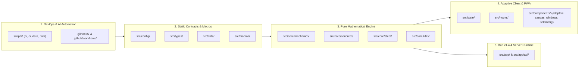
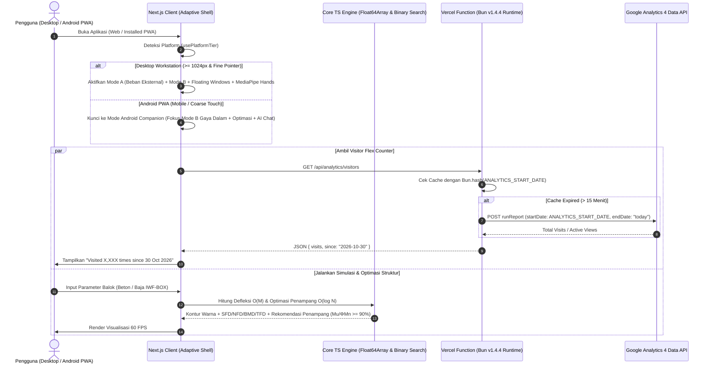
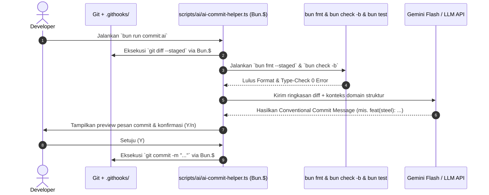

# ⚡ Technical Architecture & Context: Next.js + Bun v1.4.4 Native Stack

> **Dokumen Konteks Teknis (`mdfiles/bun_v1_4_4_architecture_and_context.md`)**
> Dokumen ini menjadi acuan tunggal (_Single Source of Truth_) bagi pengembang maupun _AI Coding Agent_ dalam membangun **Interactive Beam Deflection & Structural Design Simulator**. Seluruh keputusan arsitektur di bawah ini dirancang untuk memenuhi **20 Pilar Kualitas Rekayasa**: _Modular, Maintainable, Professional, Flexible, Sustainable, Reliable, Secure, Adaptive, Robust, Effective, Efficient, High-performance, User-friendly, Future-proof, Elegant, Intelligent, Trusted, Premium, Consistent, and Resilient_.
>
> 📌 **Referensi Struktur File Final:** Daftar lengkap seluruh _folder_, _file_ produksi final, persiapan _environment_, serta kontrak fungsi per _file_ telah dipisahkan secara khusus ke dalam dokumen `mdfiles/final_project_file_structure_and_preparation.md`.

---

## 🔬 1. Hasil Riset Ekosistem Bun (Hingga Bun v1.4.4 & Versi Sebelumnya)

Sejak **Bun v1.4.0** (ditulis ulang dengan **Rust** untuk memangkas penggunaan CPU _idle_ hingga $5\times$ dan memori Next.js sebesar $28\%$) hingga rilis **Bun v1.4.4**, Bun telah bertransformasi menjadi _all-in-one runtime, package manager, type-checker, formatter, shell scripting engine,_ dan _native standard library_ yang menghilangkan kebutuhan akan puluhan _dependency_ npm pihak ketiga yang berat.

Selain itu, **Vercel mendukung Bun Runtime secara native** melalui konfigurasi `"bunVersion": "1.x"` di `vercel.json` di atas infrastruktur _Fluid Compute_, sehingga Next.js Route Handlers dan Server Components dapat memanggil API global `Bun.*` secara langsung di _production_.

### 📊 Matriks Fitur Baru Bun v1.4.4, v1.4.x, & Native APIs yang Kita Maksimalkan

| Fitur / API Native Bun                             |     Versi Rilis      | Keunggulan Teknis & Benchmark                                                                                                                                                                                                                                                                      | Implementasi Langsung pada Aplikasi Simulator Balok Kita                                                                                                                                                                        | Menggantikan Dependency Berat                              |
| :------------------------------------------------- | :------------------: | :------------------------------------------------------------------------------------------------------------------------------------------------------------------------------------------------------------------------------------------------------------------------------------------------- | :------------------------------------------------------------------------------------------------------------------------------------------------------------------------------------------------------------------------------ | :--------------------------------------------------------- |
| **`bun fmt`**                                      |      **v1.4.4**      | _Built-in code formatter_ kompatibel Prettier (**$286\times$ lebih cepat dari Prettier**, $3\times\text{–}6\times$ lebih cepat dari `oxfmt`, RAM hanya $48\text{ MB}$ vs $459\text{ MB}$). Mencakup _auto-sort_ Tailwind CSS, `package.json`, dan _imports_ serta flag `--staged`.                 | Menjaga konsistensi seluruh kode `.ts`, `.tsx`, `.css`, `.json`, dan `.md` secara instan lewat _pre-commit hook_ `bun fmt --staged`.                                                                                            | `prettier`, `prettier-plugin-tailwindcss`, `lint-staged`   |
| **`bun check` & `bun check -b`**                   | **v1.4.3 & v1.4.4**  | _Built-in TypeScript type checker_ berbasis _native_ (lulus $100\%$ uji konformansi TS 7.0.2). Di **v1.4.4**, kecepatannya meningkat **$1{,}4\times\text{–}7{,}8\times$** pada proyek besar dan **$15\times$ lebih cepat** dengan flag `-b`. Mendukung `bun test --check` dan `bun build --check`. | Memvalidasi _advanced type-safety_ (satuan _branded types_ $\text{kN}, \text{kNm}, \text{MPa}, \text{mm}$) dalam hitungan milidetik di CI/CD maupun _git hooks_.                                                                | `tsc` CLI standar yang lambat saat CI/CD                   |
| **`Bun.$` (Bun Native Shell) & `Bun.Glob`**        |  **v1.1 – v1.4.4**   | Eksekusi perintah _cross-platform shell_ (Windows, Linux, macOS) langsung di TypeScript dengan proteksi _command injection_ otomatis dan pemindaian _file_ berkecepatan tinggi.                                                                                                                    | Menjalankan automasi `scripts/` seperti membaca `git diff --staged` untuk **AI Commit Co-Helper**, instalasi _git hooks_, dan verifikasi _pipeline_ CI/CD.                                                                      | `husky`, `commitizen`, `zx`, `cross-env`, `glob`, `rimraf` |
| **`Bun.SQL` & `bun:sqlite`**                       |  **v1.0 – v1.4.4**   | Di **v1.4.4**, penggunaan CPU `Bun.SQL` turun **$48\%$ per query**, hadir fitur `query.cancel()`, `COPY` streams, _column name transforms_, serta _User-Defined Functions (UDF)_ & _update hooks_ di `bun:sqlite`.                                                                                 | Disiapkan untuk **Iterasi v0.5 (Database)**: menyimpan riwayat proyek simulasi pengguna, _custom_ tabel profil baja, dan _cache_ analitik tanpa ORM berat.                                                                      | `prisma`, `pg`, `mysql2`, `better-sqlite3`                 |
| **Bun Install v1.4.4 & Package Manager**           |      **v1.4.4**      | _Exponential backoff retry_ saat _registry_ gangguan, `bun pm fetch`, `bun pm cache pack/unpack/prune`, _peer dependency resolution_ cerdas ala `pnpm`, skip paket Linux berbeda `libc` (`glibc` vs `musl`), dan proteksi `minimumReleaseAge`.                                                     | Mempercepat _build time_ di Vercel, mengamankan rantai pasok (_supply-chain security_) dengan `minimumReleaseAge = "3d"`, dan menjaga ukuran `node_modules` tetap minimal.                                                      | `npm`, `yarn`, `pnpm`, `npm-audit`                         |
| **Bun Macros (`with { type: "macro" }`)**          |  **v1.0 – v1.4.4**   | Menjalankan fungsi TypeScript saat _bundle/compile-time_ dan menyuntikkan hasilnya langsung ke _bundle_ sebagai AST statis (_zero runtime cost_).                                                                                                                                                  | Mengurutkan (_pre-sort_) tabel profil baja **IWF & BOX** berdasarkan modulus plastis $Z_x$, momen inersia $I_x$, dan konstanta torsi $J$ saat _build time_, sehingga _runtime_ tinggal melakukan **Binary Search $O(\log N)$**. | Skrip _pre-build_ eksternal                                |
| **`Bun.markdown`**                                 | **v1.4.0 & v1.3.12** | Parser dan _renderer_ Markdown native ditulis dalam Rust (**$138\times$ lebih cepat** daripada `marked.parse()`).                                                                                                                                                                                  | Merender penjelasan rumus SNI dari _AI Structural Assistant_ dan menghasilkan laporan perhitungan struktur (_calculation sheet_) secara instan.                                                                                 | `marked`, `remark`, `rehype`                               |
| **`Bun.Image`**                                    | **v1.3.14 & v1.4.x** | Pemrosesan gambar native (decode, resize, rotate, WebP/AVIF/PNG encode, dan pembuatan `.placeholder()` _thumbhash_).                                                                                                                                                                               | Menghasilkan seluruh ukuran ikon PWA (`192x192`, `512x512`, _maskable_) via `scripts/pwa/generate-pwa-icons.ts` dan _OpenGraph preview_ penampang balok.                                                                        | `sharp`, `jimp`, `pwa-asset-generator`                     |
| **`Bun.hash()` & `Bun.CryptoHasher`**              |  **v1.0 – v1.4.4**   | _Non-cryptographic hash_ super cepat (Wyhash, CRC32, CityHash) & _cryptographic hash_ (SHA-256, BLAKE2b).                                                                                                                                                                                          | Membuat _cache key_ deterministik $O(1)$ untuk hasil _solver_ kombinasi beban $(P_u, M_{ux}, M_{uy}, T_u, L)$ dan _caching response_ Google Analytics.                                                                          | `crypto-js`, `object-hash`, `xxhashjs`                     |
| **`Bun.zstdCompressSync()` & `Bun.deflateSync()`** |  **v1.1 – v1.4.4**   | Kompresi Zstandard, Gzip, dan Deflate native berkecepatan tinggi + native `CompressionStream`.                                                                                                                                                                                                     | Mengompresi _state_ konfigurasi balok menjadi _shareable URL string_ yang pendek dan padat tanpa _database_ pada tahap awal (MVP).                                                                                              | `pako`, `fflate`, `lz-string`                              |
| **`Bun.color()`**                                  |  **v1.1 – v1.4.4**   | Parsing, normalisasi, dan konversi format warna (`hex`, `rgb`, `hsl`, `css`) secara native.                                                                                                                                                                                                        | Menghasilkan gradasi warna _contour_ defleksi balok bergaya **SAP2000** secara presisi dan konsisten.                                                                                                                           | `chroma-js`, `tinycolor2`, `colord`                        |
| **`Bun.deepEquals()` & `Bun.peek()`**              |  **v1.0 – v1.4.4**   | Perbandingan objek bersarang secara mendalam di level native dan pembacaan nilai _resolved Promise_ tanpa ticks `await` tambahan.                                                                                                                                                                  | Mencegah _re-render_ yang tidak perlu pada kanvas defleksi $60\text{ FPS}$ saat parameter beban belum berubah dan mempercepat pembacaan _cache_ sinkron.                                                                        | `lodash.isequal`, `fast-deep-equal`                        |
| **`bun:test` & `Bun.WebView`**                     |  **v1.0 – v1.4.4**   | Test runner paralel (`bun test --parallel --check`) + _headless browser automation_ native (`Bun.WebView` di v1.4).                                                                                                                                                                                | Menguji keakuratan rumus SNI 2847 & SNI 1729 terhadap hitungan manual/SAP2000 secara otomatis.                                                                                                                                  | `jest`, `vitest`, `playwright`                             |

---

## 🗺️ 2. Ringkasan Domain Arsitektur & Referensi File Structure

Untuk menjaga agar proyek tetap **Modular, Maintainable, dan Clean**, seluruh kode dibagi menjadi **8 Lapisan Domain Terisolasi**. Detail pohon _file_ produksi final dan spesifikasi tiap _file_ terdapat di `mdfiles/final_project_file_structure_and_preparation.md`.



---

## 🔄 3. Diagram Urutan Runtime & Automasi AI Co-Helper

### A. Alur Runtime Aplikasi (Desktop Workstation vs Android PWA + GA4 Flex Counter)



### B. Alur Automasi DevOps, Pre-Commit Hook, & AI Commit Message Co-Helper (`scripts/`)



---

## 🛡️ 4. Standar Rekayasa Kode, Type-Safety, & Optimasi Algoritma (Big O)

### A. Aturan Komentar Ketat (_Strict Comment Policy_)

1. **Dilarang keras menulis komentar yang tidak berguna (_No useless comments_).** Jangan pernah menulis komentar yang hanya mengulang nama fungsi atau variabel.
2. **Hanya tulis komentar jika benar-benar krusial** untuk menjelaskan logika matematika/rekayasa yang kompleks (misalnya: batas faktor $\beta_1$ SNI 2847 Pasal 22.2.2.4.3 atau persamaan tekuk torsi lateral SNI 1729 Bab F).
3. **Seluruh komentar WAJIB menggunakan Bahasa Inggris yang sederhana, lugas, dan mudah dipahami.**

### B. Advanced TypeScript Type-Safety (Divalidasi via `bun check -b`)

Untuk mencegah kesalahan konversi satuan teknik sipil (seperti mencampur $\text{kNm}$ dengan $\text{Nmm}$ pada rumus tegangan lentur), kita menggunakan **Branded Types** dan **Discriminated Unions**:

```typescript
// src/types/branded-units.ts
declare const UnitBrand: unique symbol;
export type Branded<T, B extends string> = T & { readonly [UnitBrand]: B };

export type Kilonewton = Branded<number, "kN">;
export type KilonewtonMeter = Branded<number, "kNm">;
export type Megapascal = Branded<number, "MPa">;
export type Millimeter = Branded<number, "mm">;
export type Meter = Branded<number, "m">;
export type UtilizationRatio = Branded<number, "DCR">;

export const toNmm = (moment: KilonewtonMeter): number => moment * 1_000_000;
```

### C. Optimasi Big O & Pemanfaatan Bun Macros

1. **Pencarian Profil Baja Ekonomis dalam $O(\log N)$ dengan Bun Macros:**
   Daripada melakukan _looping_ dan _sorting_ ratusan profil IWF dan BOX setiap kali pengguna menggeser beban di layar ($O(N \log N)$ per _frame_), kita menggunakan **Bun Macro** untuk mengurutkan tabel JSON berdasarkan modulus penampang plastis $Z_x$ pada saat _build time_:

```typescript
// src/macros/precompute-steel-catalog.macro.ts
import rawIwf from "../data/steel-iwf-catalog.json";

export function getSortedIwfCatalog() {
  return [...rawIwf].sort((a, b) => a.Zx - b.Zx);
}
```

Saat _runtime_, kita langsung mencari batas bawah modulus plastis minimum yang dibutuhkan ($Z_{\text{req}} = \frac{M_{ux}}{\phi_b \cdot 0{,}90 \cdot f_y}$ untuk target efisiensi $\ge 90\%$) menggunakan **Binary Search $O(\log N)$**:

```typescript
// src/core/steel/steel-section-optimizer.ts
import { getSortedIwfCatalog } from "../../macros/precompute-steel-catalog.macro" with { type: "macro" };

const IWF_CATALOG = getSortedIwfCatalog();

// Binary search finds the lightest profile meeting target plastic modulus in O(log N) time.
export function findLowerBoundIndex(requiredZx: number): number {
  let low = 0;
  let high = IWF_CATALOG.length - 1;
  while (low <= high) {
    const mid = (low + high) >>> 1;
    if (IWF_CATALOG[mid].Zx < requiredZx) {
      low = mid + 1;
    } else {
      high = mid - 1;
    }
  }
  return low;
}
```

2. **Solver Defleksi Balok $O(M)$ Tanpa Alokasi Garbage Collector:**
   Kurva defleksi sepanjang bentang $L$ dibagi menjadi $M$ segmen diskrit (misal $M = 256$) dan dihitung menggunakan `Float64Array` yang dialokasikan satu kali (_pre-allocated typed buffer_), sehingga pergerakan tangan/mouse pada **Mode A** berjalan mulus di **$60\text{–}120\text{ FPS}$** tanpa membebani memori.

---

## 📈 5. Arsitektur Google Analytics (GA4) & Custom Hardcoded Date Visitor Counter

Untuk memenuhi kebutuhan _flex counter_ ("Website ini telah dikunjungi **X** kali sejak tanggal **Y**"), kita menggabungkan:

1. **Konstanta Tanggal Hardcoded (`src/config/analytics-config.ts`):**
   Kamu bebas mengubah tanggal mulai perhitungan kapan saja di satu tempat.
2. **Zero-Dependency GA4 Fetcher di Bun Runtime (`src/app/api/analytics/visitors/route.ts`):**
   Tidak perlu menginstal SDK `@google-analytics/data` yang beratnya puluhan megabyte. Kita cukup menggunakan `crypto.subtle` bawaan Bun/Web API untuk menandatangani JWT Service Account dan memanggil endpoint REST GA4 `runReport` secara langsung, lalu menyimpannya di _cache_ selama $15\text{ menit}$.

---

## 📱 6. Strategi PWA Adaptif: Desktop Full Workstation vs Android Restricted Mode

Memaksakan seluruh fitur _heavy desktop_ (seperti $5$ _floating window_ sekaligus, kamera _hand tracking_ MediaPipe, dan _drag_ vektor beban bebas) ke layar sempit Android akan memicu _layout collision_, _touch conflict_, dan menguras baterai.

Oleh karena itu, kita menerapkan **Adaptive Capability Gate** melalui `src/config/platform-capabilities.ts`:

- **Di Desktop (`DESKTOP_WORKSTATION`):** Mengaktifkan seluruh fitur **Mode A (Gaya Eksternal Interaktif)**, **Mode B (Gaya Dalam)**, **Floating Window Manager**, **MediaPipe Hand Tracking**, dan **Voice Command**.
- **Di Android PWA (`ANDROID_COMPANION`):** Modul MediaPipe Hands dan _Floating Window Manager_ **tidak pernah di-download (_code-split_ via _dynamic import_)**, sehingga aplikasi Android menjadi pendamping lapangan/kelas yang super ringan dan berfokus pada **Mode B: Kalkulator & Optimizer Penampang Beton/Baja ($P_u, M\_{ux}, M\_{uy}, T_u, L$) + Diagram Gaya Dalam + Asisten Diskusi AI**.

---

## ⚙️ 7. Konfigurasi File Inti (`vercel.json`, `bunfig.toml`, & `package.json`)

### `vercel.json` (Mengaktifkan Native Bun v1.4.4 Runtime di Vercel)

```json
{
  "$schema": "https://openapi.vercel.sh/vercel.json",
  "bunVersion": "1.x",
  "framework": "nextjs"
}
```

### `bunfig.toml` (Memaksimalkan `bun fmt` v1.4.4, Security, & Test Runner)

```toml
[install]
minimumReleaseAge = "3d"
exact = true

[fmt]
printWidth = 100
semi = true
singleQuote = false
sortImports = true
sortTailwindcss = true
sortPackageJson = true

[test]
coverage = true
```

### `package.json` (Lengkap dengan Automasi `scripts/` & AI Co-Helper)

```json
{
  "name": "interactive-beam-simulator",
  "version": "0.4.0",
  "private": true,
  "scripts": {
    "dev": "bun --bun next dev --turbopack",
    "build": "bun check -b && bun --bun next build",
    "start": "bun --bun next start",
    "typecheck": "bun check -b",
    "format": "bun fmt",
    "format:check": "bun fmt --check",
    "format:staged": "bun fmt --staged",
    "test": "bun test --parallel --check",
    "commit:ai": "bun run scripts/ai/ai-commit-helper.ts",
    "pr:ai": "bun run scripts/ai/ai-pr-summary.ts",
    "hooks:install": "bun run scripts/ci/install-git-hooks.ts",
    "ci:verify": "bun run scripts/ci/verify-pipeline.ts",
    "data:validate": "bun run scripts/data/validate-sni-catalogs.ts",
    "pwa:icons": "bun run scripts/pwa/generate-pwa-icons.ts"
  }
}
```

---

## 🗺️ 8. Catatan Iterasi & Rencana Pengembangan Selanjutnya

1. **Iterasi Saat Ini (v0.4 — Fondasi Arsitektur, Persiapan Proyek & Final File Structure):**
   - Penetapan _stack_ **Next.js + Bun v1.4.4 + Vercel**.
   - Pemisahan tegas **PWA Desktop Workstation** vs **PWA Android Restricted Companion**.
   - Desain _endpoint_ **Google Analytics (GA4) Custom Start-Date Visitor Counter**.
   - Penyusunan struktur _file_ produksi final dan skrip automasi CI/CD + **AI Commit Co-Helper** di `mdfiles/final_project_file_structure_and_preparation.md`.
2. **Iterasi Selanjutnya (v0.5 — Implementasi Core Solver & UI MVP):**
   - Implementasi `src/core/mechanics/`, `src/core/concrete/`, dan `src/core/steel/` beserta pengujian unit (`bun test --parallel --check`).
   - Pembuatan antarmuka kanvas defleksi, diagram SFD/NFD/BMD/TFD, serta _badge_ pengunjung GA4.
3. **Iterasi Masa Depan (v0.6 — Database & Multimodal):**
   - Diskusi dan pemilihan skema _database_ menggunakan **`Bun.SQL` (PostgreSQL/SQLite)** untuk menyimpan riwayat perhitungan dan profil kustom.
   - Integrasi penuh **MediaPipe Hands** dan **Voice Command Registry** pada mode Desktop.
