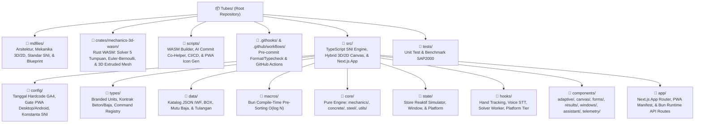

# 🏛️ Final Production File Structure & Project Preparation Blueprint

> **Dokumen Blueprint Persiapan & Struktur File Final (`mdfiles/final_project_file_structure_and_preparation.md`)**
> Dokumen ini dirancang sebagai cetak biru produksi (_Production Blueprint_) untuk proyek **Interactive Beam Deflection & Structural Design Simulator**.
> Setiap _folder_ memiliki satu domain tanggung jawab yang tegas, dan setiap _file_ di dalamnya memiliki nama yang mencerminkan secara presisi isi, algoritma, dan kontrak tipe di dalamnya.

## 🧰 1. Persiapan Menyeluruh Sebelum Mulai Ngoding (Pre-Flight Checklist)

Sebelum menulis baris kode pertama pada tahap implementasi, berikut adalah daftar kebutuhan teknis, kredensial, dan _dataset_ teknik sipil yang perlu disiapkan:

### A. Persiapan Runtime & Development Tooling

1. **Bun v1.4.4+ Native Toolchain & Rust WASM Compiler (Opsi B):**

   - Pastikan terinstal `bun >= 1.4.4` (`bun upgrade`) agar fitur native `bun fmt`, `bun check -b`, `Bun.SQL`, `Bun.markdown`, `Bun.Image`, dan `Bun.$` aktif sepenuhnya.
   - Pastikan terinstal `rustup` dengan target `wasm32-unknown-unknown` (`rustup target add wasm32-unknown-unknown`) dan `wasm-bindgen-cli` / `wasm-pack` untuk mengompilasi `crates/mechanics-3d-wasm/` melalui perintah `bun run wasm:build`.

2. **Git Hooks Native (Tanpa Husky):**

   - Menggunakan direktori `.githooks/` yang diaktifkan satu kali lewat `bun run hooks:install` (`git config core.hooksPath .githooks`), sehingga setiap `git commit` otomatis menjalankan `bun fmt --staged` dan `bun check -b`.

3. **Editor / AI Coding Agent Configuration:**

   - Menyimpan aturan _system prompt_ proyek (20 pilar kualitas, _strict comment policy_, _branded units_, dan larangan _heavy dependency_) agar AI Coding Agent selalu patuh pada arsitektur.

### B. Persiapan Environment Variables (`.env.local` & Vercel Secrets)

| Nama Variabel                    | Sifat                  | Kegunaan Spesifik                                                                                                                    |
| -------------------------------- | ---------------------- | ------------------------------------------------------------------------------------------------------------------------------------ |
| `AI_PROVIDER_API_KEY`            | Rahasia (Server & CLI) | Kunci API LLM (mis. Gemini 2.5 Flash / OpenRouter) untuk fitur _In-App AI Assistant_ DAN skrip CLI `scripts/ai/ai-commit-helper.ts`. |
| `AI_COMMIT_MODEL`                | Opsional               | Model cepat untuk pembuat pesan _commit_ otomatis (default: `gemini-2.5-flash`).                                                     |
| `NEXT_PUBLIC_GA4_MEASUREMENT_ID` | Publik (Client)        | ID pelacakan Google Analytics 4 (format `G-XXXXXXXXXX`) untuk mencatat aktivitas halaman.                                            |
| `GA4_PROPERTY_ID`                | Rahasia (Server)       | ID numerik properti GA4 untuk ditarik oleh _endpoint_ `/api/analytics/visitors`.                                                     |
| `GA4_SERVICE_ACCOUNT_EMAIL`      | Rahasia (Server)       | Email _Service Account_ Google Cloud dengan akses _Viewer_ ke properti GA4.                                                          |
| `GA4_PRIVATE_KEY`                | Rahasia (Server)       | Kunci privat RSA untuk menandatangani token JWT GA4 secara native menggunakan `crypto.subtle`.                                       |

### C. Persiapan Dataset & Benchmark Teknik Sipil (`src/data/` & `tests/fixtures/`)

1. **Katalog Dimensi Primer Baja IWF (`steel-iwf-catalog.json`):** Hanya menyimpan 5 dimensi primer standar JIS G 3192 / SNI ($H, B, t_w, t_f, r$) untuk menghemat ukuran data & _context window_. Seluruh properti turunan ($A, W, I_x, I_y, S_x, S_y, Z_x, Z_y, r_x, r_y, h_o, J, C_w, r_{ts}$) dihitung otomatis saat _compile-time_ oleh Bun Macro menggunakan rumus di `mdfiles/dokumentasi_rumus_profil_baja_wf.md`.

2. **Katalog Dimensi Primer Baja BOX (`steel-box-catalog.json`):** Menyimpan dimensi primer _Hollow Structural Section_ persegi/persegi panjang standar JIS G 3466 ($H, B, t$), sedangkan properti penampang ($A, W, I_x, I_y, Z_x, Z_y, J, C$) dihitung otomatis saat _compile-time_.

3. **Katalog Baja Tulangan (`concrete-rebar-catalog.json`):** Tabel diameter nominal tulangan polos (BJTP 24/30) dan sirip/ulir (BJTS 40/50/60) beserta luas penampang satu tulangan ($A_{b} = \frac{1}{4}\pi d_b^2$) dan berat per meter.

4. **Kasus Uji Benchmark SAP2000 (`tests/fixtures/sap2000-verification-cases.json`):** Nilai referensi reaksi tumpuan, momen maksimum, lendutan $\Delta_{\max}$, luas tulangan $A_s$, dan rasio kapasitas baja $\text{DCR} = M_u / \phi M_n$ untuk pengujian otomatis.

## 🧭 2. Diagram Pemetaan Folder ke Tanggung Jawab Domain



## 🌳 3. Pohon Struktur File Final Produksi (Exhaustive File Tree)

Setiap nama _file_ di bawah ini dirancang agar **100% mencerminkan isi modulnya** dan **selaras dengan nama _folder_ induknya**:

```
Tubes/
├── .github/
│   └── workflows/
│       ├── ci-quality-gate.yml                         # Pipeline GitHub Actions: bun fmt --check, bun check -b, bun test
│       └── release-vercel-preview.yml                  # Pipeline verifikasi build & validasi katalog SNI sebelum deploy
├── .githooks/
│   ├── pre-commit                                      # Menjalankan bun fmt --staged & bun check -b secara otomatis
│   └── commit-msg                                      # Memvalidasi format Conventional Commits pada pesan commit
├── mdfiles/
│   ├── bun_v1_4_4_architecture_and_context.md          # Konteks arsitektur Bun v1.4.4, Big O, & 20 Pilar Rekayasa
│   ├── final_project_file_structure_and_preparation.md # Blueprint struktur file final, persiapan, & kontrak modul
│   ├── dokumentasi_rumus_profil_baja_wf.md             # Rumus geometri penampang IWF & BOX (A, I, S, Z, J, Cw, rts, C)
│   ├── sni_2847_concrete_design_specification.md       # Dokumentasi optimasi tulangan lentur (As, A's) & sengkang geser beton
│   ├── sni_1729_steel_design_specification.md          # Dokumentasi rumus LTB, biaxial, torsi, & katalog dimensi IWF/BOX
│   ├── structural_mechanics_and_deflection_solver_spec.md # Dokumentasi 5 tumpuan, lendutan negatif, sumbu XYZ, & 3D/2D
│   ├── cad_bim_cae_export_specification.md             # Spesifikasi ekspor ke AutoCAD, SAP2000, Revit, IDEA StatiCa, & SolidWorks
│   └── iterate/                                        # Arsip riwayat iterasi dokumen spesifikasi (V2, v3, v4, v4.1)
├── crates/
│   └── mechanics-3d-wasm/
│       ├── Cargo.toml                                  # Konfigurasi crate Rust (crate-type = ["cdylib", "rlib"], wasm-bindgen)
│       └── src/
│           ├── lib.rs                                  # Entrypoint ekspor fungsi WASM & alokasi buffer memori linear
│           ├── supports.rs                             # Solver reaksi 5 jenis tumpuan (Kantilever, Sendi-Rol, Jepit-Jepit, Jepit-Rol, Jepit-Sendi)
│           ├── diagrams.rs                             # Generator array diskrit SFD (Vu), NFD (Pu), BMD (Mux, Muy), & TFD (Tu)
│           ├── deflection.rs                           # Integrasi trapesium ganda Euler-Bernoulli O(M) & Interpolator Mode B
│           ├── extrude_3d.rs                           # Generator 3D Extruded Mesh tanpa distorsi untuk profil IWF, BOX, & Beton Solid
│           └── rebar_cage_3d.rs                        # Generator 3D Wireframe tulangan memanjang & cincin sengkang beton per spasi s
├── scripts/
│   ├── wasm/
│   │   └── build-mechanics-wasm.ts                     # Mengompilasi crates/mechanics-3d-wasm ke src/wasm/ via Bun.$
│   ├── ai/
│   │   ├── ai-commit-helper.ts                         # Membaca git diff --staged via Bun.$ & membuat commit message via AI
│   │   ├── ai-pr-summary.ts                            # Membuat deskripsi Pull Request otomatis dari riwayat commit cabang
│   │   └── ai-code-policy-auditor.ts                   # Memeriksa kepatuhan terhadap aturan "No useless comments"
│   ├── ci/
│   │   ├── install-git-hooks.ts                        # Mengaktifkan folder .githooks/ ke konfigurasi lokal git
│   │   ├── verify-pipeline.ts                          # Orkestrator satu perintah untuk format, typecheck, & unit test
│   │   └── benchmark-solver-performance.ts             # Mengukur waktu eksekusi solver O(M) & binary search O(log N)
│   ├── data/
│   │   ├── validate-sni-catalogs.ts                    # Memvalidasi integritas properti geometris JSON IWF, BOX, & Rebar
│   │   └── generate-sap2000-fixtures.ts                # Menghasilkan dataset uji referensi analitis untuk folder tests/
│   └── pwa/
│       └── generate-pwa-icons.ts                       # Menghasilkan seluruh ukuran ikon PWA dari 1 logo menggunakan Bun.Image
├── public/
│   ├── icons/
│   │   ├── icon-192x192.png                            # Ikon standar PWA Android & Desktop
│   │   ├── icon-512x512.png                            # Ikon splash screen PWA beresolusi tinggi
│   │   └── icon-maskable-512x512.png                   # Ikon adaptif Android Launcher
│   └── wasm/
│       └── mediapipe-hands-assets.json                 # Manifest lokasi aset WebAssembly lokal untuk hand tracking Desktop
├── src/
│   ├── config/
│   │   ├── analytics-config.ts                         # Konstanta HARDCODED_START_DATE & TTL cache untuk visitor flex badge
│   │   ├── platform-capabilities.ts                    # Aturan pembatasan fitur Desktop Workstation vs Android Companion
│   │   ├── sni-safety-factors.ts                       # Faktor reduksi kekuatan (Φ lentur, geser, torsi, aksial) SNI 2847 & 1729
│   │   └── deflection-limits-config.ts                 # Batas lendutan izin (L/180, L/240, L/360, L/480)
│   ├── types/
│   │   ├── branded-units.ts                            # Tipe satuan ketat: Kilonewton, KilonewtonMeter, Megapascal, Millimeter
│   │   ├── beam-loading-modes.ts                       # Discriminated union untuk Mode A (External Load) & Mode B (Internal Forces)
│   │   ├── concrete-sni2847-types.ts                   # Kontrak input/output desain balok beton bertulang (fc', K-xxx, BJTP/BJTS)
│   │   ├── steel-sni1729-types.ts                      # Kontrak input/output desain profil baja (IWF, BOX, BJ 34-55, Hmax/Wmax)
│   │   ├── hand-gesture-cursor-types.ts                # Tipe landmark tangan & 5 state simbol kursor dinamis
│   │   ├── command-registry-types.ts                   # Skema ketat seluruh ID command untuk Voice Control & AI Intent Router
│   │   └── analytics-telemetry-types.ts                # Tipe payload response visitor counter GA4
│   ├── data/
│   │   ├── steel-iwf-catalog.json                      # Dimensi primer profil standar IWF (H, B, tw, tf, r)
│   │   ├── steel-box-catalog.json                      # Dimensi primer profil standar BOX / Hollow (H, B, t)
│   │   ├── steel-material-grades.json                  # Daftar mutu baja BJ 34, BJ 37, BJ 41, BJ 50, BJ 55 (fy & fu)
│   │   ├── concrete-rebar-catalog.json                 # Daftar diameter tulangan polos/ulir & mutu BJTP 24/30, BJTS 40/50/60
│   │   └── command-registry-catalog.json               # Daftar definisi command diskrit beserta deskripsi untuk function calling AI
│   ├── wasm/
│   │   ├── mechanics_3d_wasm_bg.wasm                   # Binary WebAssembly hasil kompilasi Rust untuk solver mekanika & 3D mesh
│   │   └── mechanics_3d_wasm.js                        # Glue binding TypeScript/JS otomatis dari wasm-bindgen
│   ├── macros/
│   │   ├── precompute-steel-catalog.macro.ts           # Bun Macro: menghitung properti IWF/BOX (A, I, S, Z, J, Cw, rts) & sort Zx saat build-time
│   │   └── build-metadata.macro.ts                     # Bun Macro: menyuntikkan hash commit & timestamp build ke bundle
│   ├── core/
│   │   ├── mechanics/
│   │   │   ├── wasm-mechanics-bridge.ts                # Jembatan TypeScript zero-copy menuju modul Rust WASM (crates/mechanics-3d-wasm)
│   │   │   ├── support-reactions-solver.ts             # Wrapper TS & fallback analitis untuk 5 jenis tumpuan (8 variasi orientasi)
│   │   │   ├── internal-force-diagrams-solver.ts       # Wrapper TS pembaca buffer SFD (Vu), NFD (Pu), BMD (Mux, Muy), TFD (Tu)
│   │   │   ├── euler-bernoulli-deflection-solver.ts    # Wrapper TS pembaca kurva lendutan Float64Array & mesh 3D Float32Array
│   │   │   └── direct-internal-force-interpolator.ts   # Mengestimasi kurvatur & lendutan langsung dari input Mode B
│   │   ├── concrete/
│   │   │   ├── concrete-grade-converter.ts             # Konversi akurat mutu K-xxx ke fc' (MPa), modulus Ec, & faktor β1
│   │   │   ├── whitney-flexural-designer.ts            # Perhitungan blok tegangan Whitney, jumlah & diameter tulangan tarik As & tekan A's
│   │   │   ├── shear-stirrup-designer.ts               # Perhitungan kuat geser beton Vc, diameter sengkang, & jarak spasi s
│   │   │   └── concrete-section-optimizer.ts           # Optimasi iteratif dimensi ekonomis (b x h) & kombinasi tulangan efisien
│   │   ├── steel/
│   │   │   ├── section-compactness-classifier.ts       # Klasifikasi sayap & badan (Kompak, Non-Kompak, Langsing) SNI 1729 Bab B4
│   │   │   ├── lateral-torsional-buckling-solver.ts    # Kapasitas momen nominal Mn berdasarkan panjang tak terkekang Lb (Lp, Lr)
│   │   │   ├── biaxial-interaction-evaluator.ts        # Persamaan interaksi aksial-lentur biaxial SNI 1729 Pasal H1-1a & H1-1b
│   │   │   ├── steel-torsion-shear-evaluator.ts        # Evaluasi geser & torsi penampang terbuka (IWF) vs tertutup (BOX)
│   │   │   └── steel-section-optimizer.ts              # Binary search O(log N) profil IWF/BOX & mutu ekonomis (Mu/ΦMn >= 90%)
│   │   ├── exporters/
│   │   │   ├── dxf-autocad-exporter.ts                 # Generator 2D Section & 3D Mesh (.dxf) serta AutoLISP (.lsp) untuk AutoCAD
│   │   │   ├── s2k-sap2000-exporter.ts                 # Generator model teks (.s2k) lengkap profil, 5 tumpuan, & beban untuk SAP2000
│   │   │   ├── ifc4-bim-revit-exporter.ts              # Generator BIM (.ifc IFC4 & Revit Type Catalog .txt) untuk Revit & Tekla
│   │   │   ├── ideastatica-exporter.ts                 # Generator IDEA Open Model (.iom.xml & .saf) untuk IDEA StatiCa
│   │   │   └── step-solidworks-exporter.ts             # Generator 3D B-Rep Solid (.step/.stp AP214) & Mesh (.stl) untuk SolidWorks
│   │   └── utils/
│   │       ├── sap2000-contour-color-mapper.ts         # Interpolasi warna kontur lendutan menggunakan Bun.color
│   │       ├── url-state-zstd-serializer.ts            # Kompresi konfigurasi balok ke URL via Bun.zstdCompressSync / CompressionStream
│   │       └── deterministic-solver-cache.ts           # Memoization hasil kalkulasi struktur menggunakan kunci cepat Bun.hash
│   ├── state/
│   │   ├── beam-simulator-store.ts                     # State terpusat untuk material, mode beban, hasil solver, & hasil optimasi
│   │   ├── floating-window-store.ts                    # State koordinat (x, y), z-index, & visibilitas tiap floating window Desktop
│   │   └── multimodal-interaction-store.ts             # State aktif/nonaktif kamera tangan, simbol kursor, & mikrofon suara
│   ├── hooks/
│   │   ├── use-platform-capabilities.ts                # Hook reaktif pendeteksi Desktop Workstation vs Android Companion
│   │   ├── use-structural-solver-engine.ts             # Hook penghubung input UI ke Core Engine dengan proteksi Bun.deepEquals
│   │   ├── use-mediapipe-hand-tracking.ts              # Hook kamera hand tracking (Hanya dimuat secara dinamis di Desktop)
│   │   ├── use-web-speech-command.ts                   # Hook Speech-to-Text & pengirim transkrip ke AI Intent Router
│   │   └── use-visitor-flex-counter.ts                 # Hook pengambil jumlah kunjungan sejak HARDCODED_START_DATE
│   ├── components/
│   │   ├── adaptive/
│   │   │   ├── AdaptiveApplicationShell.tsx            # Pembungkus utama yang merender DesktopWorkstation atau AndroidCompanion
│   │   │   ├── DesktopWorkstationView.tsx              # Tata letak penuh kanvas interaktif + Floating Windows + Kursor Tangan
│   │   │   └── AndroidCompanionView.tsx                # Tata letak mobile ringkas khusus Mode B (Gaya Dalam) & Optimasi Penampang
│   │   ├── canvas/
│   │   │   ├── ErzyshDarkGridBackground.tsx            # Latar belakang #0A0A0A + grid teknik #1F2020 + radial glow (Gambar 1 & 2)
│   │   │   ├── Beam3DExtrudedViewport.tsx              # Viewport WebGL 3D ekstrusi profil Baja IWF/BOX & Beton (Solid vs Wireframe Sengkang)
│   │   │   ├── SupportSymbols2DOverlay.tsx             # Overlay 2D tumpuan Sendi, Rol, & Jepit bergaya Gambar 3 (#94A3B8 & #334155)
│   │   │   ├── MultiModeDiagram2DOverlay.tsx           # Grafik 2D SFD/NFD/BMD/TFD (3 Mode: Bertumpuk di As Balok, Vertikal Bawah, atau Window)
│   │   │   ├── DeflectionHudAndColorbar.tsx            # Colorbar Legend (0 s/d -Δmax) di kanan & kartu -Δmax di kiri bawah
│   │   │   ├── CoordinateAxisSwitcher.tsx              # Pengatur orientasi sumbu dinamis (Z-Up, Y-Up, atau Custom XYZ) + 3D Gizmo
│   │   │   ├── ConcreteCrossSectionSvg.tsx             # Gambar teknik 2D potongan ujung beton lengkap dengan tulangan & sengkang
│   │   │   └── SteelProfileCrossSectionSvg.tsx         # Gambar teknik 2D potongan melintang profil IWF & BOX beserta dimensi
│   │   ├── forms/
│   │   │   ├── MaterialAndLoadModeSelector.tsx         # Toggle pemilihan Beton vs Baja dan Mode A (Eksternal) vs Mode B (Gaya Dalam)
│   │   │   ├── ExternalLoadInteractiveForm.tsx         # Input bentang L, tumpuan, beban titik P, & beban merata q (Mode A)
│   │   │   ├── DirectInternalForcesForm.tsx            # Input langsung Pu, Mux, Muy, Tu, Vu, & L (Mode B)
│   │   │   ├── ConcreteDesignParametersForm.tsx        # Input fc' / K-xxx, selimut beton, & mutu tulangan BJTP/BJTS
│   │   │   └── SteelDesignParametersForm.tsx           # Input mutu BJ 34-55, filter IWF/BOX/All, serta batas Hmax & Wmax
│   │   ├── results/
│   │   │   ├── ConcreteOptimizationResultCard.tsx      # Ringkasan dimensi ekonomis (b x h), tulangan tarik/tekan, & sengkang
│   │   │   ├── SteelOptimizationRankingTable.tsx       # Tabel peringkat profil IWF/BOX & rekomendasi mutu (Mu/ΦMn >= 90%)
│   │   │   ├── DeflectionServiceabilityBadge.tsx       # Indikator lulus/gagal batas lendutan izin (|Δmax| <= L/batas)
│   │   │   └── ProfileAndModelExportModal.tsx          # Panel ekspor profil & balok ke .dxf, .lsp, .s2k, .ifc, .iom.xml, .step, .stl
│   │   ├── windows/
│   │   │   ├── DraggableFloatingWindow.tsx             # Komponen jendela mengambang Desktop (mendukung drag mouse & gestur ✌️)
│   │   │   ├── DynamicHandCursorOverlay.tsx            # Kursor virtual dengan 5 perubahan simbol (✋ ◎, 🤏 ⌖, ✊ ▼, ☝️ ▸, ✌️ ▣)
│   │   │   └── HandTrackingCameraPreview.tsx           # Jendela mini pratinjau skeleton tangan & indikator gestur aktif
│   │   ├── assistant/
│   │   │   ├── StructuralAiAssistantPanel.tsx          # Panel diskusi rekayasa struktur & penjelasan hasil optimasi SNI
│   │   │   └── VoiceCommandStatusToast.tsx             # Notifikasi visual saat perintah suara berhasil mengeksekusi Command Registry
│   │   └── telemetry/
│   │       ├── GoogleAnalyticsScriptLoader.tsx         # Pengirim event page_view & interaksi ke Google Analytics 4
│   │       └── CustomEpochVisitorFlexBadge.tsx         # Badge UI: "Visited X,XXX times since [HARDCODED_START_DATE]"
│   └── app/
│       ├── globals.css                                 # Styling dasar Tailwind CSS & variabel tema gelap rekayasa struktur
│       ├── layout.tsx                                  # Root layout Next.js + metadata PWA + GoogleAnalyticsScriptLoader
│       ├── page.tsx                                    # Halaman utama yang memuat AdaptiveApplicationShell
│       ├── manifest.ts                                 # Generator Web App Manifest PWA (mendukung instalasi Desktop & Android)
│       └── api/
│           ├── analytics/
│           │   └── visitors/
│           │       └── route.ts                        # Bun Runtime API: tarik total kunjungan GA4 sejak HARDCODED_START_DATE
│           ├── ai/
│           │   ├── intent-router/
│           │   │   └── route.ts                        # Bun Runtime API: terjemahkan suara ke Command Registry via function calling
│           │   └── structural-consultant/
│           │       └── route.ts                        # Bun Runtime API: diskusi hasil optimasi IWF vs BOX & beton SNI
│           └── report/
│               └── calculation-sheet/
│                   └── route.ts                        # Bun Runtime API: render laporan struktur via Bun.markdown & Bun.Image
├── tests/
│   ├── fixtures/
│   │   └── sap2000-verification-cases.json             # Data uji acuan dari spreadsheet manual & SAP2000
│   ├── mechanics/
│   │   └── euler-bernoulli-deflection.test.ts          # Uji akurasi lendutan & diagram SFD/NFD/BMD/TFD
│   ├── concrete/
│   │   └── concrete-sni2847-optimizer.test.ts          # Uji akurasi jumlah & diameter tulangan tarik/tekan serta spasi sengkang geser
│   ├── steel/
│   │   └── steel-sni1729-optimizer.test.ts             # Uji akurasi binary search O(log N), LTB, interaksi biaxial, & rasio >= 90%
│   └── platform/
│       └── platform-capabilities-gate.test.ts          # Uji kepastian pembatasan fitur pada mode Android Companion vs Desktop
├── .env.example                                        # Template variabel environment tanpa kunci rahasia asli
├── bunfig.toml                                         # Konfigurasi native bun fmt, bun test, & bun install security
├── next.config.ts                                      # Konfigurasi Next.js, headers keamanan, & optimasi bundle
├── package.json                                        # Daftar skrip kerja & minimal dependencies
├── tsconfig.json                                       # Aturan strict TypeScript untuk bun check -b
└── vercel.json                                         # Konfigurasi deployment Vercel dengan native "bunVersion": "1.x"
```

## 📋 4. Matriks Kontrak Tanggung Jawab Setiap Folder & File Inti

### A. Folder `scripts/` (Automasi DevOps, CI/CD, & AI Co-Helper)

| Path File                               | Fungsi Spesifik                                                                                                                                                                                     | API Native Bun yang Dipakai        |
| --------------------------------------- | --------------------------------------------------------------------------------------------------------------------------------------------------------------------------------------------------- | ---------------------------------- |
| `scripts/ai/ai-commit-helper.ts`        | Menjalankan `bun fmt --staged` dan `bun check -b`, membaca `git diff --staged`, mengirim perubahan ke LLM API untuk menyusun pesan _Conventional Commit_ yang presisi, lalu melakukan `git commit`. | `Bun.$`, `fetch()`, `console`      |
| `scripts/ai/ai-pr-summary.ts`           | Membaca daftar _commit_ antara cabang aktif dan `main`, lalu membuat ringkasan _Pull Request_ lengkap dengan bagian perubahan rumus/UI.                                                             | `Bun.$`, `Bun.markdown`, `fetch()` |
| `scripts/ai/ai-code-policy-auditor.ts`  | Memindai seluruh _file_ `.ts`/`.tsx` di `src/` untuk memastikan tidak ada komentar sampah (_useless comments_) dan seluruh komentar menggunakan Bahasa Inggris sederhana.                           | `Bun.Glob`, `Bun.file().text()`    |
| `scripts/ci/install-git-hooks.ts`       | Mengatur `git config core.hooksPath .githooks` dan memberikan izin eksekusi (`chmod +x`) pada `.githooks/pre-commit` serta `.githooks/commit-msg`.                                                  | `Bun.$`                            |
| `scripts/ci/verify-pipeline.ts`         | Menjalankan `bun fmt --check`, `bun check -b`, `bun run data:validate`, dan `bun test --parallel --check` secara berurutan.                                                                         | `Bun.$`, `Bun.nanoseconds()`       |
| `scripts/data/validate-sni-catalogs.ts` | Memeriksa seluruh entri JSON profil IWF, BOX, dan tulangan agar tidak ada nilai $Z_x, I_x, A, f_y$ yang nol, negatif, atau salah satuan.                                                            | `Bun.file().json()`                |
| `scripts/pwa/generate-pwa-icons.ts`     | Mengubah satu gambar master menjadi `icon-192x192.png`, `icon-512x512.png`, dan `icon-maskable-512x512.png` untuk manifest PWA.                                                                     | `Bun.Image`, `Bun.write()`         |

### B. Folder `src/core/` (Pure Mathematical & Structural Engine)

| Path File                                        | Algoritma & Standar Acuan                                                                                                                                                                                                                         | Kompleksitas Waktu (Big O)                     |
| ------------------------------------------------ | ------------------------------------------------------------------------------------------------------------------------------------------------------------------------------------------------------------------------------------------------- | ---------------------------------------------- |
| `mechanics/euler-bernoulli-deflection-solver.ts` | Integrasi numerik trapesium ganda atas kurva kelengkungan $\kappa(x) = \frac{M_x(x)}{E I_x}$ ke dalam _pre-allocated_ `Float64Array` berukuran $M$ titik.                                                                                         | $O(M)$ dengan _Zero GC Allocation_             |
| `concrete/whitney-flexural-designer.ts`          | Blok tegangan tekan ekuivalen Whitney SNI 2847 ($\beta_1$ dinamis terhadap $f'_c$), evaluasi tulangan tunggal vs rangkap ($A_s$ & $A'_s$).                                                                                                        | $O(1)$ Analitis Langsung                       |
| `concrete/shear-stirrup-designer.ts`             | Kapasitas geser beton $\phi V_c = \phi \cdot 0{,}17 \lambda \sqrt{f'_c} b_w d$ dan penentuan jarak sengkang $s = \frac{A_v f_{yt} d}{V_s}$.                                                                                                       | $O(K)$ terhadap $K$ kandidat diameter sengkang |
| `steel/lateral-torsional-buckling-solver.ts`     | Evaluasi3 zona LTB SNI 1729 Bab F ($L_b \le L_p$ plastis penuh, $L_p < L_b \le L_r$ inelastis, dan $L_b > L_r$ tekuk elastis).                                                                                                                    | $O(1)$ per evaluasi profil                     |
| `steel/steel-section-optimizer.ts`               | Pencarian batas bawah modulus plastis $Z_{\text{req}}$ menggunakan _Binary Search_ pada katalog yang sudah diurutkan oleh Bun Macro, difilter dengan $H \le H_{\max}$, $W \le W_{\max}$, dan target $0{,}90 \le \frac{M_u}{\phi M_n} \le 1{,}00$. | $O(\log N)$ untuk pencarian awal               |

## 🤖 5. Blueprint Kode Automasi `scripts/` (Siap Pakai dengan Bun v1.4.4)

Berikut adalah rancangan kode untuk skrip **AI Commit Message Co-Helper** dan **Git Hooks Installer** menggunakan `Bun.$` native tanpa _dependency_ tambahan:

### A. `scripts/ai/ai-commit-helper.ts`

```
import { $ } from "bun";

async function generateAiCommitMessage(): Promise<void> {
  await $`bun fmt --staged`;
  await $`bun check -b`;

  const stagedDiff = await $`git diff --staged --unified=2`.text();
  if (!stagedDiff.trim()) {
    console.error("No staged changes found. Run 'git add' first.");
    process.exit(1);
  }

  const apiKey = Bun.env.AI_PROVIDER_API_KEY;
  if (!apiKey) {
    console.error("Missing AI_PROVIDER_API_KEY in environment.");
    process.exit(1);
  }

  const prompt = [
    "Generate a concise Conventional Commit message (feat, fix, perf, refactor, docs, test, chore).",
    "Scope must match the folder name (e.g., mechanics, concrete, steel, canvas, pwa, analytics, scripts).",
    "Output ONLY the commit message without markdown backticks.",
    "Staged git diff:",
    stagedDiff.slice(0, 12000),
  ].join("\n\n");

  const response = await fetch(
    `https://generativelanguage.googleapis.com/v1beta/models/${Bun.env.AI_COMMIT_MODEL ?? "gemini-2.5-flash"}:generateContent?key=${apiKey}`,
    {
      method: "POST",
      headers: { "Content-Type": "application/json" },
      body: JSON.stringify({
        contents: [{ parts: [{ text: prompt }] }],
        generationConfig: { temperature: 0.2, maxOutputTokens: 120 },
      }),
    }
  );

  const payload = await response.json();
  const commitMessage = payload?.candidates?.[0]?.content?.parts?.[0]?.text?.trim();

  if (!commitMessage) {
    console.error("Failed to generate commit message from AI response.");
    process.exit(1);
  }

  console.log(`\nProposed Commit Message:\n----------------------------------------\n${commitMessage}\n----------------------------------------`);

  if (Bun.argv.includes("--auto")) {
    await $`git commit -m ${commitMessage}`;
    return;
  }

  process.stdout.write("Commit with this message? [Y/n]: ");
  for await (const line of console) {
    const answer = line.trim().toLowerCase();
    if (answer === "" || answer === "y" || answer === "yes") {
      await $`git commit -m ${commitMessage}`;
    } else {
      console.log("Commit aborted.");
    }
    break;
  }
}

generateAiCommitMessage();

```

### B. `scripts/ci/install-git-hooks.ts`

```
import { $ } from "bun";

async function installHooks(): Promise<void> {
  await Bun.write(
    ".githooks/pre-commit",
    "#!/usr/bin/env sh\nset -e\nbun fmt --staged\nbun check -b\n"
  );

  await Bun.write(
    ".githooks/commit-msg",
    '#!/usr/bin/env sh\nset -e\ngrep -Eq "^(feat|fix|perf|refactor|docs|test|chore)(\\([a-z0-9-]+\\))?: .+" "$1" || {\n  echo "Error: Commit message must follow Conventional Commits format."\n  exit 1\n}\n'
  );

  await $`chmod +x .githooks/pre-commit .githooks/commit-msg`;
  await $`git config core.hooksPath .githooks`;
  console.log("Native Bun git hooks installed in .githooks/");
}

installHooks();

```

### C. `.github/workflows/ci-quality-gate.yml`

```
name: CI Quality Gate (Bun v1.4.4)

on:
  push:
    branches: [main]
  pull_request:
    branches: [main]

jobs:
  verify:
    runs-on: ubuntu-latest
    steps:
      - name: Checkout Repository
        uses: actions/checkout@v4

      - name: Setup Bun v1.4.4
        uses: oven-sh/setup-bun@v2
        with:
          bun-version: "1.4.4"

      - name: Install Dependencies
        run: bun install --frozen-lockfile

      - name: Check Formatting (bun fmt)
        run: bun fmt --check

      - name: Native TypeScript Check (bun check -b)
        run: bun check -b

      - name: Validate SNI Steel & Concrete Catalogs
        run: bun run data:validate

      - name: Audit Strict Comment Policy
        run: bun run scripts/ai/ai-code-policy-auditor.ts

      - name: Run Parallel Unit & SAP2000 Benchmark Tests
        run: bun test --parallel --check

```
