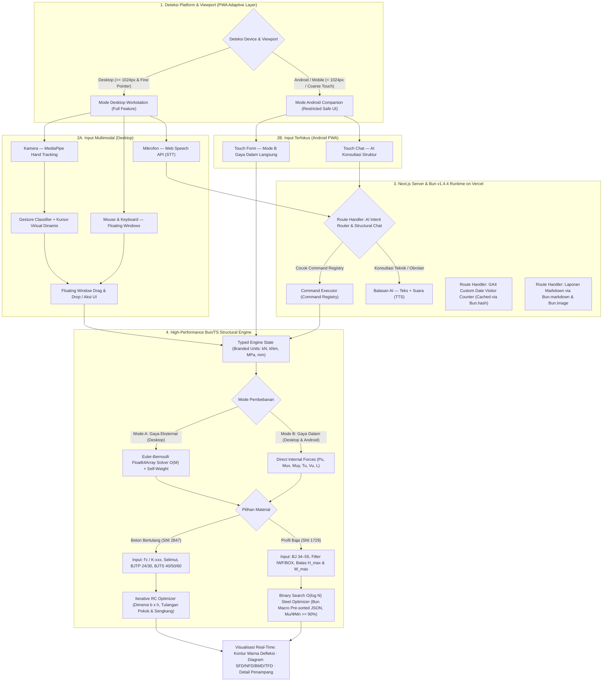

# 🏗️ Interactive Beam Deflection & Structural Design Simulator

**Simulasi defleksi balok & optimasi desain penampang (Beton Bertulang & Profil Baja IWF/BOX) akibat beban eksternal maupun gaya dalam — dikendalikan lewat gerakan tangan, mouse, dan suara secara _real-time_ di atas arsitektur super ringan Next.js + Bun v1.4.4 Native APIs dengan dukungan PWA adaptif (Desktop Full Workstation & Android Field Mode).**

[https://img.shields.io/badge/rencana-v0.4_living_document-yellow?style=flat-square]
[https://img.shields.io/badge/stack-Next.js_%2B_Bun_v1.4.4-black?style=flat-square]
[https://img.shields.io/badge/material-Beton_(SNI_2847)_%26_Baja_IWF%2FBOX_(SNI_1729)-teal?style=flat-square]
[https://img.shields.io/badge/animasi-real--time_dan_ringan-brightgreen?style=flat-square]
[https://img.shields.io/badge/defleksi-pemetaan_warna_intuitif-blue?style=flat-square]
[https://img.shields.io/badge/interaksi-motion_capture_tangan-orange?style=flat-square]
[https://img.shields.io/badge/kontrol-voice_command_%2B_AI-purple?style=flat-square]
[https://img.shields.io/badge/platform-Adaptive_PWA_(Desktop_%26_Android)-informational?style=flat-square]

---

## 📖 Gambaran Umum

> [!IMPORTANT]
> **Interactive Beam Deflection & Structural Design Simulator** adalah aplikasi rekayasa struktur interaktif berbasis web dan **Progressive Web App (PWA)** yang menyimulasikan **defleksi balok**, **diagram gaya dalam**, serta **optimasi desain penampang Balok Beton Bertulang dan Balok Profil Baja (IWF & BOX)** dengan animasi yang **_smooth_ dan ringan**. Aplikasi ini mendukung **dua mode input pembebanan** — melalui **beban eksternal & berat sendiri (_self-weight_)** secara _real-time_ maupun **input langsung gaya dalam hasil analisis struktur ($P_u, M\_{ux}, M\_{uy}, T_u$)** — serta dapat dikendalikan sepenuhnya melalui **gerakan tangan (_motion capture_)**, **mouse/kursor**, dan **perintah suara** yang diterjemahkan oleh **AI assistant** pada mode Desktop.

> [!NOTE]
> 📌 Dokumen ini bersifat _**living document**_ (Saat ini: **Iterasi v0.4**) — rencana akan terus berkembang seiring berjalannya waktu. Rancangan ini disusun mengikuti alur pengembangan _software_ teknik sipil berbasis AI (mulai dari analisis kebutuhan, spesifikasi input-output terukur, standar desain SNI, hingga rencana pengujian dan dokumentasi GitHub). Spesifikasi arsitektur mendalam terkait **Bun v1.4.4 Native APIs**, struktur _folder_, standar kode TypeScript, PWA Desktop vs Android, dan analitik pengunjung disimpan secara terpisah dan terstruktur di dalam `mdfiles/bun_v1_4_4_architecture_and_context.md`.

---

## ✨ Fitur Utama

### `1` · Pemilihan Material & Mode Input Pembebanan Ganda

Fleksibilitas penuh pada tahap awal permodelan balok:

- **Pilihan Material Balok:**
  - 🧱 **Balok Beton Bertulang (_Reinforced Concrete_)** — desain dimensi dan penulangan berdasarkan standar beton struktural (**SNI 2847**).
  - 🔩 **Balok Profil Baja (_Structural Steel_)** — pemilihan dan optimasi profil **IWF (_Wide Flange_)** maupun **BOX (_Hollow Structural Section_)** berdasarkan **SNI 1729**.
- **Pilihan Mode Input Pembebanan:**
  - **Mode A — Gaya Eksternal (_External Load Mode_):** Input panjang bentang ($L$), kondisi tumpuan, beban titik ($P$), beban merata ($q$), momen eksternal, serta perhitungan otomatis berat sendiri (_self-weight_). Mendukung interaksi beban _real-time_ menggunakan kursor maupun gestur tangan _(Khusus Mode Desktop)_.
  - **Mode B — Gaya Dalam Langsung (_Direct Internal Forces Mode_):** Input langsung hasil perhitungan gaya dalam terfaktor dari analisis struktur tanpa harus memodelkan beban eksternal dari awal _(Tersedia di Desktop & Android PWA)_, meliputi:
    - **Axial Load ($P_u$)** — gaya aksial terfaktor ($\text{kN}$)
    - **Momen Sumbu Kuat ($M\_{ux}$)** — momen lentur terfaktor arah sumbu X ($\text{kNm}$)
    - **Momen Sumbu Lemah ($M\_{uy}$)** — momen lentur terfaktor arah sumbu Y ($\text{kNm}$)
    - **Torsi ($T_u$)** — momen puntir/torsi terfaktor ($\text{kNm}$)
    - **Gaya Geser ($V_u$)** & **Panjang Bentang ($L$)** — untuk evaluasi geser, tekuk torsi lateral (_LTB_), dan kontrol lendutan ($\text{m}$)

### `2` · Desain & Optimasi Iteratif Penampang Berkecepatan Tinggi ($O(\log N)$)

Algoritma **optimasi iteratif** berbasis _pre-sorted lookup tables_ (di-bundle saat _compile-time_ menggunakan **Bun Macros**) yang mengevaluasi berbagai kandidat dimensi, penulangan, atau profil standar secara bertahap dan instan untuk menghasilkan rekomendasi desain paling aman dan ekonomis:

- **Optimasi Balok Beton Bertulang:** Merekomendasikan dimensi penampang ($b \times h$), konfigurasi & diameter tulangan tarik/tekan, serta tulangan geser/torsi (sengkang).
- **Optimasi Balok Profil Baja (IWF & BOX):** Merekomendasikan profil baja standar menggunakan _binary search_ $O(\log N)$ terhadap modulus plastis $Z_x$ yang memenuhi batas geometri maksimum ($H_{\max}$ dan $W_{\max}$) serta merekomendasikan mutu baja paling ekonomis dengan target efisiensi kapasitas **$M_u / \phi M_n \ge 90\%$** (namun tetap $\le 100\%$).

### `3` · Pemetaan Warna Defleksi

Menghitung kurva lendutan (_deflection_) sepanjang bentang balok menggunakan `Float64Array` berkecepatan $O(M)$ dan menggambarkannya melalui **_pemetaan warna_ (_color contour_) yang intuitif** — layaknya _software_ analisis struktur profesional seperti **SAP2000** — lengkap dengan pengecekan batas lendutan izin ($\Delta_{\max} \le L/\text{batas}$).

### `4` · Visualisasi Diagram Gaya Dalam

Visualisasi **SFD · NFD · BMD · TFD** yang **interaktif dan komprehensif**:

| Diagram | Kepanjangan              | Deskripsi                                                                |
| :-----: | :----------------------- | :----------------------------------------------------------------------- |
| **SFD** | _Shear Force Diagram_    | Diagram gaya lintang/geser ($V_u$) sepanjang bentang balok               |
| **NFD** | _Normal Force Diagram_   | Diagram gaya normal (aksial $P_u$) sepanjang balok                       |
| **BMD** | _Bending Moment Diagram_ | Diagram momen lentur/tekuk ($M_{ux}$ & $M_{uy}$) sepanjang bentang balok |
| **TFD** | _Torsion Force Diagram_  | Diagram momen puntir/torsi ($T_u$) sepanjang bentang balok               |

### `5` · Interaksi Multimodal

Kendalikan seluruh aplikasi pada mode Desktop lewat **tiga modalitas input** — gestur tangan (_motion capture_), mouse/kursor, dan perintah suara via AI — yang dapat saling menggantikan secara mulus. _(Detail mekanisme interaksi, pemetaan gestur, floating window, dan command registry dijabarkan lengkap pada bab Sistem Interaksi Multimodal di bawah.)_

### `6` · Arsitektur PWA Adaptif (Desktop Workstation vs Android Field Companion)

Aplikasi memiliki dukungan instalasi **Progressive Web App (PWA)** penuh dengan pembagian kapabilitas antarmuka secara tegas untuk mencegah _error_ tampilan maupun penurunan performa pada layar kecil:

| Fitur & Kapabilitas                                            | 💻 Desktop (Web & Installed PWA) |       📱 Android (Installed PWA Lite Mode)       |
| :------------------------------------------------------------- | :------------------------------: | :----------------------------------------------: |
| **Mode B: Input Gaya Dalam ($P_u, M\_{ux}, M\_{uy}, T_u, L$)** |             ✅ Penuh             |          ✅ Penuh (Fokus Utama Mobile)           |
| **Optimasi Penampang Beton (SNI 2847) & Baja (SNI 1729)**      |             ✅ Penuh             |                     ✅ Penuh                     |
| **Visualisasi Potongan Penampang & Diagram Statis**            |             ✅ Penuh             |        ✅ Responsif Vertikal (_Tab View_)        |
| **AI Engineering Assistant (Diskusi Hasil Desain)**            |         ✅ Teks & Suara          |               ✅ Chat Teks Ringkas               |
| **Mode A: Simulasi Beban Eksternal Interaktif (_Drag Load_)**  |      ✅ _Real-time_ 60 FPS       | 🔒 Dinonaktifkan (Cegah _mis-touch_ layar kecil) |
| **Multi-Floating Draggable Windows**                           |      ✅ Bebas _Drag & Drop_      |     🔒 Diganti _Bottom Sheet_ / _Single Tab_     |
| **Kamera Hand Tracking (_Motion Capture_ Kursor)**             |        ✅ MediaPipe Hands        |  🔒 Dinonaktifkan (Hemat baterai & _viewport_)   |

### `7` · Google Analytics (GA4) & Custom Epoch Visitor Badge ("Flex Counter")

Dilengkapi telemetri **Google Analytics 4 (GA4)** serta _widget_ penghitung jumlah kunjungan (_visitor/session counter_) sejak tanggal peluncuran kustom yang di-_hardcode_ langsung di konfigurasi sistem (`ANALYTICS_START_DATE`), disajikan secara _real-time_ (dengan _server-side caching_ ringan di Bun Runtime Vercel) sebagai _trust & traction badge_ pada aplikasi.

---

## 📐 Spesifikasi Teknis Input & Output Perhitungan Struktur

Bagian ini merinci parameter input dan keluaran (_output_) teknis untuk masing-masing mode pembebanan dan jenis material balok.

### 🔄 1. Parameter Input Pembebanan & Geometri Bentang

| Mode Input                                            | Parameter yang Diinput Pengguna                                                                                                                                                                                                                                                                                           | Keterangan / Satuan                                                                                                                                    |
| :---------------------------------------------------- | :------------------------------------------------------------------------------------------------------------------------------------------------------------------------------------------------------------------------------------------------------------------------------------------------------------------------ | :----------------------------------------------------------------------------------------------------------------------------------------------------- |
| **Mode A: Gaya Eksternal** _(Khusus Desktop)_         | • Panjang bentang ($L$) & jenis tumpuan • Beban terpusat ($P$) & posisi beban • Beban merata ($q$) & momen eksternal • Berat sendiri (_self-weight_ otomatis dari $\gamma_{\text{material}}$)                                                                                                                    | Menghitung reaksi tumpuan, diagram gaya dalam, lendutan _real-time_, lalu meneruskan nilai ekstrem ($P_u, V_u, M_u, T_u$) ke modul desain penampang.   |
| **Mode B: Gaya Dalam Langsung** _(Desktop & Android)_ | • **Axial Load ($P_u$)** — $\text{kN}$ • **Momen Lentur Mayor ($M\_{ux}$)** — $\text{kNm}$ • **Momen Lentur Minor ($M\_{uy}$)** — $\text{kNm}$ • **Torsi ($T_u$)** — $\text{kNm}$ • **Gaya Geser ($V_u$)** — $\text{kN}$ _(opsional/otomatis dari gradien momen)_ • **Panjang Bentang ($L$)** — $\text{m}$ | Langsung mengevaluasi kapasitas penampang terhadap kombinasi aksial-lentur biaxial-torsi serta menghitung estimasi kurvatur/lendutan pada bentang $L$. |

---

### 🧱 2. Modul Balok Beton Bertulang (_Reinforced Concrete Beam_)

Mengacu pada prinsip desain kekuatan batas (_Ultimate Strength Design_ / SNI 2847):

| Kategori                       | Parameter                             | Pilihan / Format Input & Output                                                                                                                                                                                                                                                                                     |
| :----------------------------- | :------------------------------------ | :------------------------------------------------------------------------------------------------------------------------------------------------------------------------------------------------------------------------------------------------------------------------------------------------------------------ |
| **Input Material & Penampang** | **Mutu Beton**                        | Pilihan input dalam **$f'\_c$ ($\text{MPa}$)** _(mis. $20, 25, 30, 35\text{ MPa}$)_ atau **Mutu $K\text{-xxx}$** _(mis. $K\text{-}225, K\text{-}250, K\text{-}300, K\text{-}350, K\text{-}400$ dengan konversi otomatis $f'\_c \approx 0{,}083 \times K$)_.                                                         |
|                                | **Selimut Beton (_Concrete Cover_)**  | Tebal bersih selimut beton $d_c$ / $c_c$ ($\text{mm}$) — mis. $25\text{ mm}, 40\text{ mm}$, atau $50\text{ mm}$ sesuai kondisi eksposur.                                                                                                                                                                            |
|                                | **Mutu Baja Tulangan**                | • **Tulangan Polos (BJTP):** **BJTP 24** ($f_y = 240\text{ MPa}$) atau **BJTP 30** ($f_y = 295\text{–}300\text{ MPa}$) • **Tulangan Sirip/Ulir (BJTS):** **BJTS 40** ($f_y = 390\text{–}400\text{ MPa}$), **BJTS 50** ($f_y = 490\text{–}500\text{ MPa}$), atau **BJTS 60** ($f_y = 590\text{–}600\text{ MPa}$). |
|                                | **Dimensi Awal _(Opsional)_**         | Lebar ($b$) dan tinggi ($h$) awal jika ingin mode _check_, atau dikosongkan untuk mode _full auto-optimization_.                                                                                                                                                                                                    |
| **Output Optimasi Desain**     | **Rekomendasi Dimensi Penampang**     | Lebar balok ($b$) dan tinggi total ($h$) hasil optimasi rasio ekonomis ($h/b \approx 1{,}5\text{–}2{,}0$) yang memenuhi syarat lendutan dan spasi tulangan.                                                                                                                                                         |
|                                | **Tulangan Tarik & Tekan**            | Jumlah dan **diameter tulangan longitudinal tarik** ($A_s$, mis. `4 D19`) serta **tulangan tekan** ($A'_s$, mis. `2 D16`) beserta pengecekan rasio tulangan ($\rho_{\min} \le \rho \le \rho_{\max}$).                                                                                                               |
|                                | **Tulangan Geser (Sengkang) & Torsi** | **Diameter dan jarak sengkang** (mis. `Ø10 - 150 mm` di tumpuan & `Ø10 - 200 mm` di lapangan) serta kebutuhan tulangan memanjang tambahan akibat torsi ($A_l$) bila $T_u > T_{th}$.                                                                                                                                 |
|                                | **Ringkasan Rasio Kapasitas**         | Nilai kapasitas terfaktor ($\phi M_n, \phi V_n, \phi T_n$), rasio utilisasi ($M_u / \phi M_n$), dan visualisasi sketsa potongan melintang penampang beton.                                                                                                                                                          |

---

### 🔩 3. Modul Balok Profil Baja (_Structural Steel Beam — IWF & BOX_)

Mengacu pada metode LRFD (_Load and Resistance Factor Design_ / SNI 1729) dengan _database_ tabel profil baja standar (IWF dan Hollow/Box):

| Kategori                                | Parameter                              | Pilihan / Format Input & Output                                                                                                                                                                                                                                                                                                                       |
| :-------------------------------------- | :------------------------------------- | :---------------------------------------------------------------------------------------------------------------------------------------------------------------------------------------------------------------------------------------------------------------------------------------------------------------------------------------------------- |
| **Input Material**                      | **Mutu Baja Struktural**               | Pilihan standar: **BJ 34** ($f_y = 210\text{ MPa}, f_u = 340\text{ MPa}$), **BJ 37** ($f_y = 240\text{ MPa}, f_u = 370\text{ MPa}$), **BJ 41** ($f_y = 250\text{ MPa}, f_u = 410\text{ MPa}$), **BJ 50** ($f_y = 290\text{ MPa}, f_u = 500\text{ MPa}$), atau **BJ 55** ($f_y = 410\text{ MPa}, f_u = 550\text{ MPa}$).                               |
| **Input Filter & Batasan (_Optional_)** | **Filter Tipe Profil**                 | Pilihan ruang pencarian: **Hanya IWF**, **Hanya BOX (Hollow)**, atau **Semua Profil (IWF + BOX)** _(otomatis membandingkan efisiensi IWF vs BOX terutama saat ada beban $M\_{uy}$ dan Torsi $T_u$ besar)_.                                                                                                                                            |
|                                         | **Batasan Dimensi Maksimum**           | Input opsional **Tinggi Penampang Maksimum ($H\_{\max}$)** dan **Lebar Penampang Maksimum ($W\_{\max}$ / $B\_{\max}$)** dalam $\text{mm}$ (mis. akibat batas ruang plafon atau arsitektural).                                                                                                                                                         |
| **Output Optimasi Desain**              | **Rekomendasi Profil Penampang**       | Daftar peringkat profil terbaik (mis. `IWF 300x150x6.5x9` atau `BOX 250x250x9`) yang lolos kelangsingan penampang (_compact/non-compact_), tekuk torsi lateral (_LTB_), interaksi aksial-lentur biaxial ($P_u\text{-}M_{ux}\text{-}M_{uy}$), torsi ($T_u$), dan batas dimensi ($H \le H_{\max}, W \le W_{\max}$).                                     |
|                                         | **Rekomendasi Mutu & Profil Ekonomis** | Fitur _Smart Grade & Section Optimizer_: mengevaluasi lintas mutu (**BJ 34 s/d BJ 55**) untuk merekomendasikan kombinasi profil + mutu baja paling ringan/ekonomis dengan **rasio utilisasi optimal $M_u / \phi M_n \ge 90\%$** (mendekati kapasitas penuh tanpa melewati batas 100%, yakni rentang _sweet spot_ $0{,}90 \le \text{DCR} \le 1{,}00$). |

---

## 🖐️ Sistem Interaksi Multimodal

_(Fitur gestur tangan, floating window bebas, dan kontrol suara penuh berjalan di **Mode Desktop Workstation**, sementara **Mode Android PWA** difokuskan pada input sentuh Mode B & AI Chat Teks yang aman untuk layar kecil)._

### 🤚 A · Kontrol Gestur Tangan — _Motion Capture_

Kamera menangkap gerakan tangan secara langsung (_hand tracking_ di dalam _browser_ menggunakan MediaPipe Hands), lalu **tangan menggantikan kursor** pada seluruh halaman — tanpa perlu menyentuh mouse.

Kunci desainnya: **kursor virtual bersifat dinamis** — setiap gestur yang terdeteksi akan **mengubah bentuk simbol kursor** secara otomatis, sehingga pengguna selalu tahu "mode apa" yang sedang aktif.

**Pemetaan Gestur → Simbol Kursor → Fungsi** _(usulan awal — masih dapat disesuaikan):_

|            Gestur            | Nama         |      Simbol Kursor       | Fungsi                                                                     |
| :--------------------------: | :----------- | :----------------------: | :------------------------------------------------------------------------- |
|      ✋ Telapak terbuka      | _Open Palm_  |     `◎` cincin halus     | Mode pointer — kursor virtual aktif, _hover_ & navigasi                    |
| 🤏 Cubit (jempol + telunjuk) | _Pinch_      |      `⌖` _reticle_       | **Klik** — pilih elemen, tekan tombol, pilih material/profil, mulai _drag_ |
|           ✊ Kepal           | _Fist_       | `▼` panah gaya berdenyut | **Gaya eksternal _real-time_** — beban "dipegang" di ujung tangan (Mode A) |
|       ☝️ Telunjuk saja       | _Point_      |     `▸` panah kecil      | Mode presisi — _pointing_ halus, _snap_ ke node/penampang                  |
|         ✌️ Dua jari          | _Two-Finger_ |   `▣` bingkai jendela    | Grab & pindahkan **floating window**                                       |

> [!TIP]
> 🎯 **Gaya eksternal _real-time_ dengan tangan:** saat berada pada **Mode A (Input Gaya Eksternal)** di Desktop dan gestur ✊ aktif, vektor gaya mengikuti posisi tangan di atas balok — **lendutan, pemetaan warna, seluruh diagram (SFD/NFD/BMD/TFD), dan rasio utilisasi penampang ($M_u/\phi M_n$) merespons secara langsung** seiring tangan bergerak. Simbol kursor berubah menjadi panah gaya sebagai umpan balik visual.

### 🪟 B · Floating Window (Desktop) & Bottom Sheet (Android PWA)

Pada **Mode Desktop**, panel-panel mengambang di atas kanvas simulasi **bisa dipindah-pindah bebas** dengan **dua cara**:

- 🖱️ via **mouse/kursor** (_drag & drop_ klasik), atau
- 🤚 via **gestur tangan** (cubit-tahan-geser / dua jari dengan simbol `▣` aktif).

Pada **Mode Android PWA**, _floating window_ otomatis dikonversi menjadi _Bottom Sheet_ / _Single Tab View_ vertikal agar bebas dari tumpukan jendela di layar sempit.

Daftar modul jendela:

1. **Window Konfigurasi Material & Beban** — pilih Beton Bertulang vs Baja (IWF/BOX), serta pilih Mode Gaya Eksternal vs Mode Gaya Dalam ($P_u, M_{ux}, M_{uy}, T_u, L$).
2. **Window Beban Real-Time** _(Khusus Desktop Mode A)_ — kontrol interaktif beban terpusat, merata, dan respons instan.
3. **Window Parameter & Batasan Desain** — atur mutu beton ($f'_c / K$), selimut, mutu tulangan (BJTP/BJTS), atau mutu baja (BJ 34–55), filter IWF/BOX, dan batas $H_{\max} / W_{\max}$.
4. **Window Hasil Optimasi & Penampang** — tampilkan sketsa detail tulangan beton ($n\text{-D xx}$, sengkang) atau rekomendasi profil & mutu baja ekonomis ($M_u/\phi M_n \ge 90\%$).
5. **Window Diagram Gaya Dalam** — tampilkan SFD, NFD, BMD, dan TFD secara interaktif.
6. **Window Gestur & Kamera** _(Khusus Desktop)_ — pratinjau _hand tracking_ dan indikator gestur aktif.

### 🎙️ C · Kontrol Suara — _Voice Command_

> [!WARNING]
> ⚠️ **Batasan desain yang disengaja:** kontrol suara **hanya untuk _toggle_ / kontrol diskrit** (nyalakan–matikan window, ganti material Beton/Baja, ganti mode input beban, atau filter IWF/BOX) — **bukan** untuk memasukkan angka atau mengatur parameter kontinu seperti nilai $M_{ux}$ atau panjang bentang secara presisi. Input angka dan parameter kontinu tetap dilakukan lewat UI/mouse/gestur.

Alur: 🎤 ucapan → _speech-to-text_ → **AI menerjemahkan bahasa natural** → dicocokkan ke **Command Registry** yang sudah disediakan → aksi dieksekusi.

| Contoh Ucapan                                            | Command                 | Aksi                                                       |
| :------------------------------------------------------- | :---------------------- | :--------------------------------------------------------- |
| _"Ganti material balok ke beton bertulang"_              | `set.material.rc`       | Mode material → **Beton Bertulang**                        |
| _"Ubah ke balok baja profil IWF saja"_                   | `set.steel.filter.iwf`  | Material **Baja** + filter profil → **IWF Only**           |
| _"Pakai input gaya dalam langsung"_                      | `set.loadmode.internal` | Mode input → **Gaya Dalam ($P_u, M\_{ux}, M\_{uy}, T_u$)** |
| _"Tampilkan diagram momen tekuk"_                        | `toggle.diagram.bmd`    | Panel BMD tampil/sembunyi                                  |
| _"Jalankan optimasi penampang ekonomis"_                 | `toggle.mode.optimize`  | Optimasi iteratif & cek $M_u/\phi M_n \ge 90\%$ aktif      |
| _"Tolong nyalakan window real time untuk gestur tangan"_ | `toggle.window.gesture` | Floating window gestur → **ON**                            |
| _"Hilangkan beban real-time-nya"_                        | `toggle.window.load`    | Floating window beban → **OFF**                            |
| _"Matikan kontrol suaranya"_                             | `toggle.voice`          | Voice control → **OFF**                                    |

### 🤖 D · AI Conversational Assistant

AI memiliki **peran ganda**:

1. **🧭 Intent Router** — menerjemahkan ucapan bebas (bahasa natural, tidak harus kata-kata kaku) ke _command_ yang tersedia di registry; jika tidak ada yang cocok, AI tetap merespons secara wajar.
2. **💬 Rekan Diskusi Rekayasa Struktur & Percakapan** — saat diajak berdiskusi atau ngobrol (bukan perintah UI), AI dapat menjawab secara natural dan menjelaskan arti hasil optimasi, misalnya alasan mengapa profil **BOX** lebih disarankan dibanding **IWF** ketika input **Torsi ($T_u$)** dan **$M\_{uy}$** besar, atau menjelaskan mengapa mutu **BJ 41** memberikan rasio $M_u/\phi M_n \ge 90\%$ yang lebih ekonomis dibanding **BJ 55** pada bentang tertentu.

Balasan AI disajikan dalam bentuk **teks** (gelembung chat di Desktop & Android) dan/atau **suara** (_text-to-speech_ di Desktop).

### 📊 E · Matriks Modalitas

| Kemampuan                                                     |  🤚 Gestur Tangan _(Desktop)_   |    🖱️ Mouse / Keyboard / Touch     |          🎤 Suara + AI          |
| :------------------------------------------------------------ | :-----------------------------: | :--------------------------------: | :-----------------------------: |
| Menggantikan kursor & klik elemen                             | ✅ _palm_ (`◎`) & _pinch_ (`⌖`) |             ✅ standar             |                —                |
| **Gaya eksternal real-time (Mode A)**                         |    ✅ simbol khusus ✊ (`▼`)    |    ✅ klik & tahan _(Desktop)_     |                —                |
| Input nilai $P_u, M_{ux}, M_{uy}, T_u, L, H_{\max}, W_{\max}$ |     ✅ _slider_ / _stepper_     |    ✅ ketik langsung / _slider_    |                —                |
| Pilih material (Beton / Baja IWF / BOX) & mutu                |               ✅                |                 ✅                 |        ✅ _toggle_ cepat        |
| Memindah floating window _(Desktop)_                          |       ✅ gestur ✌️ (`▣`)        |          ✅ _drag & drop_          |                —                |
| Toggle ON/OFF cepat                                           |        ✅ via tombol UI         |                 ✅                 |        ✅ bahasa natural        |
| Diskusi hasil optimasi & rekomendasi mutu                     |                —                | 💬 chat teks _(Desktop & Android)_ | ✅ percakapan suara _(Desktop)_ |

### ⌨️ F · Command Registry

| Command                                           | Fungsi                                                                  | Sumber Pemicu |
| :------------------------------------------------ | :---------------------------------------------------------------------- | :------------ |
| `set.material.rc` / `set.material.steel`          | Pilih material Balok Beton Bertulang atau Balok Baja                    | 🎤 · 🖱️ · 🤚  |
| `set.loadmode.external` / `set.loadmode.internal` | Pilih input Gaya Eksternal atau Gaya Dalam ($P_u, M_{ux}, M_{uy}, T_u$) | 🎤 · 🖱️ · 🤚  |
| `set.steel.filter.iwf` / `.box` / `.all`          | Filter profil baja: hanya IWF, hanya BOX, atau keduanya                 | 🎤 · 🖱️       |
| `toggle.window.gesture`                           | Floating window gestur ON/OFF                                           | 🎤 · 🖱️       |
| `toggle.window.load`                              | Floating window input beban/gaya dalam ON/OFF                           | 🎤 · 🖱️ · 🤚  |
| `toggle.diagram.sfd` / `.nfd` / `.bmd` / `.tfd`   | Diagram gaya dalam tampil/sembunyi                                      | 🎤 · 🖱️       |
| `toggle.mode.optimize`                            | Mode optimasi iteratif penampang & mutu ekonomis aktif/nonaktif         | 🎤 · 🖱️       |
| `toggle.cursor.hand` / `toggle.capture.hand`      | Kursor virtual (tangan) & motion capture kamera ON/OFF                  | 🎤 · 🖱️       |
| `toggle.voice`                                    | Kontrol suara (_voice command_) ON/OFF                                  | 🎤 · 🖱️       |

---

## ⚙️ Arsitektur Alur Sistem & Platform Split

> [!NOTE]
> **Fallback yang tetap dijaga:** bila kamera tidak tersedia/ditolak → kontrol otomatis kembali ke mouse; bila mikrofon tidak diizinkan → _voice control_ nonaktif; bila dibuka dari perangkat Android layar kecil → antarmuka otomatis beralih ke _Mode Android Companion_, sehingga seluruh fitur analisis struktur dan optimasi beton/baja tetap berfungsi penuh tanpa _error_.

---

## 🎓 Kesesuaian dengan Panduan Tugas Besar (Pengembangan Software Teknik Sipil)

Agar proyek ini terukur, tepat guna, dan terhindar dari risiko pengembangan yang sering terjadi pada tugas besar (seperti ruang lingkup terlalu melebar atau minimnya validasi), pengembangan dibagi ke dalam tahapan terstruktur berikut:

### 1. Pemisahan Ruang Lingkup (_Scope Management_: MVP vs Fitur Lanjutan)

|                   Tahap                    | Fokus Pengembangan                                                | Komponen Fitur                                                                                                                                                                                                                                                                                                                                                                                                                                                                         |
| :----------------------------------------: | :---------------------------------------------------------------- | :------------------------------------------------------------------------------------------------------------------------------------------------------------------------------------------------------------------------------------------------------------------------------------------------------------------------------------------------------------------------------------------------------------------------------------------------------------------------------------- |
|      **Tahap 1 (MVP / Fitur Wajib)**       | **Engine Analisis Struktur, Desain Beton/Baja & Visualisasi Web** | • Pemilihan Material (Beton Bertulang vs Baja IWF/BOX) • Dual Input Pembebanan (Gaya Eksternal vs Gaya Dalam $P_u, M_{ux}, M_{uy}, T_u, L$) • Kalkulasi & Optimasi Beton ($f'_c/K$, BJTP/BJTS $\rightarrow$ dimensi, tulangan pokok & sengkang) • Kalkulasi & Optimasi Baja (BJ 34–55, filter IWF/BOX, batas $H_{\max}/W_{\max}$, rasio ekonomis $M_u/\phi M_n \ge 90\%$) • Visualisasi pemetaan warna defleksi & diagram SFD/NFD/BMD/TFD dengan kontrol Mouse/UI standar. |
|      **Tahap 2 (Fitur Eksploratif)**       | **Interaksi Multimodal & AI Assistant**                           | • _Hand Tracking_ & kursor virtual dinamis via MediaPipe Hands • _Multi-Floating Draggable Windows_ • _Voice Command_ (_toggle_ cepat) via Web Speech API • _AI Conversational Assistant_ sebagai _intent router_ dan asisten diskusi hasil desain.                                                                                                                                                                                                                           |
| **Tahap 3 (Optimasi Platform & Produksi)** | **Bun v1.4.4 Native Stack, Adaptive PWA & Analitik**              | • Optimasi _compile-time_ dengan Bun Macros & `Float64Array` solver • Pemisahan adaptif PWA Desktop Workstation vs Android Field Mode • Integrasi GA4 Custom Epoch Visitor Counter (_server-side cached_ via `Bun.hash`).                                                                                                                                                                                                                                                        |

### 2. Data, Rumus, dan Standar Acuan

- **Mekanika Bahan & Analisis Struktur:** Persamaan garis elastis Euler-Bernoulli / metode integrasi numerik berbasis `Float64Array` untuk kurva lendutan dan diagram gaya dalam.
- **Beton Bertulang:** Mengacu pada **SNI 2847** (faktor reduksi kekuatan $\phi$, blok tegangan ekuivalen Whitney, kapasitas lentur tunggal/rangkap, geser $V_c + V_s$, dan torsi).
- **Struktur Baja:** Mengacu pada **SNI 1729 (LRFD)** (klasifikasi penampang kompak/non-kompak, kapasitas lentur & _Lateral-Torsional Buckling_, persamaan interaksi aksial-lentur biaxial H1-1a/b, serta torsi penampang terbuka IWF vs tertutup BOX) dengan _dataset_ JSON tabel profil baja standar (SNI/JIS) yang di-bundle saat _build-time_ melalui Bun Macros.

### 3. Rencana Pengujian, Validasi, dan Dokumentasi Akhir

- **Verifikasi Perhitungan Manual & Software Pembanding:** Menguji akurasi output aplikasi (momen, lendutan, luas tulangan $A_s$, dan rasio kapasitas profil baja $M_u/\phi M_n$) terhadap lembar hitungan manual (_spreadsheet_) dan contoh kasus **SAP2000**.
- **Pengujian Batas & Validasi Input (_Edge-Case Testing_):** Memastikan aplikasi memberi peringatan yang tepat saat input tidak valid (mis. $H_{\max}$ terlalu kecil sehingga tidak ada profil di tabel yang muat, atau beban melampaui kapasitas maksimum penampang).
- **Keluaran Akhir (_Deliverables_):**
  1. **GitHub Repository** terstruktur (kode sumber, _database_ profil IWF/BOX, dokumentasi arsitektur `mdfiles/`, riwayat _commit_, dan `README.md`).
  2. **Laporan Pengembangan** (identifikasi masalah, analisis kebutuhan fungsional/nonfungsional, _flowchart_ algoritma optimasi, dan tabel hasil validasi pengujian).
  3. **Buku Panduan (_User Manual_)** cara penggunaan mode input gaya eksternal/dalam, optimasi beton/baja, mode PWA Desktop/Android, dan kontrol multimodal.

---

## 📋 Ringkasan Cepat

| Aspek                         | Detail                                                                                                                                                                  |
| :---------------------------- | :---------------------------------------------------------------------------------------------------------------------------------------------------------------------- |
| **Jenis Aplikasi**            | Simulator defleksi balok & _optimizer_ desain penampang (Beton Bertulang & Baja) berbasis Web & PWA                                                                     |
| **Runtime & Arsitektur**      | **Next.js (App Router) + Bun v1.4.4 Native APIs** di Vercel (Bun Macros, `Bun.hash`, `Bun.markdown`, `Bun.Image`)                                                       |
| **Pilihan Material**          | **Beton Bertulang** ($f'_c$ / $K\text{-xxx}$, BJTP 24/30, BJTS 40/50/60) & **Baja** (IWF & BOX, BJ 34/37/41/50/55)                                                      |
| **Mode Input Beban**          | **1) Mode A — Gaya Eksternal** + berat sendiri (_real-time_ di Desktop) · **2) Mode B — Gaya Dalam Langsung** ($P_u, M_{ux}, M_{uy}, T_u, V_u, L$ di Desktop & Android) |
| **Output Balok Beton**        | Rekomendasi dimensi ($b \times h$), diameter & jumlah tulangan tarik/tekan, serta tulangan geser/torsi (sengkang)                                                       |
| **Output Balok Baja**         | Rekomendasi profil _binary search_ $O(\log N)$ (filter IWF/BOX, batas $H_{\max}$ & $W_{\max}$) & mutu ekonomis ($M_u/\phi M_n \ge 90\%$)                                |
| **Visual Defleksi & Diagram** | Pemetaan warna intuitif (gaya _SAP2000_) + Diagram **SFD · NFD · BMD · TFD**                                                                                            |
| **Modalitas Interaksi**       | 🤚 Gerakan tangan (_motion capture_) · 🖱️ Mouse/Keyboard/Touch · 🎤 Suara via AI                                                                                        |
| **AI Assistant**              | _Intent router_ ke Command Registry + rekan diskusi rekayasa struktur (teks & suara)                                                                                    |
| **Dukungan Platform (PWA)**   | **Desktop Workstation** (fitur penuh) & **Android Field Companion** (Mode B, Optimasi & AI Chat Teks)                                                                   |
| **Telemetri & Analitik**      | **GA4 Custom Epoch Visitor Counter** (_Flex Counter_ dengan _hardcoded start date_)                                                                                     |

---

## 🧭 Catatan Pengembangan & Roadmap Iterasi

|              Versi              | Fokus Iterasi                                                        | Detail Perubahan                                                                                                                                                                                                                                                                                                                                                                                                                                                                                                                           |
| :-----------------------------: | :------------------------------------------------------------------- | :----------------------------------------------------------------------------------------------------------------------------------------------------------------------------------------------------------------------------------------------------------------------------------------------------------------------------------------------------------------------------------------------------------------------------------------------------------------------------------------------------------------------------------------- |
|            **v0.1**             | Rencana Inti                                                         | Simulator defleksi, pemetaan warna, optimasi iteratif, SFD/NFD/BMD.                                                                                                                                                                                                                                                                                                                                                                                                                                                                        |
|            **v0.2**             | Multimodal & AI                                                      | ➕ Motion capture & kontrol gestur tangan (kursor virtual + simbol dinamis) · floating window · kontrol suara (batasan: toggle saja) · AI assistant + Command Registry.                                                                                                                                                                                                                                                                                                                                                                    |
|            **v0.3**             | Dual-Material, Dual-Load & Standar Tugas Besar                       | ➕ Pilihan material **Beton Bertulang** vs **Profil Baja (IWF & BOX)** · Dual mode input (**Gaya Eksternal** vs **Gaya Dalam $P_u, M\_{ux}, M\_{uy}, T_u, L$**) · Spesifikasi parameter beton SNI 2847 ($f'_c/K$, selimut, BJTP/BJTS, output tulangan tarik/tekan/sengkang & dimensi) · Spesifikasi parameter baja SNI 1729 (BJ 34–55, filter IWF/BOX, batas $H_{\max}/W_{\max}$, optimasi profil & mutu ekonomis $M_u/\phi M_n \ge 90\%$) · Penyelarasan tahapan pengembangan (MVP vs Eksploratif) & validasi sesuai panduan Tugas Besar. |
|      **v0.4** _(Saat Ini)_      | **Bun v1.4.4 Native Stack, PWA Desktop/Android Split & GA4 Counter** | ➕ Standardisasi _tech stack_ super ringan: **Next.js (App Router) + Bun v1.4.4 Runtime di Vercel** (`bun fmt`, `bun check`, Bun Macros, `Bun.hash`, `Bun.markdown`, `Bun.Image`, `Bun.zstdCompressSync`). ➕ **PWA Adaptive Split:** Mode penuh di Desktop vs Mode terbatas & bebas _error_ di Android PWA. ➕ **Google Analytics (GA4) Custom Start-Date Visitor Counter** dengan _hardcoded epoch date_. ➕ Pembuatan dokumentasi arsitektur teknis di `mdfiles/bun_v1_4_4_architecture_and_context.md`.                       |
| **v0.5** _(Iterasi Berikutnya)_ | **Database & Riwayat Proyek**                                        | ⏳ Integrasi persistensi database menggunakan **Bun Native SQL (`Bun.SQL` / `bun:sqlite`)** yang di Bun v1.4.4 hemat 48% CPU per _query_ dan mendukung `query.cancel()` untuk menyimpan riwayat desain balok.                                                                                                                                                                                                                                                                                                                              |
|  **v0.6** _(Iterasi Lanjutan)_  | **Ekspor Laporan & Validasi Otomatis**                               | ⏳ Ekspor lembar perhitungan struktur otomatis via `Bun.markdown` dan _thumbnail_ kurva lendutan via `Bun.Image`, serta _automated E2E testing_ menggunakan `Bun.WebView` & `bun test --check`.                                                                                                                                                                                                                                                                                                                                            |

**Rincian Teknologi Utama:**

- ⚡ **Runtime & Web Framework** → **Next.js (App Router) + Bun v1.4.4 Native APIs** di Vercel
- 🧮 **Structural Solver & Database** → **TypeScript Modular Engine (`Float64Array`)** + JSON Database Tabel Profil Baja (IWF & BOX standar SNI/JIS yang di-_inlining_ via **Bun Macros**)
- 🤚 **Hand Tracking** → **MediaPipe Hands** (berjalan lokal di _browser_ Desktop, tanpa kirim video ke server)
- 🎤 **Speech Processing** → **Web Speech API** (STT & TTS bawaan _browser_)
- 🤖 **NLU & Engineering Assistant** → **LLM API** dengan _function calling_ ke Command Registry & diskusi teknis struktur
- 📊 **Analytics & Telemetry** → **Google Analytics Data API (GA4)** dengan _server-side caching_ berbasis `Bun.hash`

---

_Real-Time · Dual-Material (RC & Steel) · Multimodal · Bun v1.4.4 Native · Desktop & Android Adaptive PWA_

