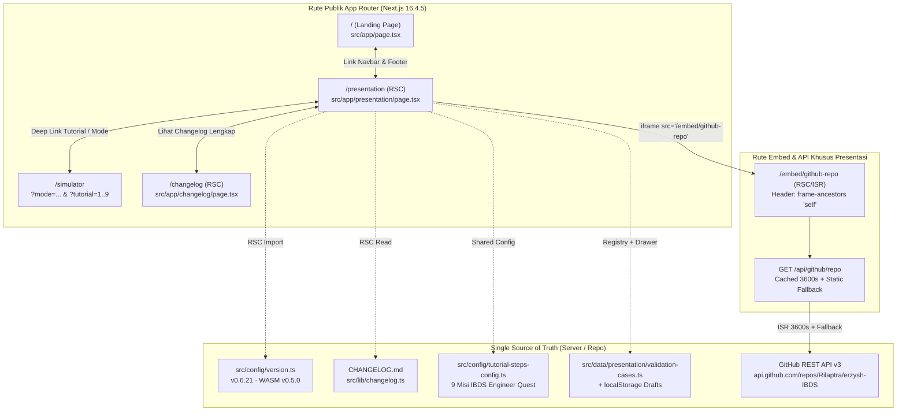
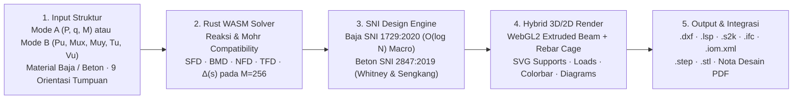
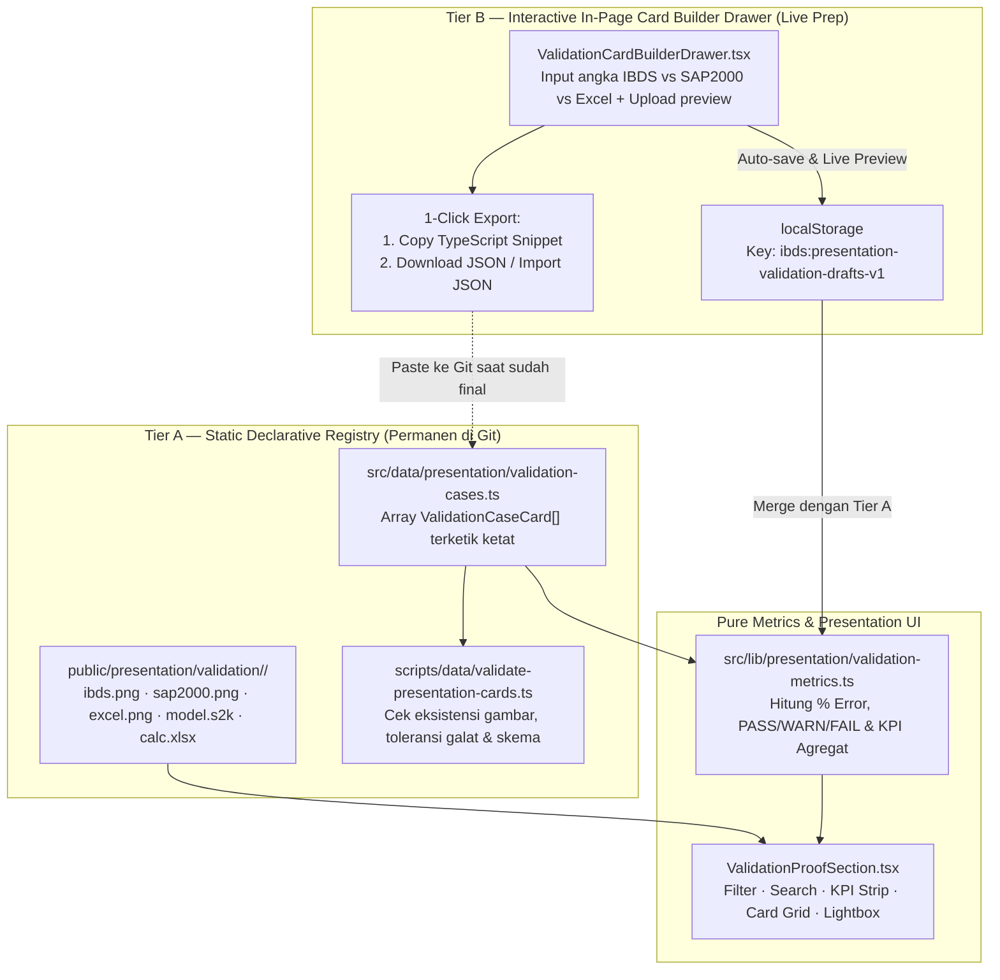
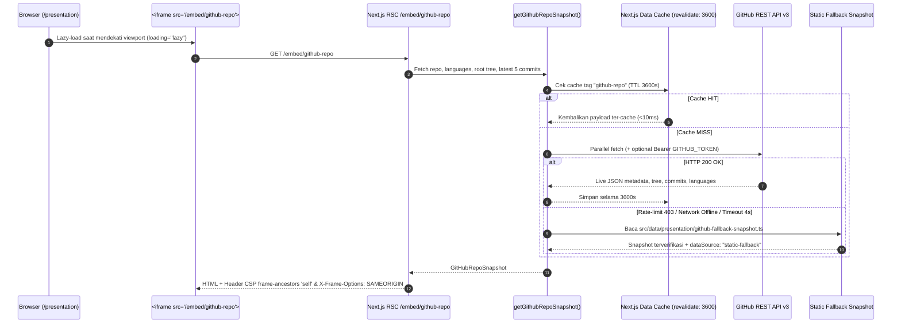

# 🎯 Spesifikasi Teknis & Rencana Implementasi Halaman Presentasi Interaktif (`Presentation Page`)

> **Dokumen Arsitektur & Rencana Implementasi (`mdfiles/presentation_page_specification_and_plan.md`)**
> Dokumen ini menetapkan spesifikasi lengkap, arsitektur teknis, kontrak data TypeScript, panduan UI/UX, kebijakan keamanan/CSP, serta roadmap implementasi untuk **Halaman Presentasi Interaktif (`/presentation`)** pada proyek **Interactive 3D Beam Deflection & Structural Design Simulator (IBDS / `interactive-beam-simulator`)**.
>
> | Atribut Proyek          | Nilai Terverifikasi dari Repositori                                                                                                                                                                                                                                                                                  |
> | :---------------------- | :------------------------------------------------------------------------------------------------------------------------------------------------------------------------------------------------------------------------------------------------------------------------------------------------------------------- |
> | **Nama Paket & Versi**  | `interactive-beam-simulator` **`v0.6.21`** (Lisensi MIT, `package.json` & `src/config/version.ts`)                                                                                                                                                                                                                   |
> | **Rust WASM Engine**    | `mechanics_3d_wasm` **`v0.5.0`** (`crates/mechanics-3d-wasm/Cargo.toml`, biner `104.6 KB`)                                                                                                                                                                                                                           |
> | **Framework & Runtime** | **Next.js `16.4.5`** (App Router, Turbopack) · **React `19.3.1`** · **Bun `1.4.4`** (Vercel `bunVersion: "1.4.x"`)                                                                                                                                                                                                   |
> | **Styling & UI**        | **Tailwind CSS `4.3.4`** · **`shadcn@4.23.0`** / **`radix-ui@1.8.1`** · **`lucide-react@1.66.0`** · **`gsap@3.15.1`** · **`katex@0.19.1`**                                                                                                                                                                           |
> | **Repositori GitHub**   | `https://github.com/Rilaptra/erzysh-IBDS` (Author: **Rizqi Lasheva Purnama Putra / `Erzy.sh` / `@Rilaptra`**)                                                                                                                                                                                                        |
> | **Referensi Silang**    | `mdfiles/ui_ux_visual_layout_and_interaction_spec.md`, `mdfiles/structural_mechanics_and_deflection_solver_spec.md`, `mdfiles/sni_1729_steel_design_specification.md`, `mdfiles/sni_2847_concrete_design_specification.md`, `mdfiles/steel_wf_box_section_geometry_spec.md`, `mdfiles/step_by_step_build_roadmap.md` |

> [!IMPORTANT]
> **Ruang Lingkup Dokumen Ini:** Dokumen ini adalah **rencana spesifikasi teknis siap-implementasi (_implementation-ready blueprint_)**. Implementasi kode sumber (`src/`, `public/`, `next.config.ts`, `scripts/`, `tests/`, `.github/ISSUE_TEMPLATE/`) dilaksanakan secara bertahap mengikuti **Bab 12** setelah spesifikasi ini disetujui. Zero tambahan _runtime dependency_ npm diperlukan—seluruh fitur dirancang menggunakan 11 _production dependencies_ yang sudah terpasang di `package.json`.

---

## 📑 Daftar Isi & Matriks Pemenuhan Kebutuhan

|  Bab   | Topik & Kebutuhan Pengguna                                                                                                                             | Rute / Komponen / Modul Utama yang Direncanakan                                                                                                |
| :----: | :----------------------------------------------------------------------------------------------------------------------------------------------------- | :--------------------------------------------------------------------------------------------------------------------------------------------- |
| **1**  | **Ringkasan Eksekutif, Arsitektur Routing, Dual-Mode UX & Kepatuhan Next.js 16.4.5**                                                                   | `src/app/presentation/{page,layout}.tsx`, `PresentationShell.tsx`, `PresentationDeckHud.tsx`                                                   |
| **2**  | **Bagian 1 — Pengertian Aplikasi, Identitas, serta Fitur Unik & Unggulan**                                                                             | `AppIdentityAndFeaturesSection.tsx`                                                                                                            |
| **3**  | **Bagian 2 — Fungsi & Tujuan Aplikasi**                                                                                                                | `PurposeAndObjectivesSection.tsx`                                                                                                              |
| **4**  | **Bagian 3 — Proses & Tahapan Pembuatan serta Pengembangan Aplikasi**                                                                                  | `DevelopmentProcessTimeline.tsx`, `src/data/presentation/development-phases.ts`                                                                |
| **5**  | **Bagian 4 — Riwayat Update yang Sudah Dilakukan (Single Source of Truth)**                                                                            | `ShippedUpdatesSection.tsx` (memakai ulang `src/lib/changelog.ts`)                                                                             |
| **6**  | **Bagian 5 — Tutorial / Panduan Lengkap Terbaru (In-System)**                                                                                          | `InteractiveManualSection.tsx` (sinkron dengan `src/config/tutorial-steps-config.ts` & PDF 24-slide)                                           |
| **7**  | **Bagian 6 — Sumber Data/Hitungan & Sistem Card Bukti Validasi (SAP2000 & Excel Manual)**                                                              | `ValidationProofSection.tsx`, `ValidationCardBuilderDrawer.tsx`, `ValidationEvidenceLightbox.tsx`, `src/data/presentation/validation-cases.ts` |
| **8**  | **Bagian 7 — Target Pengguna (Matriks Persona)**                                                                                                       | `TargetUsersSection.tsx`, `src/data/presentation/personas.ts`                                                                                  |
| **9**  | **Bagian 8 — Arsitektur & Analisis 6 Aspek Kualitas Sistem** _(Sustainability, Scalability, Modularity, Flexibility, **Simplicity**, Maintainability)_ | `QualityAttributesSection.tsx`, `src/data/presentation/quality-attributes.ts`                                                                  |
| **10** | **Bagian 9 — Pratinjau GitHub Repository via `<iframe>`** _(Solusi Same-Origin Embed + Cached API + Offline Fallback)_                                 | `src/app/embed/github-repo/page.tsx`, `src/app/api/github/repo/route.ts`, `GitHubIframePreviewSection.tsx`                                     |
| **11** | **Bagian 10 — Kotak Masukan/Saran & Panduan GitHub Issues**                                                                                            | `GitHubFeedbackComposer.tsx`, `src/lib/presentation/github-issue-url.ts`, `.github/ISSUE_TEMPLATE/*.yml`                                       |
| **12** | **Blueprint Implementasi Teknis Lengkap** _(File Tree, Kontrak TypeScript, State, A11y, CWV, Roadmap & Rencana Verifikasi)_                            | Seluruh artefak fase A–F, unit test `tests/presentation/`, QA Playwright & `bun run lint:full`                                                 |

---

## 🧭 1. Ringkasan Eksekutif, Arsitektur Routing & Dual-Mode Presentation UX

### 1.1. Tujuan Halaman `/presentation`

Halaman `/presentation` dirancang sebagai **dek presentasi rekayasa interaktif berbasis web (_Interactive Engineering Showcase & Pitch Deck_)** yang sekaligus berfungsi sebagai dokumen hidup (_living documentation_) untuk sidang akademik, demonstrasi kelas, evaluasi praktisi struktur, dan publikasi portofolio rekayasa. Tidak seperti slide PowerPoint statis, setiap bagian terhubung langsung dengan _Single Source of Truth_ repositori (`CHANGELOG.md`, `src/config/version.ts`, `src/config/tutorial-steps-config.ts`, tautan _deep-link_ langsung ke `/simulator`), serta menyediakan sistem **Card Bukti Validasi SAP2000 & Excel Manual** yang dapat ditambah/diuji secara langsung dan diekspor menjadi kode TypeScript/JSON permanen.

### 1.2. Arsitektur Routing & Integrasi Navigasi Eksisting



**Titik Integrasi ke Rute Eksisting:**

1. **`src/app/page.tsx` (Landing Page):** Tambahkan tautan navigasi `Presentasi` (`<Link href="/presentation" prefetch={false}>`) di bilah navigasi utama (sejajar dengan `Fitur`, `Tutorial`, `Changelog`) dan di bagian _Footer_.
2. **`src/app/changelog/page.tsx`:** Tambahkan tautan cepat `Presentasi` pada bilah navigasi agar audiens dapat berpindah mulus antara `/changelog` dan `/presentation`.
3. **`src/app/robots.ts`:** Pastikan `/presentation` tetap terindeks (`allow: "/"`), sementara `/embed/github-repo` diset `robots: { index: false, follow: false }` pada `metadata` agar mesin pencari tidak mengindeks fragmen _iframe_ secara terpisah dari halaman induk.

### 1.3. Arsitektur Dual-Mode UX (Scrollytelling Web + Fullscreen Slide Deck + Print PDF)

> [!CAUTION]
> **Aturan Kritis Scroll-Lock Repositori (`src/app/globals.css`):**
> `src/app/globals.css` mengunci `html, body { overflow: hidden; user-select: none; }` untuk melindungi kanvas WebGL2 penuh pada `/simulator`. Oleh karena itu, halaman `/presentation` **WAJIB** menggunakan kontainer gulir _viewport-sized_ berbasis `ErzyshPageShell` (`src/components/landing/ErzyshPageShell.tsx`: `h-dvh w-full overflow-x-hidden overflow-y-auto scroll-smooth bg-[#050a14] select-text`) pada **Scroll Mode**, menggantinya ke `overflow-hidden` pada **Deck Mode**, serta menambahkan aturan `@media print` untuk membuka kunci `overflow: visible; height: auto` saat cetak/ekspor PDF.

| Mode Tampilan                              | Aktivasi / URL Query                                               | Perilaku Tata Letak & Interaksi                                                                                                                                                                                                                                                                                                                                |
| :----------------------------------------- | :----------------------------------------------------------------- | :------------------------------------------------------------------------------------------------------------------------------------------------------------------------------------------------------------------------------------------------------------------------------------------------------------------------------------------------------------- |
| **1. Scrollytelling Web Mode _(Default)_** | `/presentation` atau `/presentation?view=scroll`                   | Seluruh 11 bagian (Hero + Bab 1–10) tersusun vertikal di dalam kontainer gulir `ErzyshPageShell`. Dilengkapi **Sticky Glass Header**, **CSS Scroll-Driven Progress Bar** di tepi atas, serta **Chapter TOC Rail** melayang di sisi kiri desktop (`xl:grid-cols-[240px_1fr]`) yang otomatis menyorot bab aktif via `IntersectionObserver`.                      |
| **2. Fullscreen Slide / Deck Mode**        | Tombol `Mode Slide (F)` atau `/presentation?view=deck&slide=1..11` | Merender **1 bab per layar penuh** (`h-dvh` dengan area konten _scrollable_ internal jika bab panjang seperti tabel validasi), menyembunyikan tombol editor non-presentasi jika `?presenter=clean` aktif, menampilkan _floating deck HUD_ di bawah (counter `04 / 11`, judul bab, navigasi `Prev`/`Next`, tombol `Fullscreen API`, tombol _slide picker_ `G`). |
| **3. Print / PDF Handout Mode**            | `Ctrl+P` atau tombol `Cetak / PDF` (`window.print()`)              | Stylesheet `@media print` memaksa seluruh 11 bab tampil berurutan, menonaktifkan latar animasi berat, menerapkan `break-after: page` per bab utama, membuka seluruh tabel/ringkasan validasi, dan mengganti _iframe_ GitHub dengan kartu ringkasan URL + QR/tautan teks eksplisit agar hasil PDF bersih tanpa bingkai kosong.                                  |

**Peta Pintasan Keyboard (Aktif Global di `/presentation`, dinonaktifkan saat fokus berada di `<input>`, `<textarea>`, `<select>`, atau `contenteditable`):**

| Tombol                              | Aksi di Deck Mode                                                                            | Aksi di Scroll Mode                                                     |
| :---------------------------------- | :------------------------------------------------------------------------------------------- | :---------------------------------------------------------------------- |
| `ArrowRight` / `PageDown` / `Space` | Pindah ke slide berikutnya (`slide + 1`)                                                     | Gulir halus ke bab berikutnya (khusus `PageDown` tetap perilaku bawaan) |
| `ArrowLeft` / `PageUp`              | Pindah ke slide sebelumnya (`slide - 1`)                                                     | —                                                                       |
| `Home` / `End`                      | Lompat ke Slide 1 / Slide 11                                                                 | Gulir ke puncak / bagian akhir                                          |
| `F`                                 | Toggle Fullscreen Browser (`document.documentElement.requestFullscreen()`) & masuk Deck Mode | Masuk ke Deck Mode + Fullscreen                                         |
| `D`                                 | Toggle antara Deck Mode dan Scroll Mode                                                      | Toggle antara Scroll Mode dan Deck Mode                                 |
| `G`                                 | Buka _Quick Slide Jump Palette_ (`<dialog>`)                                                 | Buka _Quick Chapter Jump Palette_ (`<dialog>`)                          |
| `Esc`                               | Keluar dari Fullscreen atau tutup modal/lightbox aktif                                       | Tutup modal/lightbox aktif                                              |
| `?`                                 | Buka/tutup kartu bantu pintasan keyboard                                                     | Buka/tutup kartu bantu pintasan keyboard                                |

### 1.4. Tata Letak Visual & Keselarasan Sistem Desain (_Erzysh Dark Void_)

Halaman `/presentation` mematuhi 100% palet warna, tipografi, dan primitif UI eksisting (`src/components/ui/core.tsx` & `src/app/globals.css`):

```text
+---------------------------------------------------------------------------------------------------+
| [Progress Bar 2px: CSS scroll-timeline cyan->sky->violet]                                         |
| [Sticky Glass Header (glassPanelClass): IBDS | Presentasi | Mode: Scroll/Deck | Cetak | Simulator]|
+-------------------+-------------------------------------------------------------------------------+
| [Chapter Rail     |  [HERO EXECUTIVE SLIDE (Slide 01)]                                             |
|  Desktop xl+]     |  Badge: PRESENTASI TEKNIS · v0.6.21 · WASM v0.5.0                             |
|  01. Identitas    |  Judul Utama + Subjudul + 4-Cell Telemetry Spec Strip                         |
|  02. Fungsi       |  CTA: [Mulai Mode Slide (F)] [Buka Simulator] [Unduh Manual PDF]              |
|  03. Tahapan      +-------------------------------------------------------------------------------+
|  04. Update       |  [BAB 1 .. BAB 10]                                                            |
|  05. Tutorial     |  Setiap section:                                                              |
|  06. Validasi     |   - Header Bab (Nomor 01..10, Badge Domain, Judul H2, Ringkasan 2 baris)      |
|  07. Pengguna     |   - Kartu Kaca (`glassPanelClass`: bg-[#0a1322]/80 border-cyan-500/15)        |
|  08. 6 Kualitas   |   - Interaktif terkontrol (Filter/Tab/Lightbox/Builder/Composer)              |
|  09. GitHub Frame |   - Tautan lintas rute ke `/simulator`, `/changelog`, atau GitHub             |
|  10. Masukan      |                                                                               |
+-------------------+-------------------------------------------------------------------------------+
| [Deck HUD (hanya di Deck Mode): <- Prev | Slide 06 / 11 • Validasi | Next -> | [G] [F] [Scroll]]  |
+---------------------------------------------------------------------------------------------------+
```

**Token Desain yang Diwarisi (Tanpa Duplikasi CSS):**

- **Latar Kanvas:** `#050a14` + grid cetak biru `40px × 40px` (`#122133`) + _dual radial ambient glow_ Cyan (`rgba(34,211,238,0.11)`) & Violet (`rgba(139,92,246,0.11)`) langsung dari `<ErzyshPageShell />`.
- **Permukaan Kartu:** `glassPanelClass` (`bg-[#0a1322]/80 border-cyan-500/15 rounded-lg border shadow-xl shadow-black/40 backdrop-blur-md`).
- **Aksen Semantik:** Primer Cyan (`#06b6d4`), Validasi Lulus / Beton Emerald (`#10b981`), WASM / Teknis Sky (`#38bdf8`), Baja / Arsitektur Violet (`#8b5cf6`), Peringatan / AI Amber (`#f59e0b`), Galat / Gagal Destructive (`#ef4444`).
- **Tipografi:** `Geist` (`--font-sans` dari `src/app/layout.tsx`) untuk teks antarmuka, `font-mono` dengan `tabular-nums` untuk seluruh angka validasi, persentase galat, kode versi, dan nilai gaya dalam.
- **Primitif UI:** Menggunakan komponen eksisting di `src/components/ui/` (`Badge`, `Button`, `Card*`, `Tabs*`, `Input`, `Textarea`, `Select*`, `Separator`, `Tooltip*`, `Alert*`, `ScrollArea*`, `Table*`) dengan mematuhi **Rule #4 `src/components/ui/core.tsx`**: Server Components hanya merender komponen UI dan **tidak pernah** membaca objek `palette`, `tokens`, atau `buttonVariants()` secara langsung.

### 1.5. Kepatuhan Konvensi Next.js `16.4.5` & Pola Modern Web Platform

Berdasarkan `AGENTS.md` dan dokumentasi resmi Next.js `16.4.5` di `node_modules/next/dist/docs/01-app/`:

1. **Async Route Props & Static Shell Preservation:**
   - `params` dan `searchParams` di Next.js 16 bertipe `Promise<...>` (atau menggunakan _global helper_ `PageProps<'/presentation'>` yang di-generate oleh `next typegen` / `next build`).
   - Karena membaca `props.searchParams` pada Server Component secara otomatis memaksa rute masuk _dynamic rendering_, halaman utama `src/app/presentation/page.tsx` **tidak** meng-`await searchParams` di server. Semua parameter presentasi yang murni sisi klien (`?view=deck`, `?slide=6`, `?valCat=...`, `?valSrc=...`, `?presenter=clean`) dibaca oleh Client Component `PresentationShell` melalui `useSearchParams()` yang dibungkus `<Suspense fallback={...}>`. Dengan demikian, shell HTML `/presentation` tetap dapat di-_prerender_ secara statis dengan performa LCP optimal!
2. **Strategi Caching Tanpa `cacheComponents`:**
   - `next.config.ts` saat ini **tidak** mengaktifkan `cacheComponents: true`. Maka seluruh _caching_ data server (seperti GitHub API) menggunakan pola resmi _Caching (Previous Model)_ (`node_modules/next/dist/docs/01-app/02-guides/caching-without-cache-components.md`):
     - Opsi `fetch(url, { next: { revalidate: 3600, tags: ["github-repo"] } })`.
     - Segment config `export const revalidate = 3600;` menggunakan literal integer statis (bukan ekspresi `60 * 60` karena wajib _statically analyzable_).
     - Jalur migrasi masa depan: apabila proyek mengaktifkan `cacheComponents: true` di masa depan, helper `getGithubRepoSnapshot()` tinggal diberi direktif `"use cache"` + `cacheLife("hours")` tanpa mengubah komponen pemanggil.
3. **Proxy vs Static Headers (`next.config.ts`):**
   - Di Next.js 16, `middleware.ts` telah diganti menjadi `src/proxy.ts`. Namun untuk kebutuhan _framing_ `/embed/github-repo`, kita **tidak** memerlukan `src/proxy.ts` (yang akan menonaktifkan _static/CDN caching_ jika memicu _nonce_ dinamis); cukup gunakan konfigurasi `async headers()` di `next.config.ts` secara selektif per rute.
4. **Pola Modern Web Platform (Terverifikasi):**
   - **Scroll Progress Bar (`scroll-progress-indicator`):** Menggunakan CSS native `scroll-timeline: --pres-scroll block` pada kontainer gulir `ErzyshPageShell` (di-hoist dengan `timeline-scope: --pres-scroll` pada wrapper luar) yang menganimasikan `transform: scaleX(0 -> 1)` pada _compositor thread_ (di dalam `@media (prefers-reduced-motion: no-preference)` dan `@supports (animation-timeline: scroll())`, deklarasi `animation-timeline` diletakkan **setelah** shorthand `animation`), dengan _fallback_ listener `scroll` ringan (`!CSS.supports("animation-timeline", "scroll()")`) dan **tanpa** `scroll-timeline-polyfill`.
   - **Lightbox & Jump Palette (`dialog`):** Menggunakan elemen native `<dialog>` dibuka via `showModal()` (tanpa `role="dialog"`, `aria-modal`, atau _focus trap_ manual karena sudah disediakan native), disertai aturan wajib `dialog:modal { overscroll-behavior: contain; }` dan `dialog::backdrop { overflow: hidden; overscroll-behavior: contain; }` agar latar tidak ikut tergulir (tanpa `overflow: hidden` pada `body`), serta `closedby="any"` + _pointer-bounds fallback_ untuk Safari yang belum mendukung `closedby`.
   - **Tabel Perbandingan Validasi (`responsive-table`):** Menggunakan `<table>` semantik di dalam `.table-wrapper` (`tabindex="0" role="region" aria-labelledby="..."`, `container-type: inline-size`) dengan `thead` dan `tbody th` _sticky_, serta transformasi otomatis menjadi _stacked cards_ pada `@container (width < 600px)` dengan label kolom terinjeksi via CSS custom properties (`--label-*`).

---

## 🏗️ 2. Bagian 1 — Pengertian Aplikasi, Identitas, serta Fitur Unik & Unggulan

### 2.1. Konten Faktual yang Disajikan

1. **Pengertian & Identitas Aplikasi:**
   - **IBDS (_Interactive 3D Beam Deflection & Structural Design Simulator_)** adalah aplikasi web rekayasa struktur _real-time_ (60–120 FPS) untuk analisis mekanika balok 1-bentang, visualisasi lendutan 3D/2D bergaya SAP2000, serta optimasi penampang otomatis berbasis standar **SNI 1729:2020** (Baja IWF & BOX) dan **SNI 2847:2019** (Beton Bertulang, status _Beta_ sesuai `src/app/page.tsx`).
   - Dibangun dengan arsitektur _client-side compute_ berbasis **Rust WebAssembly (`mechanics_3d_wasm v0.5.0`, 104.6 KB)** dan **Next.js `16.4.5` + Bun `1.4.4`**, berjalan langsung di peramban sebagai **Adaptive PWA** tanpa instalasi perangkat lunak berat dan tanpa mengirim data proyek struktur ke server.
   - Dikembangkan oleh **Rizqi Lasheva Purnama Putra (`Erzy.sh` / `@Rilaptra`)**, Program Studi Teknik Sipil, untuk Mata Kuliah **Aplikasi Komputer Teknik Sipil**, berlisensi terbuka **MIT**.

2. **7 Fitur Unik & Unggulan (Terverifikasi 100% pada Kode Sumber):**

|   #   | Fitur Unggulan                                                                      | Bukti Implementasi Nyata di Repositori                                                                                                                                                                                                 | Nilai Pembeda (_Unique Selling Point_)                                                                                                                                                                                                                                                                                                                                                     |
| :---: | :---------------------------------------------------------------------------------- | :------------------------------------------------------------------------------------------------------------------------------------------------------------------------------------------------------------------------------------- | :----------------------------------------------------------------------------------------------------------------------------------------------------------------------------------------------------------------------------------------------------------------------------------------------------------------------------------------------------------------------------------------- |
| **1** | **Mesin Mekanika Zero-Copy Rust WASM (`M = 256`)**                                  | `crates/mechanics-3d-wasm/src/{lib,supports,diagrams,deflection,extrude_3d,rebar_cage_3d}.rs`, `src/wasm/mechanics_3d_wasm_bg.wasm` (`104.6 KB`), `src/core/mechanics/wasm-mechanics-bridge.ts`                                        | _Pre-allocated `SolverWorkspace`_ (`65.536` float / `131.072` indeks) diakses via _typed array view_ langsung ke memori linear WASM—menghilangkan GC _churn_ untuk interaksi slider 60 FPS yang deterministik.                                                                                                                                                                             |
| **2** | **Viewport 3D WebGL2 Murni (Tanpa Three.js) + Overlay Vektor 2D 1:1**               | `src/components/canvas/Beam3DExtrudedViewport.tsx`, `SupportSymbols2DOverlay.tsx`, `LoadVisualization2DOverlay.tsx`, `MultiModeDiagram2DOverlay.tsx`, `CoordinateAxisSwitcher.tsx`                                                     | Ekstrusi 3D profil IWF (keliling 28 titik lengkap 4 _fillet_), BOX, dan Beton (Solid End-Cap & Wireframe X-Ray sangkar tulangan 3D) dengan kontur warna lendutan SAP2000, proyeksi beban 3D akurat perspektif, orientasi sumbu `Z-Up` / `Y-Up` / `CustomXYZ`, serta 3 mode tata letak diagram SFD/BMD/NFD/TFD.                                                                             |
| **3** | **Paradigma Ganda (Mode A & Mode B) + 9 Orientasi Tumpuan**                         | `src/core/mechanics/{support-reactions-solver,internal-force-diagrams-solver,euler-bernoulli-deflection-solver,direct-internal-force-interpolator}.ts`                                                                                 | Mendukung **Mode A** (beban eksternal $P, q, M$ + berat sendiri) maupun **Mode B** (input langsung gaya dalam terfaktor $P_u, M_{ux}, M_{uy}, T_u, V_u$ untuk cek cepat lapangan), mencakup 5 kategori / **9 orientasi tumpuan** (statis tertentu & statis tak tentu via kompatibilitas Mohr).                                                                                             |
| **4** | **Optimasi Penampang Otomatis SNI 1729:2020 & SNI 2847:2019**                       | `src/core/steel/*`, `src/core/concrete/*`, `src/macros/precompute-steel-catalog.macro.ts`, `src/data/{steel-iwf-catalog,steel-box-catalog,steel-material-grades,concrete-rebar-catalog}.json`                                          | Katalog **90 profil IWF JIS G 3192**, **23 profil BOX JIS G 3466**, **5 mutu baja BJ 34–55**, generator **Custom Parametric BOX** (`r=0`, maks. 2.500 kombinasi), serta blok tekan Whitney beton 1–2 lapis & sengkang otomatis. Prekomputasi _compile-time_ Bun Macro menghasilkan pencarian profil $O(\log N)$ menuju target efisien $0.90 \le \text{DCR} \le 1.00$.                      |
| **5** | **Ekspor 9 Format Industri CAD / BIM / CAE + Nota Desain KaTeX**                    | `src/core/exporters/{dxf-autocad,s2k-sap2000,ifc4-bim-revit,ideastatica,step-solidworks}-exporter.ts`, `src/app/api/report/calculation-sheet/route.ts`                                                                                 | Menghasilkan `.dxf` (4 layer standar AC1009), `.lsp` AutoLISP, `.s2k` SAP2000 v22, `.ifc` IFC4 & Revit Type Catalog `.txt` [Beta], `.iom.xml` IDEA StatiCa [Beta], `.step` & `.stl` SolidWorks/ANSYS [Beta], serta _Nota Desain Balok_ A4/PDF berformat rumus KaTeX.                                                                                                                       |
| **6** | **Interaksi Multimodal: AI "Ucuy", 60 Perintah Suara, Double-Clap & Gestur Tangan** | `src/components/assistant/StructuralAiAssistantPanel.tsx`, `src/types/command-registry-types.ts`, `src/core/audio/clap-detector.ts`, `src/lib/{wake-word-detector,gemini-api-failover}.ts`, `src/hooks/use-mediapipe-hand-tracking.ts` | Pengenalan suara bahasa Indonesia/Inggris (**60 `CommandId`** di 11 `CommandCategory`), aktivasi _hands-free_ via _wake-word_ (`"halo ucuy"`) atau tepuk tangan ganda (_double-clap_ `crest-factor >= 2.6`), _failover_ multi-API-key & multi-model Gemini + fallback deterministik offline, serta pelacakan tangan **MediaPipe Knuckle-Anchored** (5 gestur, Eco-Mode 15–16 FPS `<45°C`). |
| **7** | **Adaptive Dual-Platform PWA + Onboarding Gamifikasi 9 Misi**                       | `src/components/adaptive/{AdaptiveApplicationShell,DesktopWorkstationView,AndroidCompanionView}.tsx`, `src/config/tutorial-steps-config.ts`, `src/components/tutorial/InteractiveTutorialOverlay.tsx`                                  | Desktop mendapat _workstation_ 6 _Floating Windows_ + WebGL2 + MediaPipe; Android (`<= 768px` / mobile UA) otomatis beralih ke **Android Field Companion** 3-tab hemat baterai; dilengkapi **IBDS Engineer Quest** (9 misi interaktif dengan spotlight DOM & narasi suara).                                                                                                                |

### 2.2. Komponen UI Bagian 1 (`AppIdentityAndFeaturesSection.tsx`)

- **Bento Grid 7 Kartu Fitur Interaktif:** Kartu atas berukuran lebar (_featured_) untuk Rust WASM + Native WebGL2, diikuti grid 3 kolom untuk fitur lainnya. Tiap kartu menampilkan _capability badge_, cuplikan metrik nyata (`104.6 KB WASM`, `90 IWF + 23 BOX`, `60 Voice Cmds`, `9 Export Formats`), dan tombol _deep-link_ terkait.
- **Tabel Komparasi Ringkas (_IBDS vs Spreadsheet Manual vs Software CAE Desktop Berat_):** Membandingkan aspek waktu setup, visualisasi 3D _real-time_, kepatuhan SNI otomatis, dukungan mobile/PWA, ekspor lintas CAD/BIM, dan biaya/lisensi.

---

## 🎯 3. Bagian 2 — Fungsi & Tujuan Aplikasi

### 3.1. Pemetaan Fungsi Utama & Tujuan Akademik/Rekayasa

Komponen `PurposeAndObjectivesSection.tsx` menampilkan matriks dua kolom yang menghubungkan **4 Pilar Fungsi Operasional** dengan **4 Tujuan Strategis**:

| Pilar Fungsi Aplikasi                              | Mekanisme Kerja di IBDS                                                                                                                                                                       | Tujuan Akademik & Rekayasa yang Dicapai                                                                                                                                                                                           |
| :------------------------------------------------- | :-------------------------------------------------------------------------------------------------------------------------------------------------------------------------------------------- | :-------------------------------------------------------------------------------------------------------------------------------------------------------------------------------------------------------------------------------- |
| **1. Analisis Mekanika & Visualisasi Real-Time**   | Menghitung reaksi tumpuan, gaya dalam (SFD, BMD, NFD, TFD), serta lendutan negatif ($\Delta < 0$) secara instan saat beban/tumpuan/bentang digeser pada 3D/2D.                                | **Media Pembelajaran Visual Interaktif:** Membantu mahasiswa & dosen memahami perilaku elastis balok, titik balik momen, dan pengaruh kondisi batas tumpuan secara intuitif tanpa abstraksi semata.                               |
| **2. Perancangan & Optimasi Patuh SNI**            | Mengevaluasi kekompakan penampang, LTB, geser, interaksi biaksial/torsi (**SNI 1729:2020**), serta tulangan lentur/geser Whitney (**SNI 2847:2019**) dan syarat layan $L/180 \text{–} L/480$. | **Percepatan _Preliminary Structural Design_ & Reduksi _Human Error_:** Memangkas iterasi coba-coba (_trial-and-error_) pemilihan profil dari puluhan menit menjadi milidetik dengan penelusuran rumus yang transparan.           |
| **3. Interoperabilitas Data Rekayasa**             | Mentransformasi geometri & hasil desain menjadi berkas industri siap pakai (`.s2k`, `.dxf`, `.lsp`, `.ifc`, `.iom.xml`, `.step`, `.stl`) dan Nota Desain PDF.                                 | **Jembatan Alur Kerja Industri (CAD/BIM/CAE):** Mencegah input ulang manual saat berpindah dari tahap pradesain ke pemodelan portal penuh (SAP2000), penggambaran detail (AutoCAD/Revit), atau analisis sambungan (IDEA StatiCa). |
| **4. Aksesibilitas Multimodal & Lintas Perangkat** | Menyediakan mode desktop _workstation_ (mouse + gestur + suara) dan Android Companion PWA ringan dengan kemampuan komputasi lokal (_offline-first_).                                          | **Inklusivitas & Produktivitas Lapangan:** Mendukung demonstrasi kelas _hands-free_ bagi pengajar dan pengecekan cepat gaya dalam di lapangan proyek tanpa bergantung pada PC berspesifikasi tinggi.                              |

### 3.2. Diagram Alur Kerja End-to-End (Dirender Visual di Bagian 2)



---

## 🛠️ 4. Bagian 3 — Proses & Tahapan Pembuatan serta Pengembangan Aplikasi

Bagian ini mendokumentasikan riwayat konstruksi nyata repositori berdasarkan **57 commit Git (`2026-10-31` s/d `2026-11-19`)**, **24 git tags (`web-v0.5.0` s/d `web-v0.6.21`)**, **8 Pull Request tergabung (`flash` → `main`)**, arsip spesifikasi di `mdfiles/archive/`, prototipe di `prototype/`, serta 7 langkah pembangunan pada `mdfiles/step_by_step_build_roadmap.md`.

### 4.1. Tahapan Kronologis (Data untuk `DevelopmentProcessTimeline.tsx`)

| Fase                                                                          | Periode & Referensi Git                                                        | Fokus Pekerjaan & Artefak Nyata Repositori                                                                                                                                                                                                                                                                                                                  | Luaran Kunci (_Deliverables_)                                                                                                                          |
| :---------------------------------------------------------------------------- | :----------------------------------------------------------------------------- | :---------------------------------------------------------------------------------------------------------------------------------------------------------------------------------------------------------------------------------------------------------------------------------------------------------------------------------------------------------- | :----------------------------------------------------------------------------------------------------------------------------------------------------- |
| **Fase 0 — Konseptualisasi & Evolusi Spesifikasi (_Spec-First Engineering_)** | `2026-10-31` – `2026-11-02`<br/>(`41dccfe`–`eb56a69`)                          | Iterasi arsitektur dari `mdfiles/archive/interactive_beam_deflection_simulator_v2.md` → `v3.md` → `v4.md` → `v4.1.md`, kemudian dipecah menjadi **9 spesifikasi modular aktif** di `mdfiles/` + penetapan arsitektur **Hybrid Option B (Rust WASM + Next.js + Bun)**.                                                                                       | Blueprint kontrak matematis SNI, desain visual _Erzysh Dark Void_, skema Adaptive PWA, dan peta 7 tahap pembangunan (`step_by_step_build_roadmap.md`). |
| **Fase 1 — R&D Prototipe Multimodal Independen**                              | Awal Nov 2026<br/>(`prototype/`)                                               | Eksperimen terisolasi pada `prototype/hand-tracking/` (`engine.ts`, `server.ts`: _Knuckle-Anchored tracking_ anti _pinch-dip_, Eco-Mode 16 FPS `<45°C`) dan `prototype/voice-command/` (`server.ts`, `public/app.js`, `tests/test-live*.ts`: WebSocket Gemini Live 24kHz PCM).                                                                              | Validasi teknis interaksi _hands-free_ sebelum diintegrasikan ke codebase produksi Next.js.                                                            |
| **Fase 2A — Fondasi, Katalog SNI & CI Quality Gate (Step 1–2)**               | `2026-11-05`<br/>(`33a8b0e`, `47eac1e`, `6e21ba5`, `web-v0.5.0`)               | Scaffolding Bun `1.4.4`, `src/types/branded-units.ts`, `.githooks/`, katalog primer **90 IWF + 23 BOX + 5 BJ + tulangan**, mesin geometri _fillet_ akurat (`iwf-geometric-properties.ts`), Bun Macro (`precompute-steel-catalog.macro.ts`), `scripts/verify.ts`, `scripts/release.ts`, & `.github/workflows/{ci-quality-gate,release}.yml`.                 | Pondasi tipe satuan ketat, pencarian profil $O(\log N)$, dan pagar mutu CI otomatis sejak hari pertama.                                                |
| **Fase 2B — Rust WASM Solver & Engine Desain SNI (Step 3–4)**                 | `2026-11-05` – `2026-11-06`<br/>(`19a328d`, `ca3c9d6`, `e7cc265`)              | Implementasi `crates/mechanics-3d-wasm` (`wasm-bindgen = 0.2.130`, `lib.rs` + 5 submodul Rust, 5 `#[test]` Cargo), jembatan zero-copy TS (`wasm-mechanics-bridge.ts`), engine **SNI 2847:2019** (`src/core/concrete/*`) dan **SNI 1729:2020** (`src/core/steel/*`).                                                                                         | Solver mekanika & mesh 3D berkecepatan tinggi teruji + engine optimasi baja & beton bertulang.                                                         |
| **Fase 2C — Hybrid 3D/2D Viewport, Exporters & Multimodal (Step 5–7)**        | `2026-11-06`<br/>(`fb0e233`, `4f3480b` `web-v0.5.1`, `73fb9ea`, `cc7bbd2`)     | WebGL2 viewport (`Beam3DExtrudedViewport.tsx`), 6 _Floating Windows_, Adaptive Android Companion, 5 modul ekspor CAD/BIM/CAE (DXF AC1009, `.s2k`, `.ifc`, `.iom.xml`, `.step`/`.stl`), integrasi MediaPipe + Web Speech + GA4 Visitor Counter + PWA.                                                                                                        | Aplikasi fungsional penuh _end-to-end_ dirilis pada `web-v0.5.1`.                                                                                      |
| **Fase 3 — Polish UI/UX, AI "Ucuy", Dokumentasi & Upgrade Next.js 16.4.5**    | `2026-11-08` – `2026-11-19`<br/>(`web-v0.6.0` – `web-v0.6.21`, `HEAD 97a0514`) | Migrasi Tailwind v4 + `shadcn/ui`, persona AI **"Ucuy"** + _wake-word_ + _double-clap_ + multi-key Gemini failover, Custom Parametric BOX (`r=0`), Landing GSAP + interactive SVG morph, Manual PDF 24-slide, `/changelog` & What's New modal, Onboarding 9 Misi (**IBDS Engineer Quest**), proyeksi beban 3D perspektif, dan upgrade **Next.js `16.4.5`**. | Produk matang siap presentasi publik (`https://erzysh-ibds.vercel.app`) dengan **23 file test / 364 kasus uji** lolos CI.                              |

### 4.2. Desain Komponen UI (`DevelopmentProcessTimeline.tsx`)

- **Interactive Stepper + Detail Drawer:** Menampilkan 6 simpul fase horizontal di desktop (vertikal di mobile). Mengklik setiap fase menampilkan panel rincian berisi rentang tanggal, tag Git, daftar berkas artefak utama (dengan badge folder `mdfiles/archive/`, `prototype/`, `crates/`, `src/core/`, `.github/`), serta _engineering lesson_ yang diterapkan.
- **Catatan Transparansi Artefak:** Menyertakan ringkasan otomatis jumlah _commit_, _tag_, _PR_, dan status CI agar audiens melihat disiplin _software engineering_ di balik proyek teknik sipil ini.

---

## 📜 5. Bagian 4 — Riwayat Update yang Sudah Dilakukan (Single Source of Truth)

### 5.1. Strategi Anti-Duplikasi Data (Reuse `src/lib/changelog.ts`)

> [!TIP]
> **Single Source of Truth:** Halaman `/presentation` **TIDAK BOLEH** menyimpan salinan statis teks rilis yang berisiko basi. Server Component `src/app/presentation/page.tsx` wajib memanggil langsung `getAllChangelogReleases()` dan `formatChangelogDate()` dari `src/lib/changelog.ts` (yang mem-parsing `CHANGELOG.md` di root repositori pada sisi server—persis seperti `src/app/changelog/page.tsx` dan `src/app/page.tsx`).

**Mekanisme Kerja:**

1. `src/app/presentation/page.tsx` (RSC) mengeksekusi `const releases = getAllChangelogReleases();`.
2. Modul pembantu `src/data/presentation/update-highlights.ts` hanya menyimpan **metadata kurasi ringan** (mis. pemetaan nomor versi ke kategori _milestone_ presentasi seperti `"Core WASM"`, `"UI & shadcn"`, `"AI Ucuy"`, `"Manual & Quest"`, `"Next.js 16.4.5"`), lalu menggabungkannya secara dinamis dengan `releases` hasil parsing `CHANGELOG.md`.
3. Ketika versi baru dirilis via `bun run commit` (`scripts/release.ts`), Bagian 4 di `/presentation` **otomatis ikut terbarui** tanpa menyentuh satu baris pun kode halaman presentasi!

### 5.2. Ringkasan Tonggak Update Terverifikasi (`v0.4.0` s/d `v0.6.21`)

| Versi                     |     Tanggal      | Kategori Utama    | Sorotan Pembaruan Nyata dari `CHANGELOG.md`                                                                                                                                                                                                              |
| :------------------------ | :--------------: | :---------------- | :------------------------------------------------------------------------------------------------------------------------------------------------------------------------------------------------------------------------------------------------------- |
| **`v0.4.0` – `v0.5.0`**   |  04–05 Nov 2026  | `Added` / `CI`    | Fondasi Step 1–3 (_Branded Units_, 90 IWF + 23 BOX, Bun Macro, Rust WASM zero-copy), CI Quality Gate (`.github/workflows/ci-quality-gate.yml`), & CLI rilis AI 8 tahap (`scripts/release.ts`).                                                           |
| **`v0.5.1`**              |  05–06 Nov 2026  | `Added` / `Fixed` | Rilis patch `v0.5.1` (`CHANGELOG.md` 05 Nov 2026) & milestone Step 4–7 (Optimasi SNI, 3D/2D Viewport, Exporters, MediaPipe, Voice, PWA) + migrasi DXF ke versi universal **AC1009** kompatibel AutoCAD 2024 (commit `4f3480b` & `73fb9ea`, 06 Nov 2026). |
| **`v0.6.0` – `v0.6.1`**   |   08 Nov 2026    | `UI/UX`           | Migrasi total ke **Tailwind CSS v4** `@theme` (_Erzysh Dark Void_) & standardisasi primitif **`shadcn/ui`** (`src/components/ui/core.tsx`) pada Desktop & Android.                                                                                       |
| **`v0.6.2` & `v0.6.6`**   | 08 & 10 Nov 2026 | `Docs`            | Penerbitan `USER_MANUAL.md` lengkap (481 baris, 7 bab berbahasa Indonesia) & tautan produksi Vercel.                                                                                                                                                     |
| **`v0.6.3` – `v0.6.5`**   |   09 Nov 2026    | `AI / Voice`      | Multi-command AI intent router + saran lanjutan dinamis + _wake-word_ & detektor _double-clap_ + persona konsultan struktur **"Ucuy"** dengan fallback multi-model Gemini.                                                                               |
| **`v0.6.8` – `v0.6.9`**   |  11–12 Nov 2026  | `Resilience`      | Rotasi & _failover_ multi-key Gemini (`GEMINI_API_KEY_BACKUP`, `GEMINI_API_KEYS`, `GEMINI_API_KEY_1..10`) via header `x-goog-api-key`, _backoff_ 60–900 detik, fallback deterministik offline, & perbaikan baseline analitik.                            |
| **`v0.6.11`**             |   12 Nov 2026    | `Added` / `Fixed` | Generator **Custom Parametric BOX** bersudut tajam (`r = 0`), perbaikan pemetaan parameter ekspor BOX, & penguncian `bunVersion: "1.4.x"` di Vercel.                                                                                                     |
| **`v0.6.14` – `v0.6.15`** |   13 Nov 2026    | `UI / Perf`       | Animasi Hero bertenaga **GSAP `3.15.1`**, visual interaktif `HeroBeamMorphVisual.tsx` (drag beban 25/50/100 kN), sinkronisasi query `?mode=`, & `prefetch={false}`.                                                                                      |
| **`v0.6.16`**             |   14 Nov 2026    | `Docs`            | Buku panduan teknis 24 slide (`docs/Panduan_01_IBDS.pdf` & `docs/manual.html` via `scripts/docs/generate-manual.ts`), lisensi MIT, TypeScript `5.9.3`, & KaTeX `0.19.1`.                                                                                 |
| **`v0.6.17`**             |   14 Nov 2026    | `Added`           | Halaman `/changelog` lengkap (`ChangelogExplorer.tsx`: pencarian & filter kategori) + dialog interaktif **What's New** pada Landing Page.                                                                                                                |
| **`v0.6.18`**             |   15 Nov 2026    | `Added`           | Tur _onboarding_ gamifikasi 9 misi (**IBDS Engineer Quest** — `InteractiveTutorialOverlay.tsx`) dengan spotlight DOM, narasi suara, dan pemicu cepat lintas platform.                                                                                    |
| **`v0.6.19`**             |   15 Nov 2026    | `Added`           | `LoadVisualization2DOverlay` untuk beban titik/merata pada _screen-space_, tema warna diagram positif/negatif terpisah, & peningkatan tabel material/restraint `.s2k` SAP2000.                                                                           |
| **`v0.6.20` – `v0.6.21`** |   19 Nov 2026    | `Upgrade / 3D`    | Upgrade ke **Next.js `16.4.5`**, proyeksi vektor beban 3D akurat perspektif sepanjang sumbu gravitasi aktif (`Z-Up`/`Y-Up`/`CustomXYZ`), _smart badge collision avoidance_, & mikro-animasi grid CAD.                                                    |

### 5.3. Komponen UI (`ShippedUpdatesSection.tsx`)

- **KPI Strip Rilis:** Menampilkan 4 angka otomatis dari `releases` (Versi Aktif `v0.6.21`, Total Rilis Tercatat, Total Item Perubahan, Tanggal Rilis Terakhir).
- **Filter Kategori & Compact Timeline:** Chip filter (`Semua`, `Added`, `Performance`, `Fixed`, `Docs`, `Maintenance`) dengan tampilan 6–8 _milestone_ utama yang dapat diperluas (_expandable accordion_) + CTA `<Link href="/changelog" prefetch={false}>Buka Explorer Changelog Lengkap ↗</Link>`.

---

## 📘 6. Bagian 5 — Tutorial & Panduan Lengkap Terbaru (In-System)

### 6.1. Integrasi Langsung dengan Sistem Onboarding & Manual Eksisting

Agar panduan di dalam `/presentation` selalu mutakhir dan konsisten dengan aplikasi utama, desain Bagian 5 mensinkronkan **tiga sumber resmi** yang sudah ada:

1. **`TUTORIAL_QUEST_STEPS` (`src/config/tutorial-steps-config.ts`):** 9 misi terstruktur **IBDS Engineer Quest** lengkap dengan `stepNumber`, `title`, `badgeLabel`, `ucuyDialogue`, `missionDescription`, `voiceCommandExample`, `targetWindowId`, dan `acceptedCommandIds`.
2. **Deep-Link Simulator Nyata (`src/components/adaptive/AdaptiveApplicationShell.tsx`):**
   - `parseTutorialQueryParam` sudah mendukung **`/simulator?tutorial=1`** hingga **`/simulator?tutorial=9`** (dan `/simulator?tutorial=true`) untuk langsung melompat ke misi spesifik!
   - Mode pembebanan sudah mendukung **`/simulator?mode=MODE_A_EXTERNAL_LOADS`** dan **`/simulator?mode=MODE_B_DIRECT_INTERNAL_FORCES`**.
3. **Manual Teknis 24-Slide & Dokumentasi Tertulis:** `USER_MANUAL.md` (7 bab), `docs/Panduan_01_IBDS.pdf` (2,99 MB, 24 slide 16:9), dan 14 tangkapan layar di `docs/screenshots/`.

### 6.2. Menutup Celah Deployment Aset `docs/` → `public/`

> [!WARNING]
> **Temuan Audit Repositori:** Saat ini `docs/Panduan_01_IBDS.pdf`, `docs/manual.html`, dan 14 tangkapan layar `docs/screenshots/*.png` berada di folder `docs/` (**di luar `public/`**), sehingga Next.js **tidak melayani berkas tersebut** pada URL publik (akan menghasilkan 404 jika langsung ditautkan).

**Solusi Teknis yang Direncanakan:**

- Buat skrip sinkronisasi deterministik **`scripts/docs/sync-presentation-assets.ts`** (didaftarkan sebagai `"presentation:sync-assets"` di `package.json`) yang menyalin secara terkurasi:
  - `docs/Panduan_01_IBDS.pdf` → `public/presentation/manual/Panduan_01_IBDS.pdf` (untuk tombol **Unduh Manual PDF 24-Slide** & penampil pratinjau opsional).
  - Tangkapan layar terpilih dari `docs/screenshots/` (`01-landing.png`, `02-desktop-steel.png`, `03-mode-a-loads.png`, `04-mode-b-direct.png`, `05-steel-params.png`, `06-steel-results.png`, `07-concrete-params.png`, `08-concrete-wireframe.png`, `09-diagrams-window.png`, `10-ai-assistant.png`, `11-android-companion.png`, `12-export-modal.png`) → `public/presentation/manual/screenshots/` (dengan konversi/optimasi ukuran dan dimensi intrinsik tercatat untuk `next/image`).

### 6.3. Struktur UI Panduan Lengkap In-System (`InteractiveManualSection.tsx`)

1. **Interactive 9-Step Guided Walkthrough (Sinkron `TUTORIAL_QUEST_STEPS`):**
   - **Panel Kiri:** Daftar 9 langkah interaktif bernomor (1. Material & Mode Beban → 2. Bentang, Tumpuan & Beban → 3. Parameter Desain SNI → 4. Kontrol Viewport 3D & Sumbu XYZ → 5. Inspeksi Diagram SFD/BMD/NFD/TFD → 6. Evaluasi Hasil Optimasi Penampang → 7. Asisten AI "Ucuy", Suara & Gestur Kamera → 8. Ekspor AutoCAD DXF & CAD/BIM/CAE → 9. Alur Kerja 3-Langkah & 4-Layer AutoCAD DXF).
   - **Panel Kanan (Active Step Card):**
     - Tangkapan layar antarmuka nyata (`next/image` dengan rasio aspek terkunci agar CLS = `0`).
     - Instruksi langkah demi langkah (Mouse/Desktop & Android Companion Tab).
     - Kotak kutipan **"Tips Ucuy"** (`ucuyDialogue`) + lencana contoh perintah suara (`voiceCommandExample`, mis. `"Tambah beban titik 50 kN"`).
     - Tombol aksi langsung **`Coba Misi #N di Simulator ↗`** mengarah ke `/simulator?tutorial=N` (`prefetch={false}`).
2. **Tab Referensi Cepat Pendamping (3 Sub-Tab):**
   - **Tab A — Mode A vs Mode B & Alur Kerja Cepat:** Kapan memakai Mode A (`/simulator?mode=MODE_A_EXTERNAL_LOADS`) vs Mode B (`/simulator?mode=MODE_B_DIRECT_INTERNAL_FORCES`).
   - **Tab B — Cheat Sheet Multimodal (Suara, Double-Clap & 5 Gestur MediaPipe):** Tabel ringkas _wake-word_ (`"halo ucuy"`, `"oi cuy"`), perintah suara populer dari 60 `CommandId` (11 kategori), serta 5 gestur tangan (`OPEN_PALM`, `PINCH_CLICK`, `FIST_LOAD`, `POINT_PRECISION`, `TWO_FINGER_GRAB`).
   - **Tab C — Matriks 9 Format Ekspor & Unduh Manual PDF 24-Slide:** Panduan ringkas 4-layer DXF (`S-SECT-OUTLINE`, `S-REBAR-STIRRUP`, `S-REBAR-MAIN`, `S-ANNO-DIMS`), import `.s2k` ke SAP2000, tombol unduh `/presentation/manual/Panduan_01_IBDS.pdf`, dan tautan `USER_MANUAL.md` di GitHub.

---

## 🔬 7. Bagian 6 — Sumber Data/Hitungan & Sistem Card Bukti Validasi (SAP2000 & Excel Manual)

Bagian ini merupakan **jantung kredibilitas ilmiah & rekayasa** dari halaman presentasi: memaparkan sumber rumus/standar secara transparan sekaligus menyediakan **Sistem Card Bukti Validasi yang Ekstensibel** sehingga pengguna dapat menginput, menampilkan, membandingkan, dan memperbarui banyak bukti validasi antara **`erzysh-IBDS`**, **SAP2000**, dan **Perhitungan Excel Manual**.

### 7.1. Sumber Data, Standar Normatif, Persamaan Pengatur & Ketertelusuran Kode

Seluruh rumus utama dirender di sisi server menggunakan **`katex.renderToString()`** (`katex@0.19.1`, sudah terpasang di proyek) untuk ketajaman tipografi matematis tanpa _layout shift_:

| Domain Perhitungan                | Standar / Referensi Normatif                                                                                                                                                      | Persamaan & Formulasi Pengatur Utama                                                                                                                                                                                                                                                                                                       | Sumber Katalog / Berkas Kode                                                                                                                                                                                                                                                     |
| :-------------------------------- | :-------------------------------------------------------------------------------------------------------------------------------------------------------------------------------- | :----------------------------------------------------------------------------------------------------------------------------------------------------------------------------------------------------------------------------------------------------------------------------------------------------------------------------------------- | :------------------------------------------------------------------------------------------------------------------------------------------------------------------------------------------------------------------------------------------------------------------------------- |
| **Mekanika Balok & Lendutan**     | Teori Balok **Euler-Bernoulli** Orde-1, Fungsi Singularitas **Macaulay** $\langle s-a \rangle^n$, Kompatibilitas **Mohr** ($\Phi_A, \Phi_B$), Integrasi Trapesium Ganda ($M=256$) | $\dfrac{d^2 v}{ds^2} = +\dfrac{M_{\text{major}}(s)}{EI}$ (lendutan gravitasi $\Delta < 0$); Fixed-Fixed: $M_A = -\dfrac{2}{L}(2\Phi_A - \Phi_B)$; Fixed-Roller: $M_A = -\dfrac{3}{L}\Phi_A$; Mode B: $\Delta_{\max,\text{SS}} = -\dfrac{5                                                                                                  | M_{ux}                                                                                                                                                                                                                                                                           | L^2}{48EI}$, $\Delta_{\max,\text{FF}} = -\dfrac{ | M_{ux} | L^2}{32EI}$, $\Delta_{\max,\text{Cant}} = -\dfrac{ | M_{ux} | L^2}{4EI}$ | `crates/mechanics-3d-wasm/src/{supports,diagrams,deflection}.rs`<br/>`src/core/mechanics/*`<br/>`src/config/deflection-limits-config.ts` ($L/180, L/240, L/360, L/480$; $L_{\text{eff}} = 2L$ kantilever) |
| **Geometri Profil Baja & Fillet** | **JIS G 3192 / SNI 07-2054** (IWF), **JIS G 3466** (SHS/RHS BOX), **AISC Design Guide 9** (El-Darwish & Johnston, 1965)                                                           | Luas _fillet_ $a_f = (1 - \pi/4)r_c^2$, $C_w = \dfrac{I_y h_o^2}{4}$, $r_{ts} = \sqrt{\dfrac{I_y h_o}{2 S_x}}$; Torsi Bredt BOX: $J = \dfrac{2t_w(b-t_w)^2(h-t_w)^2}{b+h-2t_w}$                                                                                                                                                            | `src/data/steel-iwf-catalog.json` (**90 profil**)<br/>`src/data/steel-box-catalog.json` (**23 profil**)<br/>`src/core/steel/iwf-geometric-properties.ts`<br/>`src/macros/precompute-steel-catalog.macro.ts`                                                                      |
| **Desain Struktur Baja**          | **SNI 1729:2020** (adopsi identik **ANSI/AISC 360-16**): Tabel B4.1b, Bab F (F2/F3/F6/F7), Bab G, Bab H (H1-1a/H1-1b & H3-6)                                                      | LTB ($\phi_b = 0.90$): $M_p = F_y Z_x$, $L_p = 1.76 r_y \sqrt{E/F_y}$; Interaksi H1-1a ($P_r/P_c \ge 0.2$): $\dfrac{P_r}{P_c} + \dfrac{8}{9}\left(\dfrac{M_{rx}}{M_{cx}} + \dfrac{M_{ry}}{M_{cy}}\right) \le 1.0$; Torsi H3-6: $\left(\dfrac{P_r}{P_c}+\dfrac{M_r}{M_c}\right) + \left(\dfrac{V_r}{V_c}+\dfrac{T_r}{T_c}\right)^2 \le 1.0$ | `src/data/steel-material-grades.json` (**5 mutu**: BJ 34, 37, 41, 50, 55; $E=200.000\text{ MPa}$)<br/>`src/core/steel/{section-compactness-classifier,lateral-torsional-buckling-solver,biaxial-interaction-evaluator,steel-torsion-shear-evaluator,steel-section-optimizer}.ts` |
| **Desain Beton Bertulang [Beta]** | **SNI 2847:2019**: Pasal 9.6.1.2, Tabel 9.7.6.2.2, Pasal 19.2.2.1, Tabel 20.6.1.3.1, Tabel 21.2.1–21.2.2, Pasal 22.2 & 22.5, Tabel 24.2.2, Pasal 25.2.1                           | $f'_c = 0.083 K$, $E_c = 4700\sqrt{f'*c}$, $\beta_1 \in [0.65, 0.85]$; Blok Whitney $c*{\max} = 0.375d$ ($\phi = 0.90$); $A_{s,\min} = \max\!\left(\dfrac{0.25\sqrt{f'_c}}{f_y}, \dfrac{1.4}{f_y}\right)b_w d$; Geser ($\phi_v = 0.75$): $V_c = 0.17\lambda\sqrt{f'_c}b_w d$, $V_{s,\max} = 0.66\sqrt{f'_c}b_w d$                          | `src/data/concrete-rebar-catalog.json` (5 mutu tulangan, 5 polos, 9 ulir, $\gamma_c = 24\text{ kN/m}^3$)<br/>`src/core/concrete/{concrete-grade-converter,whitney-flexural-designer,shear-stirrup-designer,concrete-section-optimizer}.ts`                                       |
| **Integritas Satuan Fisika**      | Nominal Branded Types (Compile-Time Unit Safety)                                                                                                                                  | Pemisahan ketat `Kilonewton`, `KilonewtonMeter`, `Newton`, `NewtonMillimeter`, `Megapascal`, `Millimeter`, `Meter`, `UtilizationRatio` — mustahil tertukar saat kompilasi TS.                                                                                                                                                              | `src/types/branded-units.ts`                                                                                                                                                                                                                                                     |

### 7.2. Arsitektur Sistem Card Bukti Validasi (SAP2000 & Perhitungan Excel Manual)

> [!NOTE]
> **Status Repositori Saat Ini:** Berdasarkan audit langsung, `tests/fixtures/sap2000-verification-cases.json` belum ada di repositori, sementara **23 file uji (`364` kasus uji)** di `tests/` dan **5 Rust `#[test]`** di `crates/mechanics-3d-wasm/src/lib.rs` telah memverifikasi hitungan analitik/SNI secara eksak. Oleh karena itu, arsitektur di bawah membangun **sistem registri validasi baru yang bersih, terstruktur, dan super mudah diisi** dengan bukti tangkapan layar maupun angka pembanding dari **SAP2000** dan **Excel Manual**.

#### A. Alur Kerja Input 2-Tier (_Two-Tier Authoring Workflow_)

Sistem dirancang agar presenter/developer **tidak perlu mengedit JSX atau layout** setiap kali menambah studi kasus validasi baru:



1. **Tier A — Registri Data Deklaratif Permanen (`src/data/presentation/validation-cases.ts`):**
   - Cukup tambahkan satu objek `ValidationCaseCard` dan letakkan tangkapan layar SAP2000 / Excel / IBDS di `public/presentation/validation/<case-id>/` (mis. `public/presentation/validation/val-01-simply-supported-udl/sap2000.png`).
   - Divalidasi otomatis oleh `scripts/data/validate-presentation-cards.ts` (yang diintegrasikan ke `bun run data:validate`) agar tidak ada tautan gambar rusak, ID duplikat, atau galat melebihi batas toleransi tanpa tanda eksplisit.
2. **Tier B — Drawer "Tambah / Edit / Pratinjau Card Validasi" Langsung di Halaman (`ValidationCardBuilderDrawer.tsx`):**
   - Memungkinkan pengguna memasukkan beberapa card validasi baru langsung dari browser saat menyiapkan presentasi (termasuk _drag-and-drop_ pratinjau gambar tangkapan layar SAP2000 & Excel, tabel input baris parameter dinamis yang menghitung `% Error` secara _real-time_).
   - Tersimpan di `localStorage` (`ibds:presentation-validation-drafts-v1`, dengan _guard_ kapasitas `<= 4 MB` dan kompresi canvas WebP otomatis untuk _preview_ lokal agar tidak melampaui kuota browser).
   - Dilengkapi tombol **1-Klik `Salin Snippet TypeScript`** (siap tempel ke `src/data/presentation/validation-cases.ts`), **`Ekspor JSON`**, dan **`Impor JSON`** untuk pindah perangkat/backup.
   - Tombol `+ Tambah Card Validasi` otomatis tersembunyi bila parameter `?presenter=clean` aktif atau saat dicetak (`@media print`), sehingga tampilan sidang tetap bersih!

#### B. Rumus Evaluasi Galat & Status Lulus (`src/lib/presentation/validation-metrics.ts`)

Untuk setiap baris perbandingan `ValidationComparisonRowInput` (menghasilkan `ComputedValidationRow`, mendukung perbandingan 2 arah `IBDS vs SAP2000`, `IBDS vs Excel Manual`, atau **3 arah sekaligus `IBDS vs SAP2000 vs Excel Manual`**):

$$
\text{Error}_{\%}(\text{App}, \text{Ref}) =
\begin{cases}
0\% & \text{jika } |\text{Ref}| < \varepsilon \text{ dan } |\text{App} - \text{Ref}| \le \tau_{\text{abs}} \\
\dfrac{|\text{App} - \text{Ref}|}{|\text{Ref}|} \times 100\% & \text{jika } |\text{Ref}| \ge \varepsilon
\end{cases}
$$

dengan $\varepsilon = 10^{-9}$ dan $\tau_{\text{abs}}$ (_absolute zero tolerance_, default `1e-4` pada satuan terkait) untuk menghindari pembagian dengan nol (`NaN`/`Infinity`) pada reaksi atau momen nol.

- **Klasifikasi Status Baris & Kartu:**
  - `PASS` (Badge Emerald `#10b981`): `maxErrorPercent <= row.tolerancePercent` (default `1.0%`).
  - `WARN` (Badge Amber `#f59e0b`): `row.tolerancePercent < maxErrorPercent <= row.tolerancePercent * 2.5` (mis. `1.01% – 2.50%`, misalnya akibat perbedaan pembulatan diskretisasi mesh/fillet).
  - `FAIL` (Badge Merah `#ef4444`): `maxErrorPercent > row.tolerancePercent * 2.5`.
  - `PENDING_REF` (Badge Slate): Jika angka SAP2000 atau Excel belum diinput oleh pengguna pada kartu _template_.

#### C. Spesifikasi UI Komponen Validasi

1. **KPI Akurasi Agregat (Top Accuracy Strip — 4 Kartu):**
   - Total Kasus Tervalidasi (`Verified` vs `Draft/Template`), Rata-rata Galat vs **SAP2000** (`%`), Rata-rata Galat vs **Excel Manual** (`%`), dan Tingkat Kelulusan Toleransi (`% Pass`).
2. **Filter, Pencarian & Aksi Cepat:**
   - Filter Kategori: `Semua`, `Lendutan & Mekanika`, `Gaya Dalam (SFD/BMD)`, `Baja SNI 1729`, `Beton SNI 2847`, `Geometri Profil`.
   - Filter Sumber Pembanding: `Semua`, `SAP2000`, `Excel Manual`, `3-Arah (SAP2000 + Excel)`.
   - Pencarian instan (judul, kode `VAL-01`, nama profil, nomor pasal SNI) + tombol `+ Tambah Card Validasi` + `Impor/Ekspor JSON`.
3. **Kartu Bukti Validasi (`ValidationCaseCardItem.tsx` — Grid 2 Kolom Desktop):**
   - **Header Kartu:** Kode (`VAL-01`), Badge Sumber Pembanding (`SAP2000` / `Excel Manual` / `3-Way`), Badge Status (`PASS · Δ 0.00%`), Kategori, serta tombol `Edit` (untuk kartu lokal) atau `Duplikasi ke Draft`.
   - **Ringkasan Model Input:** Chip parameter terstruktur (Bentang $L$, Tumpuan, Profil/Dimensi, Mutu Material, Beban) + tombol `Buka Kasus Serupa di Simulator ↗`.
   - **Tabel Perbandingan Responsif (`responsive-table`):** Kolom `Parameter`, `IBDS`, `SAP2000`, `Excel Manual`, `Galat (%)`, `Status`. Menggunakan `font-mono tabular-nums`, `thead` & `tbody th` _sticky_, serta _stacked card layout_ otomatis pada `@container (width < 600px)`.
   - **Strip Bukti Visual (Thumbnail Evidence):** Menampilkan 1–3 _thumbnail_ bukti (`Tangkapan IBDS`, `Tangkapan SAP2000`, `Tangkapan Sheet Excel`) dengan _placeholder slot_ informatif jika gambar belum dimasukkan; klik membuka **Lightbox Pembanding**.
   - **Footer Traceability:** Daftar pasal SNI terkait, referensi file test otomatis di repositori (`tests/...`), dan tautan opsional unduh berkas pendukung (`.s2k` / `.xlsx`).
4. **Lightbox Bukti Visual & Mode Side-by-Side (`ValidationEvidenceLightbox.tsx`):**
   - Dibangun dengan elemen native `<dialog>` (`showModal()`, `closedby="any"` + _pointer-bounds fallback_, `overscroll-behavior: contain`).
   - Menyediakan 2 mode inspeksi bukti: **Tab Tunggal (Zoom 100%–200%)** dan **Side-by-Side Split Compare** (`IBDS` sejajar berdampingan dengan `SAP2000` atau `Excel Manual`) lengkap dengan caption versi software (`SAP2000 v22.2.0`, nama sheet Excel, tanggal pengambilan).

#### D. 4 Seed Studi Kasus Awal (Berbasis Benchmark Terverifikasi di `tests/`)

Untuk memastikan halaman presentasi langsung berisi data ilmiah valid sejak komit pertama—sekaligus memberi contoh nyata bagaimana pengguna mengisi nilai & tangkapan layar SAP2000/Excel—4 kartu _seed_ berikut disiapkan dari _unit test_ nyata di repositori:

|     Kode     | Judul Studi Kasus                                        | Sumber Test Nyata di Repo                                                                           | Parameter Kunci & Hasil IBDS Terverifikasi                                                                                                                                                                                                                                                                                       | Slot Bukti SAP2000 & Excel                                                                                                          |
| :----------: | :------------------------------------------------------- | :-------------------------------------------------------------------------------------------------- | :------------------------------------------------------------------------------------------------------------------------------------------------------------------------------------------------------------------------------------------------------------------------------------------------------------------------------- | :---------------------------------------------------------------------------------------------------------------------------------- |
| **`VAL-01`** | **Balok Sendi-Rol Beban Merata ($q = 10\text{ kN/m}$)**  | `tests/mechanics/euler-bernoulli-deflection.test.ts`                                                | `PINNED_ROLLER`, $L=6\text{ m}$, $E=200\text{ GPa}$, $I=10^8\text{ mm}^4$: $R_A = R_B = 30.00\text{ kN}$, $M_{\max}^+ = 45.00\text{ kNm}$, $\Delta_{\max} = -8.4375\text{ mm}$ di $x=3.0\text{ m}$ (eksak $-5qL^4/384EI$).                                                                                                       | Siap isi kolom `sap2000Value` & `excelValue` + folder `public/presentation/validation/val-01-simply-supported-udl/`                 |
| **`VAL-02`** | **Balok Statis Tak Tentu Jepit-Jepit & Kantilever**      | `tests/mechanics/euler-bernoulli-deflection.test.ts`                                                | `FIXED_FIXED` ($L=6\text{ m}, q=12\text{ kN/m}$): $M_A = M_B = -36.00\text{ kNm}$, $M_{\text{mid}} = +18.00\text{ kNm}$, $\Delta_{\max} = -2.0250\text{ mm}$; `CANTILEVER_LEFT` ($L=4\text{ m}, P=20\text{ kN}$): $M_{\text{fixed}} = -80.00\text{ kNm}$, $\Delta_{\text{tip}} = -21.3333\text{ mm}$.                            | Siap isi bukti SAP2000 & Excel di `public/presentation/validation/val-02-indeterminate-fixed-cantilever/`                           |
| **`VAL-03`** | **Geometri Fillet & Kapasitas Baja SNI 1729:2020**       | `tests/core/steel/iwf-geometric-properties.test.ts` & `tests/steel/steel-sni1729-optimizer.test.ts` | **WF 100×100×17.2**: $A=21.898\text{ cm}^2$, $I_x=382.58\text{ cm}^4$, $Z_x=84.18\text{ cm}^3$, $C_w=2829.5\text{ cm}^6$; **WF 300×150×36.7 (BJ 37)**: $V_n = 280.80\text{ kN}$, Interaksi H1-1a $= 0.9907 \le 1.0$, H1-1b $= 0.8833 \le 1.0$.                                                                                   | Siap isi bukti tabel profil/Excel & SAP2000 Steel Design Check di `public/presentation/validation/val-03-steel-sni1729/`            |
| **`VAL-04`** | **Lentur Whitney & Geser Beton Bertulang SNI 2847:2019** | `tests/concrete/concrete-sni2847-optimizer.test.ts`                                                 | Konversi K-250 → $20.75\text{ MPa}$, K-300 → $24.90\text{ MPa}$; Balok $300\times 500\text{ mm}$ ($d=440\text{ mm}, f'_c=25\text{ MPa}$): $E_c=23.500\text{ MPa}$, $V_c=112.20\text{ kN}$, $\phi_v V_c=84.15\text{ kN}$, $V_{s,\max}=435.60\text{ kN}$; Lentur $250\times 500\text{ mm}$ ($M_u=80/160\text{ kNm}$, 1 & 2 lapis). | Siap isi bukti sheet Excel Desain Balok Beton & SAP2000 Concrete Check di `public/presentation/validation/val-04-concrete-sni2847/` |

---

## 👥 8. Bagian 7 — Target Pengguna (Matriks Persona)

Mengacu pada `USER_MANUAL.md` Bab 1.3 dan diperluas untuk cakupan penuh ekosistem rekayasa sipil & perangkat lunak, komponen `TargetUsersSection.tsx` menampilkan **5 Kartu Persona Interaktif**:

| Persona                              | Tantangan Utama (_Pain Points_)                                                                                                                | Alur Kerja Utama di IBDS                                                                                                                                                                                    | Fitur & Mode Rekomendasi                                                                       |
| :----------------------------------- | :--------------------------------------------------------------------------------------------------------------------------------------------- | :---------------------------------------------------------------------------------------------------------------------------------------------------------------------------------------------------------- | :--------------------------------------------------------------------------------------------- |
| **1. Mahasiswa Teknik Sipil**        | Sulit membayangkan hubungan antara beban, diagram SFD/BMD, dan bentuk lendutan 3D; rawan salah hitung manual SNI.                              | Bereksperimen langsung menggeser beban/tumpuan, menyelesaikan 9 misi _IBDS Engineer Quest_, dan memeriksa hasil tugas lewat _Nota Desain KaTeX_.                                                            | **Mode A** · 3D Viewport + 3-Mode Diagram · `/simulator?tutorial=1`                            |
| **2. Dosen & Praktisi Akademik**     | Software struktur komersial berat dan lambat disiapkan saat kuliah; tidak praktis mengoperasikan mouse sambil menjelaskan di depan kelas.      | Demonstrasi langsung perilaku tumpuan, X-Ray sangkar tulangan beton, dan kurva lendutan secara _hands-free_ lewat perintah suara "Ucuy" & gestur tangan MediaPipe.                                          | **Desktop Workstation** · Voice AI + MediaPipe Gestures · Mode Slide `/presentation?view=deck` |
| **3. Junior / Structural Engineer**  | Butuh _preliminary sizing_ cepat sebelum masuk model portal penuh, serta pengecekan lapangan saat hanya memiliki gaya dalam terfaktor.         | Memasukkan $P_u, M_{ux}, M_{uy}, T_u, V_u$ di **Mode B** (atau via **Android Companion PWA** di lapangan), mencari profil baja DCR 90–100% dalam milidetik, lalu mengekspor `.s2k` / `.iom.xml` / Nota PDF. | **Mode B** · Android Companion PWA · `/simulator?mode=MODE_B_DIRECT_INTERNAL_FORCES`           |
| **4. BIM / CAD Drafter**             | Sering harus menggambar ulang penampang profil baja/tulangan balok secara manual di AutoCAD atau Revit dari laporan hitungan statis.           | Mengunduh langsung `.dxf` (4 layer standar AC1009), `.lsp` AutoLISP, `.ifc` IFC4, Revit Type Catalog `.txt`, atau `.step` untuk manufaktur/detiling.                                                        | **Export Modal 9-Format** · AutoCAD 4-Layer DXF & IFC4                                         |
| **5. Peneliti & Developer Rekayasa** | Ingin mempelajari penerapan Rust WASM _zero-copy_, WebGL2 murni tanpa library 3D besar, dan Bun _compile-time macros_ pada aplikasi sains web. | Menelusuri kode sumber terbuka (MIT), memverifikasi 364 _unit test_ + Cargo tests, atau memperluas katalog SNI/exporter baru secara modular.                                                                | **GitHub Repo Preview** · `crates/mechanics-3d-wasm` & `src/core/`                             |

---

## 🛡️ 9. Bagian 8 — Arsitektur & Analisis 6 Aspek Kualitas Sistem

Komponen `QualityAttributesSection.tsx` menyajikan ringkasan padat, persuasif, dan berbasis bukti kode nyata melalui **Grafik Radar SVG 6-Sumbu (murni SVG ringan, tanpa library chart tambahan)** dipadukan dengan **6 Kartu Pilar Interaktif**. Aspek **Simplicity** diberi sorotan visual khusus (_featured highlight card_) karena merupakan nilai inti yang ditekankan dua kali dalam arahan presentasi.

### 9.1. Matriks 6 Aspek Kualitas Sistem Berbasis Bukti Repositori

| Aspek Kualitas                                                   | Penjelasan Singkat untuk Audiens                                                                                                                           | Bukti Teknis Terverifikasi pada Repositori `erzysh-IBDS`                                                                                                                                                                                                                                                                                                                                                                                                                                                                                                                                                                                 |
| :--------------------------------------------------------------- | :--------------------------------------------------------------------------------------------------------------------------------------------------------- | :--------------------------------------------------------------------------------------------------------------------------------------------------------------------------------------------------------------------------------------------------------------------------------------------------------------------------------------------------------------------------------------------------------------------------------------------------------------------------------------------------------------------------------------------------------------------------------------------------------------------------------------- |
| **1. Sustainability** _(Keberlanjutan & Efisiensi Sumber Daya)_  | Dirancang hemat energi, hemat biaya operasional jangka panjang, dan ramah perangkat keras lama tanpa ketergantungan komputasi _cloud_ yang boros.          | • **Zero-server structural compute:** 100% simulasi berjalan lokal di browser lewat biner Rust WASM **`104.6 KB`** (`src/wasm/mechanics_3d_wasm_bg.wasm`) & WebGL2 murni tanpa Three.js.<br/>• **Zero GC churn:** Buffer memori WASM pra-alokasi (`SolverWorkspace`, 65.536 float).<br/>• **Thermal & Battery Care:** MediaPipe Eco-Mode (`15–16 FPS`, `<45°C`), `AndroidCompanionView.tsx` menonaktifkan 3D/kamera pada ponsel, serta dukungan universal `prefers-reduced-motion`.<br/>• **Zero SDK Bloat:** Penandatangan JWT GA4 memakai Web Crypto native (`crypto.subtle`) di `src/app/api/analytics/visitors/route.ts`.            |
| **2. Scalability** _(Skalabilitas Pengguna & Data)_              | Mampu melayani lonjakan pengguna serentak dengan biaya komputasi server konstan $O(1)$ dan performa pencarian katalog tetap milidetik saat data bertambah. | • **Komputasi terdistribusi ke klien:** Tambahan 10.000 pengguna simultan tidak menaikkan beban CPU server untuk solver mekanika/3D.<br/>• **Optimasi $O(\log N)$:** `src/macros/precompute-steel-catalog.macro.ts` melakukan pra-komputasi & pengurutan profil saat _build-time_.<br/>• **Batas aman kombinatorial:** Generator Custom BOX dibatasi ketat (`MAX_CUSTOM_BOX_COMBINATIONS = 2500`).<br/>• **Resiliensi API & Cache:** Cache `Bun.hash` 900s + CDN `s-maxage=900, stale-while-revalidate=1800` pada analitik; _failover_ multi-API-key & multi-model Gemini dengan _cooldown_ 60–900s di `src/lib/gemini-api-failover.ts`. |
| **3. Modularity** _(Modularitas Terisolasi)_                     | Setiap domain rekayasa dipisahkan ke modul murni yang berdiri sendiri sehingga mudah diuji, diganti, atau dipakai ulang lintas fitur tanpa efek samping.   | • **Arsitektur 7 lapis tegas:** `crates/mechanics-3d-wasm/src/` (`lib.rs` + 5 submodul Rust) → `src/core/` (`mechanics/`, `steel/`, `concrete/`, `exporters/`, `audio/`) → `src/data/` (4 katalog JSON) → `src/state/` (3 store `useSyncExternalStore`) → `src/hooks/` → `src/components/` (11 folder domain) → `src/app/`.<br/>• **Pluggable Exporters & Standards:** 5 modul ekspor di `src/core/exporters/` dan evaluator SNI di `src/core/{steel,concrete}/` bersifat _pure functions_ independen.                                                                                                                                   |
| **4. Flexibility** _(Fleksibilitas Alur Kerja & Lingkungan)_     | Menyesuaikan diri dengan berbagai metode perhitungan, standar material, sistem koordinat software lain, tipe perangkat, hingga kondisi jaringan offline.   | • **Multi-paradigma struktur:** Mode A (beban eksternal) & Mode B (gaya dalam langsung), Baja SNI 1729 + Beton SNI 2847, 9 orientasi tumpuan, 3 orientasi sumbu (`Z-Up`, `Y-Up`, `CustomXYZ`), 3 mode diagram, 9 format ekspor.<br/>• **Adaptif perangkat & jaringan:** Matriks kapabilitas `src/config/platform-capabilities.ts` (Desktop vs Android Companion) + fallback deterministik offline untuk AI konsultan, intent router, analitik, dan pratinjau GitHub.                                                                                                                                                                     |
| **5. Simplicity ★** _(Kesederhanaan — Sorotan Utama)_            | **Sederhana digunakan oleh pengguna akhir, sekaligus sederhana arsitekturnya bagi pengembang—tanpa mengorbankan presisi rekayasa.**                        | • **Simplicity bagi Pengguna:** Tanpa instalasi (cukup buka browser / instal PWA), interaksi langsung di halaman utama (`HeroBeamMorphVisual.tsx`), kendali bahasa Indonesia alami via suara ("Ucuy"), tur 9 misi terpandu (**IBDS Engineer Quest**), dan ekspor 1-klik.<br/>• **Simplicity bagi Developer:** Hanya **11 _production dependencies_** di `package.json` (tanpa Three.js, Redux, Zustand, atau SDK Google berat), **Single-File UI System** (`src/components/ui/core.tsx` memuat 22 primitif), tanpa database eksternal, dan perintah kerja satu baris (`bun run dev`, `bun run lint`, `bun run commit`).                  |
| **6. Maintainability** _(Kemudahan Pemeliharaan Jangka Panjang)_ | Menjamin perubahan kode atau penambahan fitur baru tidak merusak akurasi hitungan struktur maupun kualitas produksi berkat pengaman otomatis berlapis.     | • **Type Safety Ekstrem:** TypeScript `5.9.3` (`strict`, `noUncheckedIndexedAccess`, `noImplicitOverride`, `verbatimModuleSyntax`) + nominal units `src/types/branded-units.ts` mencegah salah satuan (`kNm` vs `Nmm`) saat kompilasi.<br/>• **Jaminan Mutu Otomatis:** **23 file test (`364` kasus uji)** + 5 Rust `#[test]`, validator integritas katalog `scripts/data/validate-sni-catalogs.ts`, sinkronisasi versi otomatis `scripts/sync-version.ts`, Git hooks (`.githooks/{pre-commit,commit-msg}`), dan gerbang CI 7-tahap (`scripts/verify.ts` + `.github/workflows/{ci-quality-gate,release}.yml`).                           |

---

## 💻 10. Bagian 9 — Pratinjau GitHub Repository via `<iframe>` (Technical Deep-Dive)

### 10.1. Analisis Kendala Keamanan Browser (`X-Frame-Options` & CSP)

Secara _default_, server GitHub (`https://github.com/Rilaptra/erzysh-IBDS`) mengirimkan header respons HTTP berikut:

- `X-Frame-Options: DENY`
- `Content-Security-Policy: ... frame-ancestors 'none'; ...`

Akibatnya, menyematkan `<iframe src="https://github.com/Rilaptra/erzysh-IBDS" />` secara langsung **pasti ditolak oleh seluruh browser modern** (Chrome, Edge, Firefox, Safari) dengan pesan galat `Refused to display 'https://github.com/' in a frame because it set 'X-Frame-Options' to 'deny'`.

### 10.2. Matriks Keputusan Arsitektur `<iframe>`

| Opsi Pendekatan                                                                                             |   Bekerja di `<iframe>`?    |                   Keandalan & Offline                   |                 Keamanan & CSP                  |              Keputusan              |
| :---------------------------------------------------------------------------------------------------------- | :-------------------------: | :-----------------------------------------------------: | :---------------------------------------------: | :---------------------------------: |
| **1. Direct `<iframe src="https://github.com/Rilaptra/erzysh-IBDS">`**                                      |     ❌ Diblokir browser     |                     ❌ Gagal total                      |             Ditolak XFO/CSP GitHub              |             **Ditolak**             |
| **2. Layanan pihak ketiga (`github1s.com` / `stackblitz.com`)**                                             |       ⚠️ Tidak stabil       | ❌ Bergantung uptime & auth eksternal, berat (>5 MB JS) |    ⚠️ Permukaan risiko _third-party origin_     |             **Ditolak**             |
| **3. Kartu statis biasa tanpa `<iframe>`**                                                                  | ❌ Tidak memakai `<iframe>` |                        ✅ Tinggi                        |                    ✅ Tinggi                    | **Tidak memenuhi spesifikasi user** |
| **4. Same-Origin Internal Embed Route (`/embed/github-repo`) di dalam `<iframe src="/embed/github-repo">`** | ✅ **100% Bekerja Native**  |    ✅ **ISR Cache 3600s + Static Fallback Snapshot**    | ✅ **CSP `frame-ancestors 'self'` + `sandbox`** |   **DIPILIH (Direkomendasikan)**    |

### 10.3. Arsitektur Solusi Same-Origin `<iframe>` + Cached API + Static Fallback



### 10.4. Spesifikasi Teknis Rinci

1. **Shared Server Service (`src/lib/github/repo-snapshot.ts`, bertanda `import "server-only";`):**
   - Menarik 4 endpoint GitHub REST API v3 secara paralel (`Promise.allSettled`) dengan `AbortSignal.timeout(4000)` dan `next: { revalidate: 3600, tags: ["github-repo"] }`:
     1. `https://api.github.com/repos/Rilaptra/erzysh-IBDS` (stars, forks, watchers, open issues, default branch, description, topics, license, pushed_at).
     2. `https://api.github.com/repos/Rilaptra/erzysh-IBDS/languages` (persentase TypeScript, Rust, CSS, dll.).
     3. `https://api.github.com/repos/Rilaptra/erzysh-IBDS/contents?ref=main` (struktur direktori/file root).
     4. `https://api.github.com/repos/Rilaptra/erzysh-IBDS/commits?sha=main&per_page=5` (5 commit terbaru).
   - Mendukung environment variable opsional `process.env.GITHUB_TOKEN` (menaikkan kuota GitHub API dari `60 req/jam` unauthenticated menjadi `5.000 req/jam`) dengan header wajib `Accept: application/vnd.github+json` dan `User-Agent: erzysh-IBDS-Presentation`.
   - Jika terjadi galat jaringan, _timeout_, atau status `403`/`429` (_rate-limit_), secara mulus mengembalikan **`GITHUB_REPO_FALLBACK_SNAPSHOT`** (`src/data/presentation/github-fallback-snapshot.ts`) berisi struktur nyata repositori saat rilis `v0.6.21` dengan flag `dataSource: "static-fallback"` agar tampilan _iframe_ tetap utuh saat sidang offline!

2. **Route Handler Opsional (`src/app/api/github/repo/route.ts`):**
   - Sesuai aturan Next.js `16.4.5` (tanpa `cacheComponents`), `GET` Route Handler bersifat **tidak ter-cache secara default**. Oleh karena itu, berkas ini secara eksplisit mendeklarasikan `export const dynamic = "force-static";` bersama `export const revalidate = 3600;` (literal statis) agar respons JSON ikut ter-prerender & ter-revalidasi ISR setiap 1 jam (sekaligus memanfaatkan _Data Cache_ pada `fetch` internal di `getGithubRepoSnapshot()`), ditambah header respons `Cache-Control: public, s-maxage=3600, stale-while-revalidate=7200` untuk tombol _Reload_ / verifikasi diagnostik.

3. **Dedicated Embed Route (`src/app/embed/github-repo/page.tsx` + `src/app/embed/github-repo/layout.tsx`):**
   - `export const revalidate = 3600;` (literal statis sesuai aturan Next.js 16).
   - `export const metadata: Metadata = { title: "GitHub Preview — Rilaptra/erzysh-IBDS", robots: { index: false, follow: false } };`
   - Merender antarmuka bergaya GitHub Dark yang autentik & selaras tema _Erzysh Dark Void_:
     - **Header Repo:** Breadcrumb `Rilaptra / erzysh-IBDS`, badge `Public`, `MIT License`, versi rilis terbaru `web-v0.6.21`, dan badge sumber data (`Live GitHub API` vs `Cached Snapshot`).
     - **Stats Strip:** Stars, Forks, Watchers, Open Issues, Branch `main`.
     - **File Tree Interaktif:** Daftar folder & berkas root (`crates/`, `mdfiles/`, `prototype/`, `public/`, `scripts/`, `src/`, `tests/`, `CHANGELOG.md`, `README.md`, `USER_MANUAL.md`, `package.json`); setiap baris membuka tautan asli `https://github.com/Rilaptra/erzysh-IBDS/tree/main/...` pada tab baru (`target="_blank" rel="noopener noreferrer"`).
     - **Language Breakdown Bar:** Bilah warna multi-segmen (TypeScript, Rust, CSS, Shell/HTML) beserta persentase akurat.
     - **Recent Commits & README Excerpt:** 5 commit terbaru (SHA 7-karakter, pesan, waktu relatif) + ringkasan _quick-start_ `README.md`.
   - Kontainer gulir internal mandiri (`h-dvh overflow-y-auto`) agar bekerja rapi di dalam `<iframe>` tanpa terpotong aturan `html, body { overflow: hidden }` global.

4. **Konfigurasi Header Keamanan di `next.config.ts`:**
   - Tambahkan entri khusus rute pada `async headers()` di `next.config.ts` (mempertahankan aturan `/_next/static/:path*` yang sudah ada dan **tidak** memasang CSP global agresif yang dapat memutus inline `<style id="core-theme">`, GA4 `<Script>`, KaTeX, atau `'wasm-unsafe-eval'`):

```ts
// Tambahan pada async headers() di next.config.ts
{
  source: "/embed/github-repo",
  headers: [
    {
      key: "Content-Security-Policy",
      value: "frame-ancestors 'self'; base-uri 'self'; form-action 'none';",
    },
    {
      key: "X-Frame-Options",
      value: "SAMEORIGIN",
    },
    {
      key: "X-Content-Type-Options",
      value: "nosniff",
    },
    {
      key: "Referrer-Policy",
      value: "strict-origin-when-cross-origin",
    },
  ],
}
```

5. **Komponen Wrapper di `/presentation` (`GitHubIframePreviewSection.tsx`):**
   - Bingkai bergaya jendela browser (_Browser Chrome Frame_) berisi:
     - Bilah URL _read-only_ `https://github.com/Rilaptra/erzysh-IBDS` + tombol _Copy URL_.
     - Toggle ukuran pratinjau (`Desktop 100%` / `Compact 768px`), tombol `Muat Ulang Iframe` (mengubah _key_ React), dan tombol utama **`Buka Repositori di GitHub ↗`**.
   - Elemen `<iframe>` yang dirender:
     ```tsx
     <iframe
       src="/embed/github-repo"
       title="Pratinjau langsung repositori GitHub Rilaptra/erzysh-IBDS"
       loading="lazy"
       sandbox="allow-scripts allow-same-origin allow-popups allow-popups-to-escape-sandbox"
       referrerPolicy="no-referrer"
       className="h-[540px] w-full rounded-b-lg border-0 bg-[#0d1117]"
     />
     ```
   - Catatan keamanan `sandbox`: mengizinkan `allow-popups` & `allow-popups-to-escape-sandbox` agar tautan ke `github.com` di dalam _iframe_ terbuka bersih di tab baru dengan `rel="noopener noreferrer"`, sambil tetap memblokir form submission dan top-navigation pembajakan.

---

## 💬 11. Bagian 10 — Kotak Masukan/Saran & Panduan GitHub Issues

### 11.1. Panduan Visual 4 Langkah untuk Pengguna Non-GitHub

Banyak dosen, mahasiswa teknik sipil, maupun praktisi struktur belum terbiasa dengan GitHub Issues. Oleh karena itu, sisi kiri Bagian 10 menyajikan **Panduan Visual 4 Langkah Ramah Pemula**:

1. **Langkah 1 — Pilih Kategori & Tulis Masukan di Kotak Sebelah:** Pilih jenis masukan (_Laporan Bug_, _Saran Fitur_, _Koreksi Hitungan/Validasi SAP2000/Excel_, atau _Pertanyaan UI/UX_), lalu isi judul & penjelasan singkat.
2. **Langkah 2 — Klik "Kirim ke GitHub Issue":** Sistem otomatis merangkum masukan Anda lengkap dengan format rapi dan info versi aplikasi (`v0.6.21`), lalu membuka halaman draft GitHub Issue di tab baru.
3. **Langkah 3 — Masuk ke Akun GitHub (Gratis):** Jika belum login, masuk dengan akun GitHub Anda (atau daftar gratis dalam 1 menit di `github.com/signup`). Draft teks yang sudah Anda tulis tetap tersimpan pada URL.
4. **Langkah 4 — Tinjau & Klik "Create / Submit New Issue":** Anda dapat melampirkan tangkapan layar (_paste_ langsung `Ctrl+V` di editor GitHub, mis. screenshot SAP2000/Excel) sebelum menekan tombol kirim, lalu memantau respons developer via notifikasi email.

### 11.2. Interaktif "Kotak Masukan / Saran" Composer (`GitHubFeedbackComposer.tsx`)

Solusi **zero-backend-auth** (tidak membutuhkan OAuth server, database, atau CAPTCHA sendiri) yang menghasilkan _pre-filled GitHub Issue URL_ secara deterministik:

- **Input Form Terstruktur:**
  - **Kategori Masukan (4 Kartu Radio):**
    1. `bug_report` → template `bug_report.yml`, label `bug,triage`
    2. `feature_request` → template `feature_request.yml`, label `enhancement`
    3. `validation_feedback` → template `validation_feedback.yml`, label `validation,engineering`
    4. `ux_question` → template `feature_request.yml`, label `ux,question`
  - **Judul Singkat** (wajib, maks. 120 karakter, auto-prefiks `[Bug]` / `[Fitur]` / `[Validasi]` / `[UX]`).
  - **Rincian Masukan** (`Textarea`, mendukung langkah reproduksi / usulan / nilai SAP2000 vs IBDS).
  - **Referensi Kasus Validasi Opsional** (muncul otomatis jika kategori = `validation_feedback`: pilih kode `VAL-01..VAL-04` atau isi nama profil/tumpuan).
  - **Checkbox Diagnostik Lingkungan Otomatis _(aktif default)_:** Menyertakan blok Markdown otomatis berisi `App Version: v0.6.21`, `WASM Engine: v0.5.0`, `Platform Mode`, `Viewport`, dan `Browser UA Ringkas` (tanpa informasi pribadi/PII).
- **Pembentuk URL Aman (`src/lib/presentation/github-issue-url.ts`):**
  - Membangun `https://github.com/Rilaptra/erzysh-IBDS/issues/new?template=...&title=...&labels=...&body=...` menggunakan `URLSearchParams`.
  - **Guard Panjang URL (`MAX_ISSUE_URL_LENGTH = 7500` karakter):** Mencegah galat `HTTP 414 URI Too Long` pada GitHub; bila deskripsi sangat panjang, menampilkan peringatan dan tombol **`Salin Isi Markdown ke Clipboard`** agar pengguna cukup `Ctrl+V` di editor GitHub.
  - Dilengkapi toggle **`Pratinjau Markdown`** sebelum dikirim dan tombol cadangan **`Buka Daftar Issues Eksisting ↗`** (`https://github.com/Rilaptra/erzysh-IBDS/issues`).

### 11.3. Rencana Template Resmi `.github/ISSUE_TEMPLATE/`

Audit repositori mengonfirmasi folder `.github/ISSUE_TEMPLATE/` **belum ada** (saat ini `.github/` hanya berisi `workflows/ci-quality-gate.yml` dan `workflows/release.yml`). Rencana implementasi menambahkan 4 berkas GitHub Issue Forms YAML standar:

| Berkas Template                                  | Fungsi & Struktur Field Utama                                                                                                                                                                                                                                                                                                                 |
| :----------------------------------------------- | :-------------------------------------------------------------------------------------------------------------------------------------------------------------------------------------------------------------------------------------------------------------------------------------------------------------------------------------------- |
| `.github/ISSUE_TEMPLATE/config.yml`              | Mengatur `blank_issues_enabled: false` dan menambahkan _contact links_ cepat ke **Live Simulator (`https://erzysh-ibds.vercel.app/simulator`)**, **Halaman Presentasi (`/presentation`)**, dan **Manual Pengguna (`USER_MANUAL.md`)**.                                                                                                        |
| `.github/ISSUE_TEMPLATE/bug_report.yml`          | Form terstruktur: Ringkasan Masalah, Modul Terdampak (Dropdown: Solver WASM, Viewport 3D/2D, Desain Baja SNI 1729, Desain Beton SNI 2847, Exporter CAD/BIM, AI Ucuy/Voice, MediaPipe, Halaman Presentasi), Langkah Reproduksi, Perilaku Diharapkan vs Aktual, Info Perangkat/Browser. Label otomatis: `["bug", "triage"]`.                    |
| `.github/ISSUE_TEMPLATE/feature_request.yml`     | Form terstruktur: Masalah yang Ingin Diselesaikan, Usulan Fitur/Peningkatan, Target Pengguna Terdampak, Contoh Kasus Rekayasa/UX. Label otomatis: `["enhancement"]`.                                                                                                                                                                          |
| `.github/ISSUE_TEMPLATE/validation_feedback.yml` | Form khusus Teknik Sipil: Referensi Kasus/Standar (SNI 1729:2020 / SNI 2847:2019 / Mekanika), Parameter Input Lengkap (Bentang, Tumpuan, Profil, Beban), Hasil IBDS vs Hasil Pembanding (SAP2000 / Excel Manual / Analitik), Persentase Selisih, serta Instruksi Lampiran `.s2k`/Screenshot. Label otomatis: `["validation", "engineering"]`. |

---

## 🧩 12. Blueprint Implementasi Teknis Lengkap

### 12.1. Pohon Berkas yang Direncanakan (_Exact Proposed File Tree_)

```text
c:\SHEVA\Kuliah\Materi\Aplikom\Tubes\
├── .github/
│   └── ISSUE_TEMPLATE/                                         # [NEW] GitHub Issue YAML Forms
│       ├── config.yml                                          # [NEW] Contact links & disable blank issues
│       ├── bug_report.yml                                      # [NEW] Form laporan bug
│       ├── feature_request.yml                                 # [NEW] Form saran fitur
│       └── validation_feedback.yml                             # [NEW] Form koreksi validasi SAP2000/Excel
├── next.config.ts                                              # [MODIFY] Tambah headers() CSP/XFO untuk /embed/github-repo
├── package.json                                                # [MODIFY] Tambah script "presentation:sync-assets" & perluas "data:validate"
├── public/
│   └── presentation/                                           # [NEW] Aset publik terkurasi untuk /presentation
│       ├── manual/
│       │   ├── Panduan_01_IBDS.pdf                             # [NEW] Salinan sinkron dari docs/Panduan_01_IBDS.pdf
│       │   └── screenshots/                                    # [NEW] Salinan teroptimasi dari docs/screenshots/*.png
│       └── validation/                                         # [NEW] Folder bukti tangkapan layar SAP2000 & Excel per kasus
│           ├── README.md                                       # [NEW] Panduan singkat penamaan gambar bukti validasi
│           ├── val-01-simply-supported-udl/                    # [NEW] Slot ibds.png / sap2000.png / excel.png
│           ├── val-02-indeterminate-fixed-cantilever/          # [NEW] Slot bukti kasus 02
│           ├── val-03-steel-sni1729/                           # [NEW] Slot bukti kasus 03
│           └── val-04-concrete-sni2847/                        # [NEW] Slot bukti kasus 04
├── scripts/
│   ├── data/
│   │   └── validate-presentation-cards.ts                      # [NEW] Validator skema, toleransi galat & eksistensi file gambar validasi
│   └── docs/
│       └── sync-presentation-assets.ts                         # [NEW] Sinkronisasi docs/Panduan_01_IBDS.pdf & screenshots -> public/presentation/manual/
├── src/
│   ├── app/
│   │   ├── page.tsx                                            # [MODIFY] Tambah tautan navigasi & footer ke /presentation
│   │   ├── changelog/
│   │   │   └── page.tsx                                        # [MODIFY] Tambah tautan navigasi ke /presentation
│   │   ├── globals.css                                         # [MODIFY] Tambah aturan CSS scroll-progress, <dialog> overscroll, responsive-table & @media print
│   │   ├── presentation/
│   │   │   ├── layout.tsx                                      # [NEW] Metadata OpenGraph/Twitter & wrapper semantik rute /presentation
│   │   │   └── page.tsx                                        # [NEW] Server Component utama: baca CHANGELOG.md, version.ts, render rumus KaTeX & delegasi ke Deck/Scroll UI
│   │   ├── embed/
│   │   │   └── github-repo/
│   │   │       ├── layout.tsx                                  # [NEW] Layout ramping khusus iframe (tanpa header global, noindex)
│   │   │       └── page.tsx                                    # [NEW] RSC/ISR (revalidate=3600) tampilan live GitHub repo di dalam <iframe>
│   │   └── api/
│   │       └── github/
│   │           └── repo/
│   │               └── route.ts                                # [NEW] GET /api/github/repo (dynamic="force-static", revalidate=3600, cached snapshot + fallback)
│   ├── types/
│   │   └── presentation-types.ts                               # [NEW] Seluruh kontrak tipe TS: Slide, ValidationCaseCard, QualityAttribute, GitHubSnapshot, FeedbackDraft
│   ├── data/
│   │   └── presentation/
│   │       ├── chapters.ts                                     # [NEW] Metadata 11 slide/bab (id, number, slug, title, shortTitle)
│   │       ├── development-phases.ts                           # [NEW] Data kronologis Fase 0–3 terverifikasi git history
│   │       ├── update-highlights.ts                            # [NEW] Metadata kurasi milestone yang digabung dinamis dengan CHANGELOG.md
│   │       ├── calculation-sources.ts                          # [NEW] Sumber standar SNI, persamaan LaTeX (diraster server via KaTeX) & file traceability
│   │       ├── validation-cases.ts                             # [NEW] Tier-A Declarative Registry studi kasus validasi (4 seed terverifikasi + template mudah ditambah)
│   │       ├── personas.ts                                     # [NEW] 5 persona target pengguna
│   │       ├── quality-attributes.ts                           # [NEW] 6 pilar kualitas sistem beserta bukti file & skor visual radar
│   │       └── github-fallback-snapshot.ts                     # [NEW] Snapshot statis GitHub repo untuk ketahanan offline / rate-limit 403
│   ├── lib/
│   │   ├── github/
│   │   │   └── repo-snapshot.ts                                # [NEW] Server-only fetcher GitHub REST API v3 (revalidate=3600, timeout 4s, graceful fallback)
│   │   └── presentation/
│   │       ├── validation-metrics.ts                           # [NEW] Pure engine hitung % Error, zero-safe tolerance, PASS/WARN/FAIL, KPI agregat & TS snippet generator
│   │       ├── validation-storage.ts                           # [NEW] CRUD aman localStorage draft validasi + JSON import/export + validasi runtime
│   │       └── github-issue-url.ts                             # [NEW] Pembentuk pre-filled GitHub Issue URL + URL length guard + Markdown body builder
│   └── components/
│       └── presentation/
│           ├── PresentationShell.tsx                           # [NEW] Wrapper dual-mode (Scroll / Deck / Print), CSS scroll-progress bar, TOC rail & keyboard handler
│           ├── PresentationHeader.tsx                          # [NEW] Sticky glass navbar (mode switcher, print, fullscreen, back to Landing/Simulator)
│           ├── PresentationDeckHud.tsx                         # [NEW] Floating bottom bar Deck Mode + Quick Slide Jump <dialog>
│           ├── HeroExecutiveSection.tsx                        # [NEW] Slide 01: Hero eksekutif, 4-cell live version strip & CTA utama
│           ├── AppIdentityAndFeaturesSection.tsx               # [NEW] Bab 1: Pengertian, 7 fitur unggulan & matriks komparasi
│           ├── PurposeAndObjectivesSection.tsx                 # [NEW] Bab 2: 4 pilar fungsi vs tujuan & diagram alur kerja
│           ├── DevelopmentProcessTimeline.tsx                  # [NEW] Bab 3: Stepper interaktif Fase 0–3 & artefak repositori
│           ├── ShippedUpdatesSection.tsx                       # [NEW] Bab 4: Riwayat update dinamis dari CHANGELOG.md + filter kategori
│           ├── InteractiveManualSection.tsx                    # [NEW] Bab 5: Panduan 9-langkah sinkron TUTORIAL_QUEST_STEPS + tab multimodal & unduh PDF
│           ├── ValidationProofSection.tsx                      # [NEW] Bab 6: Persamaan KaTeX + KPI strip + filter + grid ValidationCaseCard
│           ├── ValidationCaseCardItem.tsx                      # [NEW] Kartu validasi individual + responsive-table + thumbnail bukti
│           ├── ValidationEvidenceLightbox.tsx                  # [NEW] Native <dialog> lightbox zoom & side-by-side compare (IBDS vs SAP2000 vs Excel)
│           ├── ValidationCardBuilderDrawer.tsx                 # [NEW] Tier-B in-page drawer tambah/edit card validasi + Copy TS Snippet & Export/Import JSON
│           ├── TargetUsersSection.tsx                          # [NEW] Bab 7: Matriks 5 persona target pengguna
│           ├── QualityAttributesSection.tsx                    # [NEW] Bab 8: SVG 6-Axis Radar + 6 kartu aspek kualitas (penekanan khusus Simplicity)
│           ├── GitHubIframePreviewSection.tsx                  # [NEW] Bab 9: Browser chrome frame + sandboxed <iframe src="/embed/github-repo">
│           └── GitHubFeedbackComposer.tsx                      # [NEW] Bab 10: Panduan 4-langkah + form kotak masukan pre-filled GitHub Issue URL
└── tests/
    └── presentation/                                           # [NEW] Unit & integration test suite presentasi
        ├── validation-metrics.test.ts                          # [NEW] Uji rumus % Error, Ref=0 guard, PASS/WARN/FAIL, KPI & TS snippet export
        ├── github-issue-url.test.ts                            # [NEW] Uji encoding URL, template mapping, label & truncation guard
        └── github-repo-snapshot.test.ts                        # [NEW] Uji live parsing mock, HTTP 403 rate-limit fallback & timeout resilience
```

### 12.2. Kontrak Data TypeScript Lengkap (`src/types/presentation-types.ts`)

Seluruh tipe mematuhi `tsconfig.json` (`strict: true`, `noUncheckedIndexedAccess: true`, `verbatimModuleSyntax: true`, tanpa `any`):

```ts
/** Mode tampilan halaman presentasi */
export type PresentationViewMode = "scroll" | "deck";

export type PresentationChapterId =
  | "hero"
  | "bab-1-identitas-fitur"
  | "bab-2-fungsi-tujuan"
  | "bab-3-proses-pengembangan"
  | "bab-4-riwayat-update"
  | "bab-5-tutorial-panduan"
  | "bab-6-sumber-validasi"
  | "bab-7-target-pengguna"
  | "bab-8-kualitas-sistem"
  | "bab-9-github-preview"
  | "bab-10-masukan-issue";

export interface PresentationChapterMeta {
  readonly id: PresentationChapterId;
  readonly slideNumber: number; // 1..11
  readonly code: string; // "00" .. "10"
  readonly title: string;
  readonly shortTitle: string;
  readonly subtitle: string;
}

/* ============================================================================
 * BAGIAN 6: SISTEM CARD BUKTI VALIDASI (SAP2000 & PERHITUNGAN EXCEL MANUAL)
 * ============================================================================ */

export type ValidationCategory =
  | "DEFLECTION_MECHANICS"
  | "SHEAR_MOMENT_DIAGRAM"
  | "STEEL_SNI_1729"
  | "CONCRETE_SNI_2847"
  | "SECTION_GEOMETRY";

export type ValidationBenchmarkSource =
  "SAP2000" | "EXCEL_MANUAL" | "ANALYTICAL" | "SAP2000_AND_EXCEL";

export type ValidationRowStatus = "PASS" | "WARN" | "FAIL" | "PENDING_REF";

export type ValidationCardOrigin = "REPO_SEED" | "USER_LOCAL_DRAFT";

export type ValidationEvidenceKind = "IBDS" | "SAP2000" | "EXCEL_MANUAL";

export interface ValidationComparisonRowInput {
  readonly id: string;
  /** Nama parameter fisika, mis. "Lendutan Maksimum" */
  readonly parameter: string;
  /** Simbol/notasi singkat, mis. "Δ_max" atau "M_max+" */
  readonly symbol: string;
  /** Satuan konsisten, mis. "mm", "kN", "kNm", "cm⁴", "DCR" */
  readonly unit: string;
  /** Nilai keluaran dari aplikasi erzysh-IBDS */
  readonly ibdsValue: number;
  /** Nilai pembanding dari SAP2000 (opsional jika hanya dibandingkan ke Excel) */
  readonly sap2000Value?: number;
  /** Nilai pembanding dari Perhitungan Excel Manual (opsional jika hanya SAP2000) */
  readonly excelValue?: number;
  /** Nilai analitik tertutup (opsional untuk referensi teoretis) */
  readonly analyticalValue?: number;
  /** Batas toleransi galat relatif dalam persen (default 1.0%) */
  readonly tolerancePercent: number;
  /** Toleransi absolut khusus saat nilai referensi = 0 (default 1e-4) */
  readonly zeroAbsoluteTolerance?: number;
}

export interface ComputedValidationRow extends ValidationComparisonRowInput {
  readonly sap2000ErrorPercent: number | null;
  readonly excelErrorPercent: number | null;
  readonly analyticalErrorPercent: number | null;
  readonly maxErrorPercent: number | null;
  readonly status: ValidationRowStatus;
}

export interface ValidationEvidenceMedia {
  readonly id: string;
  readonly kind: ValidationEvidenceKind;
  /** Path lokal `/presentation/validation/...` atau DataURL sementara untuk draft lokal */
  readonly src: string;
  readonly alt: string;
  readonly caption: string;
  readonly width: number;
  readonly height: number;
  /** Mis. "SAP2000 v22.2.0" atau "Microsoft Excel 365" */
  readonly softwareVersion?: string;
  /** Mis. "Sheet: Rekap_Lentur_SNI2847" */
  readonly sheetOrModelRef?: string;
  /** ISO date string, mis. "2026-11-20" */
  readonly capturedAt?: string;
}

export interface ValidationCaseCard {
  readonly id: string; // slug unik, mis. "val-01-simply-supported-udl"
  readonly code: string; // mis. "VAL-01"
  readonly title: string;
  readonly summary: string;
  readonly category: ValidationCategory;
  readonly benchmarkSource: ValidationBenchmarkSource;
  readonly verificationStatus: "VERIFIED" | "TEMPLATE_PLACEHOLDER" | "DRAFT_LOCAL";
  readonly origin: ValidationCardOrigin;
  /** Ringkasan input struktur untuk reproduksi kasus */
  readonly modelInputs: ReadonlyArray<{
    readonly label: string;
    readonly value: string;
  }>;
  readonly comparisonRows: readonly ValidationComparisonRowInput[];
  readonly evidenceMedia: readonly ValidationEvidenceMedia[];
  readonly sniClauses: readonly string[];
  /** Path test otomatis di repo bila ada, mis. "tests/mechanics/euler-bernoulli-deflection.test.ts" */
  readonly solverTestRef?: string;
  /** Deep link ke /simulator untuk mencoba kasus serupa */
  readonly simulatorHref?: string;
  /** Tautan opsional berkas mentah `.s2k` atau `.xlsx` di public/presentation/validation/ */
  readonly downloadableArtifacts?: ReadonlyArray<{
    readonly label: string;
    readonly href: string;
    readonly format: "S2K" | "XLSX" | "PDF" | "JSON";
  }>;
  readonly notes?: string;
}

export interface ValidationAggregateMetrics {
  readonly totalCases: number;
  readonly verifiedCases: number;
  readonly totalRowsEvaluated: number;
  readonly passRatePercent: number;
  readonly meanSap2000ErrorPercent: number | null;
  readonly meanExcelErrorPercent: number | null;
  readonly maxObservedErrorPercent: number | null;
}

/* ============================================================================
 * BAGIAN 8: 6 ASPEK KUALITAS SISTEM
 * ============================================================================ */

export type QualityAttributeKey =
  | "sustainability"
  | "scalability"
  | "modularity"
  | "flexibility"
  | "simplicity"
  | "maintainability";

export interface QualityAttributeItem {
  readonly key: QualityAttributeKey;
  readonly title: string;
  readonly tagline: string;
  readonly summary: string;
  /** Skor kualitatif arsitektural (0..100) untuk visualisasi Radar SVG 6-sumbu */
  readonly maturityScore: number;
  readonly isHighlighted?: boolean; // true untuk Simplicity
  readonly evidencePoints: ReadonlyArray<{
    readonly label: string;
    readonly detail: string;
    readonly fileRef: string;
  }>;
}

/* ============================================================================
 * BAGIAN 9: SNAPSHOT GITHUB REPOSITORY UNTUK SAME-ORIGIN IFRAME
 * ============================================================================ */

export interface GitHubLanguageShare {
  readonly name: string;
  readonly bytes: number;
  readonly percentage: number;
  readonly colorHex: string;
}

export interface GitHubTreeEntry {
  readonly name: string;
  readonly path: string;
  readonly type: "dir" | "file";
  readonly htmlUrl: string;
}

export interface GitHubCommitSummary {
  readonly shaShort: string;
  readonly messageHeadline: string;
  readonly authorName: string;
  readonly committedAtIso: string;
  readonly htmlUrl: string;
}

export interface GitHubRepoSnapshot {
  readonly owner: string;
  readonly name: string;
  readonly fullName: string;
  readonly htmlUrl: string;
  readonly description: string;
  readonly defaultBranch: string;
  readonly licenseSpdx: string;
  readonly starsCount: number;
  readonly forksCount: number;
  readonly watchersCount: number;
  readonly openIssuesCount: number;
  readonly topics: readonly string[];
  readonly pushedAtIso: string;
  readonly languages: readonly GitHubLanguageShare[];
  readonly rootTree: readonly GitHubTreeEntry[];
  readonly recentCommits: readonly GitHubCommitSummary[];
  readonly fetchedAtIso: string;
  readonly dataSource: "live-github-api" | "static-fallback";
}

/* ============================================================================
 * BAGIAN 10: KOTAK MASUKAN / SARAN GITHUB ISSUE COMPOSER
 * ============================================================================ */

export type FeedbackIssueCategory =
  "bug_report" | "feature_request" | "validation_feedback" | "ux_question";

export interface FeedbackIssueDraft {
  readonly category: FeedbackIssueCategory;
  readonly title: string;
  readonly description: string;
  readonly stepsOrContext?: string;
  readonly validationCaseCode?: string;
  readonly includeClientDiagnostics: boolean;
}
```

### 12.3. Hirarki Komponen, Manajemen State & Sinkronisasi URL

- **Server-Client Split Optimal:**
  - `src/app/presentation/page.tsx` adalah **Server Component** yang:
    1. Membaca `getAllChangelogReleases()` dari `src/lib/changelog.ts`.
    2. Merender persamaan LaTeX pada `src/data/presentation/calculation-sources.ts` ke HTML statis menggunakan `katex.renderToString(expr, { displayMode: true, throwOnError: false })` di sisi server (zero client KaTeX parsing overhead).
    3. Melewatkan seluruh data statis terketik ke `<Suspense>` → `<PresentationShell />` (Client Component).
- **State Lokal & URL Sync (Tanpa Redux/Zustand):**
  - Mode tampilan (`view=scroll | deck`), nomor slide (`slide=1..11`), dan presenter flag (`presenter=clean`) disinkronkan menggunakan `useSearchParams()` + `window.history.replaceState(...)` (menghindari _full router navigation flicker_ saat menekan `ArrowRight` cepat di Deck Mode).
  - Draft kartu validasi Tier-B dikelola oleh _custom hook_ berbasis `useSyncExternalStore` atau `useState` + `localStorage` (`ibds:presentation-validation-drafts-v1`, dengan validasi skema runtime saat _hydrate_ agar aman dari data korup).
  - Semua komponen interaktif membungkus animasi GSAP dengan `gsap.context()` + `matchMedia("(prefers-reduced-motion: reduce)")` (mengikuti pola `src/components/landing/HeroAnimatedSection.tsx`).

### 12.4. Aksesibilitas (WCAG 2.1 AA), Responsivitas & Stylesheet Cetak

1. **WCAG 2.1 AA:**
   - Kontras teks minimum `4.5:1` (`#f8fafc` / `#cbd5e1` di atas `#0a1322` / `#050a14`).
   - _Skip link_ `Langsung ke konten utama` di puncak dokumen.
   - Navigasi TOC & Deck HUD memakai `aria-current="step"` / `aria-current="location"` serta `aria-live="polite"` untuk mengumumkan perpindahan slide pada pembaca layar (`"Slide 6 dari 11: Sumber Data dan Bukti Validasi"`).
   - Native `<dialog>` untuk Lightbox & Quick Jump Palette menjamin _focus trap_, `Esc` close, dan pengembalian fokus otomatis ke tombol pemanggil.
   - Tabel validasi menggunakan `<caption>`, `<th scope="col|row">`, dan kontainer gulir ber-`tabindex="0" role="region"`.
2. **Breakpoints Responsif:**
   - `< 640px` (Mobile): 1 kolom, chapter rail berubah menjadi _compact top dropdown/drawer_, tabel validasi berubah menjadi _stacked cards_ via `@container (width < 600px)`, _iframe_ GitHub tinggi `460px`.
   - `640px – 1279px` (Tablet / Laptop Kecil): Grid 2 kolom untuk fitur/persona/kualitas, chapter selector di header, Deck Mode tetap 100% fungsional.
   - `>= 1280px` (`xl`, Proyektor / Desktop): Layout 2 kolom dengan _sticky TOC Chapter Rail_ (`240px`) + area konten lebar `max-w-5xl`, Deck Mode terpusat rasio presentasi 16:9 yang lega.
3. **Aturan `@media print` (`src/app/globals.css`):**
   - `html, body { overflow: visible !important; height: auto !important; background: #ffffff !important; color: #0f172a !important; }`
   - `.erzysh-presentation-shell { height: auto !important; overflow: visible !important; }`
   - Sembunyikan `.no-print` (chapter rail, deck HUD, tombol builder drawer, animasi scanline/glow), sisipkan `break-after: page` antar bab utama, dan tampilkan blok `.print-only` pengganti `<iframe>` GitHub berisi URL repositori + statistik kunci.

### 12.5. Keamanan, Caching & Target Anggaran Performa (_Core Web Vitals_)

| Dimensi                             | Target & Mekanisme Penegakan                                                                                                                                                                                                                                                                                                                                                                                                                                                                                                                                                                                                                                                   |
| :---------------------------------- | :----------------------------------------------------------------------------------------------------------------------------------------------------------------------------------------------------------------------------------------------------------------------------------------------------------------------------------------------------------------------------------------------------------------------------------------------------------------------------------------------------------------------------------------------------------------------------------------------------------------------------------------------------------------------------- |
| **LCP (Largest Contentful Paint)**  | **`< 2.0 detik`** — Hero slide di-prerender dari RSC, font `Geist` sudah di-preload di `src/app/layout.tsx`, tanpa JavaScript _blocking_ pihak ketiga.                                                                                                                                                                                                                                                                                                                                                                                                                                                                                                                         |
| **CLS (Cumulative Layout Shift)**   | **`< 0.05`** — Seluruh gambar `next/image` menyertakan `width` & `height` eksplisit; rumus KaTeX dirender statis di server; `<iframe>` memakai tinggi tetap (`h-[540px]`).                                                                                                                                                                                                                                                                                                                                                                                                                                                                                                     |
| **INP (Interaction to Next Paint)** | **`< 150 ms`** — Progress bar gulir berjalan di _compositor thread_ lewat CSS `animation-timeline: scroll()`; pemfilteran validasi menggunakan memoized pure functions; _section_ berat di bawah lipatan diberi `content-visibility: auto; contain-intrinsic-size: 0 720px;`.                                                                                                                                                                                                                                                                                                                                                                                                  |
| **Keamanan & Privasi**              | • `/embed/github-repo` mengunci `Content-Security-Policy: frame-ancestors 'self'` + `X-Frame-Options: SAMEORIGIN`.<br/>• `<iframe>` menerapkan atribut `sandbox="allow-scripts allow-same-origin allow-popups allow-popups-to-escape-sandbox"` + `referrerPolicy="no-referrer"`.<br/>• Input di `ValidationCardBuilderDrawer` dan `GitHubFeedbackComposer` di-render murni sebagai teks React (nol `dangerouslySetInnerHTML` untuk input user; hanya string LaTeX statis dari `src/data/presentation/calculation-sources.ts` yang diproses oleh `katex.renderToString()`).<br/>• Zero PII disimpan di server; draft validasi hanya hidup di `localStorage` perangkat pengguna. |

### 12.6. Roadmap Implementasi Bertahap (Fase A s/d Fase F)

|    Fase    | Lingkup & Target Berkas                                                                                                                                                                                                                                                                                                                                                                                                                     | Dependensi | Kriteria Penerimaan (_Acceptance Criteria_)                                                                                                                                                                                                                               |
| :--------: | :------------------------------------------------------------------------------------------------------------------------------------------------------------------------------------------------------------------------------------------------------------------------------------------------------------------------------------------------------------------------------------------------------------------------------------------ | :--------: | :------------------------------------------------------------------------------------------------------------------------------------------------------------------------------------------------------------------------------------------------------------------------ |
| **Fase A** | **Kontrak Tipe, Data Statis & Utilitas Murni:**<br/>`src/types/presentation-types.ts`, `src/data/presentation/{chapters,development-phases,update-highlights,calculation-sources,validation-cases,personas,quality-attributes,github-fallback-snapshot}.ts`, `src/lib/presentation/{validation-metrics,validation-storage,github-issue-url}.ts`, `scripts/docs/sync-presentation-assets.ts`, `scripts/data/validate-presentation-cards.ts`. |     —      | `bun check -b` lolos 0 galat; unit test `validation-metrics.test.ts` & `github-issue-url.test.ts` lulus 100%; aset PDF & screenshot tersinkron ke `public/presentation/manual/`.                                                                                          |
| **Fase B** | **Rute Same-Origin GitHub Embed & Header Keamanan:**<br/>`src/lib/github/repo-snapshot.ts`, `src/app/api/github/repo/route.ts`, `src/app/embed/github-repo/{layout,page}.tsx`, `next.config.ts` (`headers()`).                                                                                                                                                                                                                              |   Fase A   | `GET /embed/github-repo` merespons HTTP 200 dengan header `Content-Security-Policy: frame-ancestors 'self'` & `X-Frame-Options: SAMEORIGIN`; fallback offline/403 lulus `github-repo-snapshot.test.ts`.                                                                   |
| **Fase C** | **Shell Dual-Mode Presentasi & Bagian 1–5:**<br/>`src/app/presentation/{layout,page}.tsx`, `src/app/globals.css`, `PresentationShell.tsx`, `PresentationHeader.tsx`, `PresentationDeckHud.tsx`, `HeroExecutiveSection.tsx`, `AppIdentityAndFeaturesSection.tsx`, `PurposeAndObjectivesSection.tsx`, `DevelopmentProcessTimeline.tsx`, `ShippedUpdatesSection.tsx`, `InteractiveManualSection.tsx`.                                          |   Fase A   | Mode Scroll & Deck (`ArrowLeft`/`ArrowRight`/`F`/`G`/`Esc`) berjalan mulus; Bagian 4 membaca langsung `CHANGELOG.md`; Bagian 5 menautkan `/simulator?tutorial=1..9` & unduh PDF 24-slide.                                                                                 |
| **Fase D** | **Bagian 6 — Sistem Validasi SAP2000 & Excel Manual (Tier A + Tier B):**<br/>`ValidationProofSection.tsx`, `ValidationCaseCardItem.tsx`, `ValidationEvidenceLightbox.tsx`, `ValidationCardBuilderDrawer.tsx`, `public/presentation/validation/*`.                                                                                                                                                                                           | Fase A, C  | 4 kartu _seed_ tampil dengan tabel responsif & perhitungan `% Error` otomatis; user dapat menambah/mengedit card via Drawer, mengunggah pratinjau screenshot SAP2000/Excel, menyalin snippet TS, mengekspor/impor JSON, dan membuka Lightbox _side-by-side_.              |
| **Fase E** | **Bagian 7–10, Issue Templates & Integrasi Navigasi:**<br/>`TargetUsersSection.tsx`, `QualityAttributesSection.tsx`, `GitHubIframePreviewSection.tsx`, `GitHubFeedbackComposer.tsx`, `.github/ISSUE_TEMPLATE/{config,bug_report,feature_request,validation_feedback}.yml`, `src/app/{page,changelog/page}.tsx`.                                                                                                                             | Fase B, C  | Radar 6 aspek kualitas (penekanan _Simplicity_) tampil tajam; `<iframe src="/embed/github-repo">` memuat pratinjau GitHub tanpa error konsol CSP/XFO; Kotak Masukan menghasilkan _pre-filled GitHub Issue URL_ valid; tautan `Presentasi` muncul di `/` dan `/changelog`. |
| **Fase F** | **Polish Print/PDF, A11y Audit, Pengujian & Build Produksi:**<br/>`tests/presentation/*.test.ts`, QA responsif (Desktop/Tablet/Mobile), audit keyboard & print preview, `bun run lint:full`.                                                                                                                                                                                                                                                | Fase D, E  | Seluruh gerbang CI (`bun fmt --check`, `bun check -b`, `bun run data:validate`, `bun test --parallel --check`, `bun run build`) hijau 100% tanpa peringatan regresi.                                                                                                      |

### 12.7. Rencana Verifikasi & Pengujian Menyeluruh

1. **Automated Unit & Integration Tests (`tests/presentation/`):**
   - `validation-metrics.test.ts`: Verifikasi rumus `% Error` pada kasus normal, kasus `Ref === 0` (uji `zeroAbsoluteTolerance` agar tidak menghasilkan `NaN`/`Infinity`), ambang batas `PASS` / `WARN` / `FAIL` / `PENDING_REF`, agregasi KPI, dan validitas sintaks keluaran _TypeScript Snippet Generator_.
   - `github-issue-url.test.ts`: Verifikasi pemetaan 4 kategori ke `template` & `labels`, _URL encoding_ karakter khusus/Markdown/emoji, penyertaan diagnostik opsional, serta _truncation guard_ saat panjang URL mendekati `7.500` karakter.
   - `github-repo-snapshot.test.ts`: Mock _fetch_ untuk 3 skenario: (a) respons HTTP 200 sukses, (b) HTTP 403 _rate-limit_ GitHub API → wajib jatuh mulus ke `static-fallback`, (c) _network timeout_ → wajib jatuh mulus ke `static-fallback` tanpa melempar _unhandled rejection_.
2. **Data Integrity & Static Checks (Gerbang CI Repositori):**
   - Jalankan perintah gerbang mutu standar proyek (`package.json`):
     ```bash
     bun run format:check
     bun run typecheck
     bun run data:validate
     bun run test
     bun run lint:full
     ```
   - Verifikasi `scripts/data/validate-presentation-cards.ts` mendeteksi ID duplikat dan gambar yang hilang pada `public/presentation/validation/`.
3. **Verifikasi Header & Ketahanan `<iframe>` (Runtime Server Test):**
   - Jalankan `bun run start` (setelah `bun run build`) dan periksa header respons:
     ```bash
     curl -I http://localhost:3000/embed/github-repo
     ```
   - Pastikan respons mengembalikan `HTTP/1.1 200 OK`, `Content-Security-Policy: frame-ancestors 'self'`, dan `X-Frame-Options: SAMEORIGIN`.
   - Buka `http://localhost:3000/presentation` di browser DevTools: pastikan **0 galat konsol** (`Refused to display ...` tidak muncul) dan pratinjau repositori ter-render di dalam `<iframe>`.
   - Uji simulasi offline / tanpa `GITHUB_TOKEN` (putus koneksi atau blokir `api.github.com`): pastikan `/embed/github-repo` tetap tampil rapi dengan indikator `Cached Snapshot`.
4. **Checklist Visual, Responsif, Keyboard & Print QA:**
   - Uji _Dual-Mode_: navigasi `ArrowRight`/`ArrowLeft`/`Home`/`End`/`F`/`G`/`Esc` di Deck Mode dan gulir _scroll-progress bar_ di Scroll Mode pada `1440×900`, `768×1024`, dan `390×844`.
   - Uji alur pengguna **Tambah Card Validasi SAP2000 & Excel**: isi form → lihat `% Error` & status `PASS` terhitung instan → _reload_ halaman (pastikan tersimpan di `localStorage`) → klik `Salin Snippet TypeScript` → klik `Ekspor JSON` & `Impor JSON` → buka Lightbox _side-by-side_.
   - Uji alur **Kotak Masukan GitHub Issue**: pilih kategori `Validasi` → klik `Buka Draft di GitHub Issue` → pastikan tab baru membuka `https://github.com/Rilaptra/erzysh-IBDS/issues/new?...` dengan judul, label, dan isi terisi otomatis.
   - Uji **Print / Save as PDF (`Ctrl+P`)**: pastikan semua 11 bab tercetak tanpa terpotong `overflow: hidden`, kontras terbaca, dan _fallback_ cetak untuk bagian GitHub muncul rapi.
